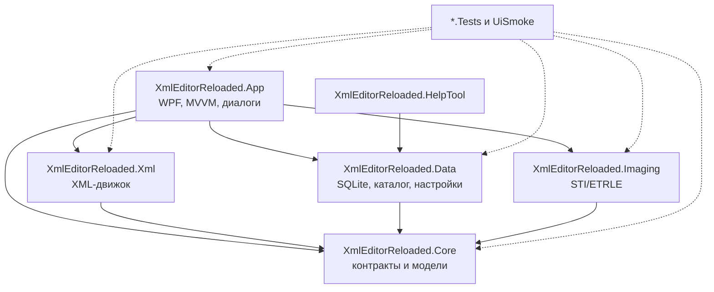
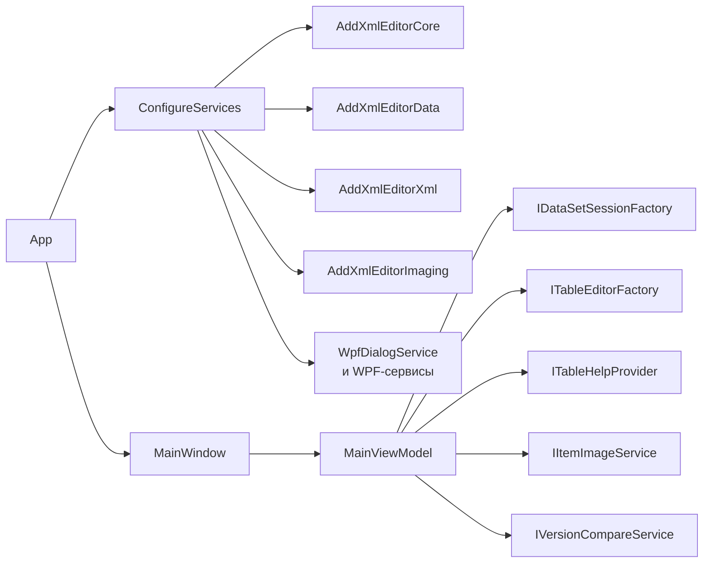
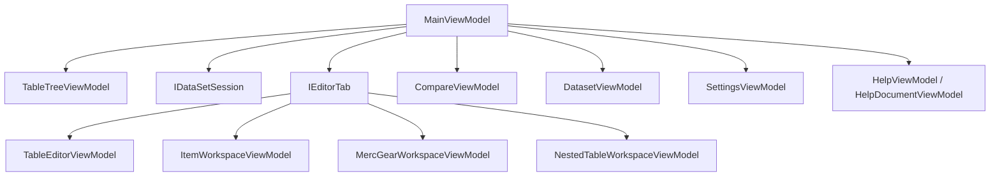
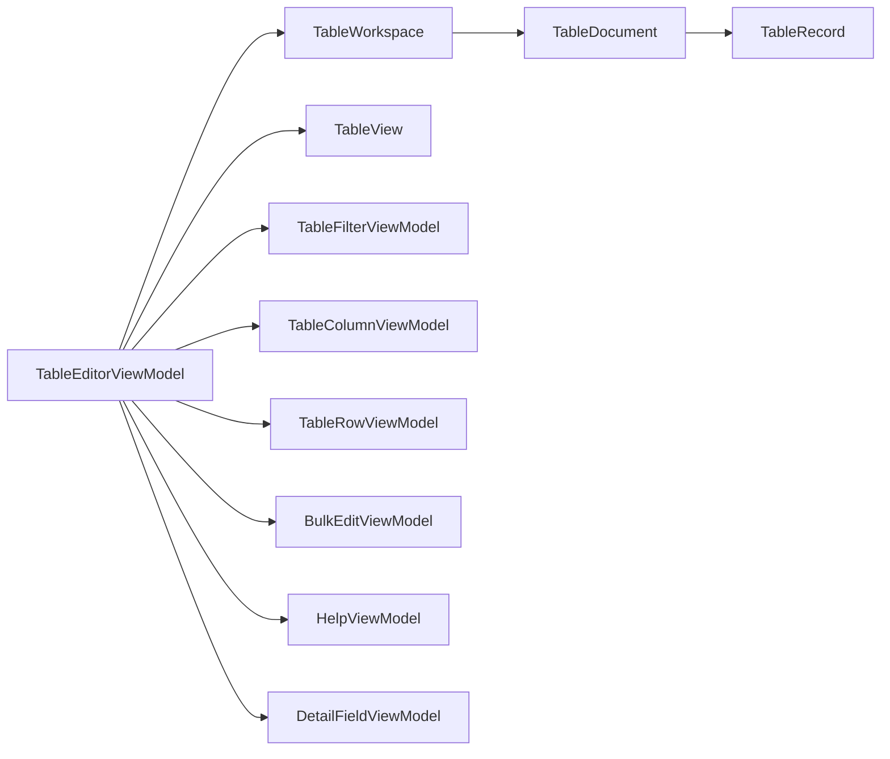
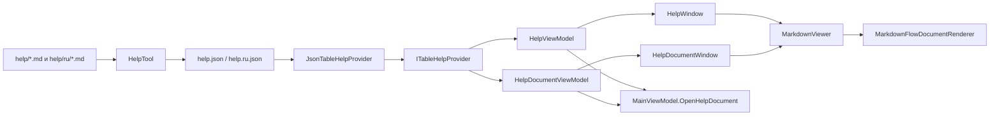
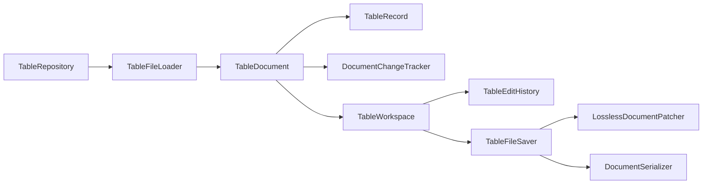
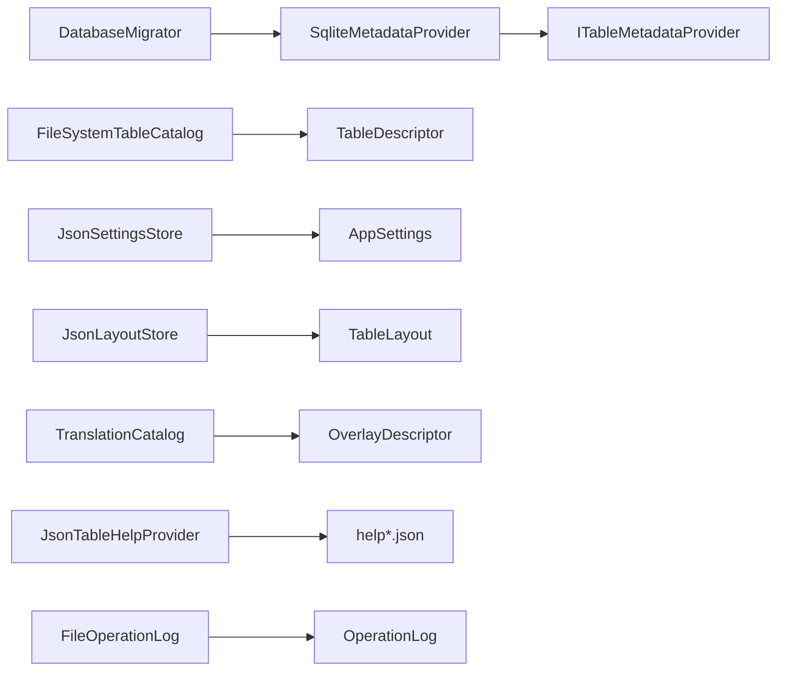
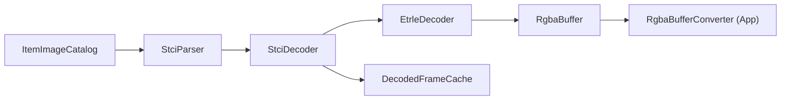

# XML Editor Reloaded — карта классов

> **Состояние:** 2026-11-14, ветка `release/1.1.0`.
> Документ отвечает на два вопроса: **что делает каждый тип** и **как типы связаны между собой**.
> Здесь перечислены все top-level `public`/`internal` классы, записи, интерфейсы, перечисления
> и структуры production-проектов, а также тестовые проекты и генератор справки.
>
> Полный инвентарь в конце документа сгенерирован из XML-комментариев исходников. Краткие
> архитектурные разделы написаны вручную; при изменении кода запускайте
> `pwsh -NoProfile -ExecutionPolicy Bypass -File util-scripts/class-map.ps1`.

## 1. Проекты решения

| Проект | TFM | Назначение | Зависит от |
|---|---|---|---|
| `XmlEditorReloaded.Core` | `net10.0` | контракты, доменные модели, `OperationResult`, метаданные, layout, локализация, валидация | BCL, DI abstractions |
| `XmlEditorReloaded.Xml` | `net10.0` | загрузка и lossless-сохранение XML, workspace, оверлеи, связи, copy, сравнение, поиск, валидация | Core |
| `XmlEditorReloaded.Data` | `net10.0` | SQLite-метабаза, каталог таблиц, настройки, layout, лог, встроенная справка | Core, `Microsoft.Data.Sqlite` |
| `XmlEditorReloaded.Imaging` | `net10.0` | STI/ETRLE → RGBA, каталог item-изображений, кэш кадров | Core |
| `XmlEditorReloaded.App` | `net10.0-windows` | WPF shell, MVVM, диалоги, темы, RESX, редакторы таблиц и item-данных | Xml, Data, Imaging, Core |
| `XmlEditorReloaded.HelpTool` | `net10.0` | сборка `help.json`/`help.ru.json` и проверка Markdown-справки | Data |
| `XmlEditorReloaded.Core.Tests` | `net10.0` | тесты доменных примитивов Core | Core |
| `XmlEditorReloaded.Xml.Tests` | `net10.0` | тесты XML-движка | Xml, Core |
| `XmlEditorReloaded.Data.Tests` | `net10.0` | тесты SQLite, каталога, настроек и справки | Data, Core |
| `XmlEditorReloaded.Imaging.Tests` | `net10.0` | тесты STI/ETRLE и кэша | Imaging, Core |
| `XmlEditorReloaded.App.Tests` | `net10.0-windows` | тесты view models, XAML-композиции и приложения | App и backend-проекты |
| `XmlEditorReloaded.UiSmoke` | `net10.0-windows` | UI-automation сценарии S01–S105 на реальном приложении | App, тестовые фикстуры |

Всего в production-проектах **409 типов** (408 из `src/` + `Program` HelpTool), в тестах —
**250 типов**. Числа включают записи, интерфейсы и перечисления, а не только `class`.

## 2. Карта зависимостей

Правило направлено только внутрь: backend-проекты не знают о WPF и `System.Windows.*`.
`Core` не содержит реализаций и не пишет файлы; `Xml`, `Data` и `Imaging` реализуют его
абстракции; `App` собирает всё через DI.

## 3. App: окно, вкладки и редакторы

### 3.1. Запуск и DI

`App` — composition root. `ConfigureServices` регистрирует три backend-модуля
(`AddXmlEditorCore`, `AddXmlEditorData`, `AddXmlEditorXml`, `AddXmlEditorImaging`), WPF-сервисы
и `MainViewModel`/`MainWindow`. `OnStartup` применяет тему, проверяет каталог данных, строит
DI-контейнер, применяет миграции, загружает настройки, восстанавливает геометрию окна и вызывает
`MainViewModel.InitializeAsync`.

`MainWindow` — тонкая оболочка: геометрия, закрытие, горячие клавиши и события дерева/таблиц;
вся бизнес-логика окна находится в `MainViewModel`.

### 3.2. Shell и вкладки

`MainViewModel` — центральный координатор. Он держит дерево таблиц (`TableTreeViewModel`,
`TableListItem`), выбранный data set (`IDataSetSession`), открытые вкладки `IEditorTab`,
команды открытия/сохранения/закрытия, настройки, справку и сравнение.

`ITableEditorFactory`/`TableEditorFactory` создают нужный редактор по `TableDescriptor` и
языковому коду. `MainViewModel` не создаёт XML-документы сам — он получает их через
`IDataSetSession` и backend-фабрики.

### 3.3. TableEditor: обычная таблица

`TableEditorViewModel` — виртуализированная сетка над `TableWorkspace`. Он хранит колонки
(`TableColumnViewModel`), строки (`TableRowViewModel`), фильтр (`TableFilterViewModel`),
выделение, текущую ячейку, undo/redo и состояние «грязной» вкладки. `TableView` — WPF-вид,
`FieldEditor` и `RelationPicker` — редакторы значений.

Сохранение идёт обратно через `TableWorkspace` → `TableFileSaver`; UI не сериализует XML.

### 3.4. Item workspace и MercGear

`ItemWorkspaceViewModel` — редактор предмета: список предметов (`ItemListSectionViewModel`),
карточка полей, изображение, дочерние таблицы (`ItemChildSectionViewModel`,
`ItemSubTableSectionViewModel`) и переводы. `MercGearWorkspaceViewModel` — редактор
`MercStartingGear`: комплекты (`MercGearKitViewModel`) и слоты. `NestedTableWorkspaceViewModel` —
общий редактор вложенных записей (`NestedRecordItemViewModel`, `NestedFieldViewModel`,
`NestedListViewModel`).

Все три используют один и тот же backend: `IDataSetSession` → `ITableRepository` →
`TableWorkspace`/`TableDocument`.

### 3.5. Диалоги и WPF-сервисы

View models не открывают окна напрямую. Они зависят от интерфейсов:

| Интерфейс | WPF-реализация | Назначение |
|---|---|---|
| `IDialogService` | `WpfDialogService` | папки, подтверждения, ошибки, About, help-окна |
| `ISettingsDialogService` | `WpfSettingsDialogService` | окно настроек |
| `ITableCopyDialogService` | `WpfTableCopyDialogService` | копирование строк между data set |
| `IVersionCompareService` | `WpfVersionCompareService` | окно сравнения версий |
| `IImageViewerService` | `WpfImageViewerService` | отдельный просмотр изображений |
| `IItemImageService` | `WpfItemImageService` | изображения предметов для редактора |

`WpfItemImageService` связывает `ItemImageCatalog` (Imaging) и `RgbaBufferConverter` (App).

### 3.6. Справка

`JsonTableHelpProvider` выбирает русский JSON при русской UI-культуре и откатывается на
английский. `MarkdownViewer` показывает Markdown как `FlowDocument`, обрабатывает ссылки и
прокрутку; `HelpPathResolver` разрешает относительные ссылки. Ссылки из индекса на таблицу
открывают `HelpWindow`, ссылки на страницы — `HelpDocumentWindow`.

### 3.7. Views, темы и инфраструктура

- `Views/*` — XAML-оболочки для view models; code-behind содержит только WPF-события.
- `Views/GridValueConverters.cs`, `InverseBooleanToVisibilityConverter` и
  `TranslationStateConverter` — форматирование значений для XAML.
- `Resources/Strings` — доступ к RESX; `Resources/CharacterCounter` — счётчик символов.
- `Themes/ThemeManager` переключает словарь палитры; `Shortcuts/ShortcutCatalog` — единый
  каталог горячих клавиш.
- `Behaviors/DataGridNavigation` добавляет навигацию Home/End/PageUp/PageDown по строкам.

## 4. Core: контракты и доменные примитивы

`Core` — единственный проект, который не ссылается ни на один другой проект решения.

- **Результат операции:** `OperationResult`, `OperationResult<T>`, `ErrorCodes`.
  Ожидаемые ошибки возвращаются как `error_code`/`error_text`, исключения — для сбоев
  программиста.
- **Идентичность:** `TableName`, `TableDescriptor`, `FieldPath`, `RecordKeySpec`,
  `RecordKeySegment`, `RecordKeyCodec`.
- **Метаданные:** `TableMetadata`, `ColumnMetadata`, `ColumnHint`, `ListFieldDefinition`,
  `DictFieldDefinition`, `TableRelation`, `RelationTarget`, `ClassVisibilityRule`,
  `ExclusiveFlagGroup`, `ClassValueLimit`, `ColumnTextLimit`, `SymmetricKeyPair`.
- **Локализация:** `LanguageDescriptor`, `OverlayDescriptor`, `TranslationReport`,
  `TranslationIssue`.
- **Контракты backend:** `ITableMetadataProvider`, `ITableCatalog`, `ITableRepository`,
  `ILookupRepository`, `ITranslationCatalog`, `ITableRelationResolver`, `ISettingsStore`,
  `ITableLayoutStore`, `ITableHelpProvider`.
- **Прочее:** фильтры `RowFilter*`, layout `TableLayout`/`ColumnLayout`, `RgbaBuffer`,
  `WindowPlacement`, `OperationLog`, `ValidationReport`, `DatasetValidationReport`.

Связь с остальными проектами: `Core` содержит только типы и интерфейсы; `Data`, `Xml` и
`Imaging` реализуют его контракты, а `App` потребляет их через DI.

## 5. Xml: движок таблиц

### 5.1. Загрузка, редактирование и сохранение

- `TableRepository` реализует `ITableRepository`: находит файл, вызывает loader/saver.
- `TableFileLoader` читает байты, сохраняет `PreserveWhitespace`, запрещает DTD/XXE и создаёт
  `TableDocument`.
- `TableDocument` владеет `XDocument`, baseline-байтами и `TableRecord`; `TableRecord` — фасад
  над `XElement`, не DTO. Отсутствующие элементы не создаются без явной правки.
- `TableWorkspace` — редактируемая проекция документа: строки (`WorkspaceRow`), значения,
  lookup/relation-контекст, транзакции (`TableEditTransaction`) и undo/redo
  (`TableEditHistory`).
- `TableFileSaver` сначала пытается `LosslessDocumentPatcher`, затем полную сериализацию,
  проверяет external changes и reparse, пишет атомарно.

### 5.2. Оверлеи и переводы

`OverlayDocument`, `OverlayKeyResolver`, `OverlayMerger`, `OverlayWriter`,
`TranslationAnalyzer` и `TableEditSession` реализуют чтение/слияние/запись языковых оверлеев.
`OverlayKeyResolver` использует `RecordKeySpec`/`RecordKeyCodec`; `OverlayMerger` объединяет
базовую запись с переводом; `OverlayWriter` пишет только изменённые поля.

### 5.3. Сравнение и copy

- `TableDataComparer`, `TableSnapshotAnalyzer`, `TableValueComparer`, `OverlayFileComparer`,
  `TableCellsReader` и модели `TableComparison*` образуют отчёт сравнения двух data set.
- `TableCopyService`, `TableCopyRemapper`, `TableCopyModels` копируют строки между наборами,
  разрешают конфликты и переназначают ID.

### 5.4. Валидация, поиск, lookup и связи

- `DatasetValidator`, `TableValidator`, `DatasetValidationReportFormatter` — проверки без
  изменения файлов.
- `DatasetSearchService` — поиск по таблицам и оверлеям.
- `XmlFileLookupRepository`, `LookupUsageService`, `LookupIdAllocator` — lookup-значения,
  занятость ID и распределение новых.
- `TableRelationResolver` — разрешение relation-целей; `TableRowFilterMatcher` — фильтрация
  строк; `TableSchemaBuilder`/`TableSchema` — схема, построенная по XML и метаданным.

## 6. Data: SQLite, каталог, настройки

- `DatabaseMigrator` создаёт/обновляет SQLite-схему; `SqliteMetadataProvider` читает
  `TableMetadata`, колонки, связи и lookup-метаданные.
- `FileSystemTableCatalog` сканирует `TableData` и находит базовые файлы/оверлеи.
- `JsonSettingsStore` и `JsonLayoutStore` хранят настройки и layout вне игровых каталогов;
  `AppPaths` определяет `%AppData%\XmlEditorReloaded` и `XER_APP_DATA`.
- `TranslationCatalog` описывает доступные языки и переводы; `JsonTableHelpProvider` отдаёт
  встроенную справку; `FileOperationLog`/`StartupTrace` пишут диагностику.

## 7. Imaging: STI/ETRLE

`ItemImageCatalog` ищет big/medium/small STI, `StciParser` читает заголовок и кадры,
`StciDecoder`/`EtrleDecoder` распаковывают пиксели в `RgbaBuffer`, `DecodedFrameCache` кэширует
кадры. WPF-слой получает уже готовый `RgbaBuffer` и конвертирует его в `BitmapSource`.

## 8. HelpTool

`Program` — консольная точка входа. Инструмент читает `help/tables` и `help/ru/tables`,
проверяет front matter/поля/ссылки и детерминированно пишет
`src/XmlEditorReloaded.Data/Help/help.json` и `help.ru.json`. `--check` используется в CI и
`help-check.ps1`; в поставку приложения инструмент не входит.

## 9. Тестовые проекты

| Проект | Что проверяет | Основные связи |
|---|---|---|
| `Core.Tests` | `TableName`, `FieldPath`, `RecordKeyCodec`, `OperationResult`, layout, логи | чистый Core |
| `Xml.Tests` | загрузка/сохранение, lossless patch, оверлеи, сравнение, copy, фильтры, валидация | `Xml` + временные каталоги |
| `Data.Tests` | миграции, SQLite-провайдер, каталог, настройки, layout, help JSON | `Data` + временная БД |
| `Imaging.Tests` | STI-заголовки, ETRLE, каталог, кэш | `Imaging` |
| `App.Tests` | view models, XAML-загрузка, команды, диалоги, help | `App`, fake-сервисы |
| `UiSmoke` | S01–S105 на реальном WPF-окне, отчёт и проверка целостности данных | `App` + UI Automation |

`App.Tests` и `UiSmoke` используют `TestWorkspace`, временные копии TableData и
`XER_APP_DATA`, поэтому не трогают `References/`. UI-smoke — не xUnit-проект; его сценарии
запускаются отдельным exe и пишут `report.md`/`report.json`.

## 10. Полный инвентарь production-типов

Ниже — все top-level `public`/`internal` типы production-проектов. Описания взяты из
XML-документации исходников; источник и строка кликабельны. Пустые описания встречаются только
у вспомогательных типов.

<!-- BEGIN GENERATED INVENTORY -->

### XmlEditorReloaded.Core (81 типов)

#### `.`

| Тип и класс | Назначение | Исходник |
|---|---|---|
| `CoreServiceCollectionExtensions` (class) | Dependency-injection registration for the Core contracts. | [CoreServiceCollectionExtensions.cs:8](xml-editor-reloaded/src/XmlEditorReloaded.Core/CoreServiceCollectionExtensions.cs#L8) |

#### `Abstractions`

| Тип и класс | Назначение | Исходник |
|---|---|---|
| `AppSettings` (record) | Application settings persisted outside the game data directories. | [ISettingsStore.cs:33](xml-editor-reloaded/src/XmlEditorReloaded.Core/Abstractions/ISettingsStore.cs#L33) |
| `EditorThemeMode` (enum) | Visual theme selected in the settings dialog. | [ISettingsStore.cs:8](xml-editor-reloaded/src/XmlEditorReloaded.Core/Abstractions/ISettingsStore.cs#L8) |
| `ILookupRepository` (interface) | Provides access to lookup tables under TableData/Lookup , including language overlays. | [ILookupRepository.cs:19](xml-editor-reloaded/src/XmlEditorReloaded.Core/Abstractions/ILookupRepository.cs#L19) |
| `ISettingsStore` (interface) | Loads and stores application settings. | [ISettingsStore.cs:56](xml-editor-reloaded/src/XmlEditorReloaded.Core/Abstractions/ISettingsStore.cs#L56) |
| `ITableCatalog` (interface) | Discovers table files and their language overlays inside a data directory. | [ITableCatalog.cs:9](xml-editor-reloaded/src/XmlEditorReloaded.Core/Abstractions/ITableCatalog.cs#L9) |
| `ITableHelpProvider` (interface) | Provides table and field help from the generated help data. | [ITableHelpProvider.cs:9](xml-editor-reloaded/src/XmlEditorReloaded.Core/Abstractions/ITableHelpProvider.cs#L9) |
| `ITableMetadataProvider` (interface) | Provides table metadata and the language catalog from a versioned metadata store. | [ITableMetadataProvider.cs:10](xml-editor-reloaded/src/XmlEditorReloaded.Core/Abstractions/ITableMetadataProvider.cs#L10) |
| `ITableRelationResolver` (interface) | Resolves relation targets from the active data directory, applying display fields, structured filters, language overlays, and caching. | [ITableRelationResolver.cs:10](xml-editor-reloaded/src/XmlEditorReloaded.Core/Abstractions/ITableRelationResolver.cs#L10) |
| `ITableRepository` (interface) | Loads and saves table documents for a data directory. | [ITableRepository.cs:57](xml-editor-reloaded/src/XmlEditorReloaded.Core/Abstractions/ITableRepository.cs#L57) |
| `ITranslationCatalog` (interface) | Provides language overlay discovery and translatable field metadata. | [ITranslationCatalog.cs:10](xml-editor-reloaded/src/XmlEditorReloaded.Core/Abstractions/ITranslationCatalog.cs#L10) |
| `LoadDiagnostic` (record) | A diagnostic message produced while loading a table file. | [ITableRepository.cs:28](xml-editor-reloaded/src/XmlEditorReloaded.Core/Abstractions/ITableRepository.cs#L28) |
| `LookupEntry` (record) | A single id/name pair from a lookup table. | [ILookupRepository.cs:14](xml-editor-reloaded/src/XmlEditorReloaded.Core/Abstractions/ILookupRepository.cs#L14) |
| `TableDocumentStatus` (enum) | Lifecycle status of a loaded table document. | [ITableRepository.cs:9](xml-editor-reloaded/src/XmlEditorReloaded.Core/Abstractions/ITableRepository.cs#L9) |
| `TableLoadResult` (record) | Result of loading a table file: status, diagnostics, and an opaque document handle. The concrete document type is owned by the backend that produced the load (for the XML backend it is XmlEditorReloaded.Xml.Documents.TableDocument ). | [ITableRepository.cs:39](xml-editor-reloaded/src/XmlEditorReloaded.Core/Abstractions/ITableRepository.cs#L39) |
| `WindowPlacement` (record) | Saved position, size, and maximized state of the main window. The values are device-independent pixels in the virtual-screen coordinate space, so a layout restored on a secondary monitor keeps its negative coordinates. | [WindowPlacement.cs:13](xml-editor-reloaded/src/XmlEditorReloaded.Core/Abstractions/WindowPlacement.cs#L13) |

#### `Api`

| Тип и класс | Назначение | Исходник |
|---|---|---|
| `ErrorCodes` (class) | Well-known machine-readable error codes used by operation results across the backend. | [ErrorCodes.cs:6](xml-editor-reloaded/src/XmlEditorReloaded.Core/Api/ErrorCodes.cs#L6) |
| `OperationResult` (class) | Standard operation result carrying either success or an error code with a human-readable text. | [OperationResult.cs:6](xml-editor-reloaded/src/XmlEditorReloaded.Core/Api/OperationResult.cs#L6) |
| `OperationResult` (class) | Standard operation result carrying a data payload on success or an error code on failure. | [OperationResult.cs:79](xml-editor-reloaded/src/XmlEditorReloaded.Core/Api/OperationResult.cs#L79) |

#### `Diagnostics`

| Тип и класс | Назначение | Исходник |
|---|---|---|
| `FileAccessFailure` (class) | Explains a failed file write in terms of the most likely cause, including the affected path and a next step that does not require elevation. The class only reads file metadata; it never changes attributes or ACLs of game files. | [FileAccessFailure.cs:8](xml-editor-reloaded/src/XmlEditorReloaded.Core/Diagnostics/FileAccessFailure.cs#L8) |
| `IOperationLog` (interface) | Sink that persists operation log entries. Implementations must never throw on a write failure: logging must not break the operation that is being logged. | [OperationLogEntry.cs:42](xml-editor-reloaded/src/XmlEditorReloaded.Core/Diagnostics/OperationLogEntry.cs#L42) |
| `OperationLog` (class) | Process-wide operation log facade. The application installs a persistent sink during start-up; when no sink is installed, for example in unit tests, every call is a no-op. A failing sink never throws, so callers can log a failure from an error branch without masking the original result; invalid a... | [OperationLogEntry.cs:58](xml-editor-reloaded/src/XmlEditorReloaded.Core/Diagnostics/OperationLogEntry.cs#L58) |
| `OperationLogEntry` (record) | One entry of the application operation log. | [OperationLogEntry.cs:30](xml-editor-reloaded/src/XmlEditorReloaded.Core/Diagnostics/OperationLogEntry.cs#L30) |
| `OperationLogLevel` (enum) | Severity of an operation log entry. | [OperationLogEntry.cs:6](xml-editor-reloaded/src/XmlEditorReloaded.Core/Diagnostics/OperationLogEntry.cs#L6) |

#### `Filtering`

| Тип и класс | Назначение | Исходник |
|---|---|---|
| `RowFilterCriterion` (class) | One structured predicate applied to a grid row. Field names and operands are matched without culture-dependent conversions; the evaluation semantics live in the XML layer. | [RowFilterCriterion.cs:7](xml-editor-reloaded/src/XmlEditorReloaded.Core/Filtering/RowFilterCriterion.cs#L7) |
| `RowFilterGroup` (class) | A flat group of row filter criteria combined with AND or OR. An empty group matches every row. | [RowFilterGroup.cs:6](xml-editor-reloaded/src/XmlEditorReloaded.Core/Filtering/RowFilterGroup.cs#L6) |
| `RowFilterLogicalOperator` (enum) | How the criteria of a RowFilterGroup are combined. | [RowFilterOperator.cs:34](xml-editor-reloaded/src/XmlEditorReloaded.Core/Filtering/RowFilterOperator.cs#L34) |
| `RowFilterOperator` (enum) | Comparison operators available to a grid row filter. The set is intentionally small: filters never evaluate arbitrary expressions or code. | [RowFilterOperator.cs:7](xml-editor-reloaded/src/XmlEditorReloaded.Core/Filtering/RowFilterOperator.cs#L7) |

#### `Help`

| Тип и класс | Назначение | Исходник |
|---|---|---|
| `FieldHelp` (record) | Help for one field path inside a table family. | [HelpModels.cs:44](xml-editor-reloaded/src/XmlEditorReloaded.Core/Help/HelpModels.cs#L44) |
| `HelpDocument` (record) | One standalone help page, such as the glossary or the table index. | [HelpModels.cs:77](xml-editor-reloaded/src/XmlEditorReloaded.Core/Help/HelpModels.cs#L77) |
| `HelpLink` (record) | A link from a help document to a related document or table. | [HelpModels.cs:61](xml-editor-reloaded/src/XmlEditorReloaded.Core/Help/HelpModels.cs#L61) |
| `HelpSearchResult` (record) | One result of a help search. | [HelpModels.cs:86](xml-editor-reloaded/src/XmlEditorReloaded.Core/Help/HelpModels.cs#L86) |
| `HelpSection` (record) | One prose section of a help document, excluding the field reference. | [HelpModels.cs:69](xml-editor-reloaded/src/XmlEditorReloaded.Core/Help/HelpModels.cs#L69) |
| `TableHelp` (record) | Help for one table family, loaded from one Markdown document. | [HelpModels.cs:19](xml-editor-reloaded/src/XmlEditorReloaded.Core/Help/HelpModels.cs#L19) |

#### `Imaging`

| Тип и класс | Назначение | Исходник |
|---|---|---|
| `ImageSize` (enum) | Size class of an item image sprite sheet. | [RgbaBuffer.cs:6](xml-editor-reloaded/src/XmlEditorReloaded.Core/Imaging/RgbaBuffer.cs#L6) |
| `RgbaBuffer` (class) | Raw straight (non-premultiplied) RGBA pixel buffer produced by the imaging backend. | [RgbaBuffer.cs:21](xml-editor-reloaded/src/XmlEditorReloaded.Core/Imaging/RgbaBuffer.cs#L21) |

#### `Layout`

| Тип и класс | Назначение | Исходник |
|---|---|---|
| `ColumnLayout` (class) | Persisted presentation state of one grid column. | [ColumnLayout.cs:6](xml-editor-reloaded/src/XmlEditorReloaded.Core/Layout/ColumnLayout.cs#L6) |
| `ITableLayoutStore` (interface) | Loads and stores per-table grid layouts outside the game data directories. A layout is keyed by the data-set directory and the table name, so the same table in two data sets keeps separate presentation state. | [ITableLayoutStore.cs:10](xml-editor-reloaded/src/XmlEditorReloaded.Core/Layout/ITableLayoutStore.cs#L10) |
| `TableLayout` (class) | Persisted presentation state of one grid: column visibility, width and order, sorting, and the structured row filter. The layout never contains data values from the table itself. | [TableLayout.cs:9](xml-editor-reloaded/src/XmlEditorReloaded.Core/Layout/TableLayout.cs#L9) |
| `TableSortDirection` (enum) | Sort direction persisted in a table layout. | [TableSortDirection.cs:6](xml-editor-reloaded/src/XmlEditorReloaded.Core/Layout/TableSortDirection.cs#L6) |

#### `Localization`

| Тип и класс | Назначение | Исходник |
|---|---|---|
| `LanguageDescriptor` (record) | Describes a language supported by the editor for data overlays and UI localization. | [LanguageDescriptor.cs:10](xml-editor-reloaded/src/XmlEditorReloaded.Core/Localization/LanguageDescriptor.cs#L10) |
| `OverlayDescriptor` (record) | Describes one language overlay file found next to its base table file. | [OverlayDescriptor.cs:9](xml-editor-reloaded/src/XmlEditorReloaded.Core/Localization/OverlayDescriptor.cs#L9) |
| `TranslationIssue` (record) | A single translation problem detected while comparing a base table with an overlay. | [TranslationReport.cs:22](xml-editor-reloaded/src/XmlEditorReloaded.Core/Localization/TranslationReport.cs#L22) |
| `TranslationIssueKind` (enum) | Category of a translation issue. | [TranslationReport.cs:27](xml-editor-reloaded/src/XmlEditorReloaded.Core/Localization/TranslationReport.cs#L27) |
| `TranslationReport` (record) | Report describing the state of a language overlay relative to its base table. | [TranslationReport.cs:7](xml-editor-reloaded/src/XmlEditorReloaded.Core/Localization/TranslationReport.cs#L7) |

#### `Metadata`

| Тип и класс | Назначение | Исходник |
|---|---|---|
| `ClassValueLimit` (class) | Describes a non-destructive limit that depends on the value of a class field, for example the number of load-bearing pockets that an LBE class permits. Validation reports fields above the limit but never clears them. | [ClassValueLimit.cs:8](xml-editor-reloaded/src/XmlEditorReloaded.Core/Metadata/ClassValueLimit.cs#L8) |
| `ClassVisibilityRule` (class) | Metadata rule that limits an item-workspace group, sub-table, or child-table section to a set of item classes. The rule is keyed by the section and expresses the classes as a bit mask over usItemClass values, mirroring the legacy editor's per-class page removal without hardcoding class names in t... | [ClassVisibilityRule.cs:32](xml-editor-reloaded/src/XmlEditorReloaded.Core/Metadata/ClassVisibilityRule.cs#L32) |
| `ClassVisibilitySectionKind` (enum) | Kind of item-workspace section governed by a ClassVisibilityRule. | [ClassVisibilityRule.cs:6](xml-editor-reloaded/src/XmlEditorReloaded.Core/Metadata/ClassVisibilityRule.cs#L6) |
| `ColumnDataType` (enum) | Value type of a table column. | [ColumnMetadata.cs:61](xml-editor-reloaded/src/XmlEditorReloaded.Core/Metadata/ColumnMetadata.cs#L61) |
| `ColumnEditorKind` (enum) | Preferred editor widget for a table column. | [ColumnMetadata.cs:91](xml-editor-reloaded/src/XmlEditorReloaded.Core/Metadata/ColumnMetadata.cs#L91) |
| `ColumnFlags` (enum) | Behavior flags of a table column. | [ColumnMetadata.cs:119](xml-editor-reloaded/src/XmlEditorReloaded.Core/Metadata/ColumnMetadata.cs#L119) |
| `ColumnHint` (class) | Optional curated hints for one XML field that is discovered from the document. Unlike ColumnMetadata, a hint never declares a field that is absent from the document; it only refines how a present field is typed, edited, and grouped. | [ColumnHint.cs:8](xml-editor-reloaded/src/XmlEditorReloaded.Core/Metadata/ColumnHint.cs#L8) |
| `ColumnMetadata` (class) | Metadata describing one editable or displayable column of a table. | [ColumnMetadata.cs:6](xml-editor-reloaded/src/XmlEditorReloaded.Core/Metadata/ColumnMetadata.cs#L6) |
| `ColumnTextLimit` (class) | Input length limit of one text field, optionally scoped to an overlay language. The limit restricts typing in the detail form; it never validates, truncates, or rewrites an existing value. | [ColumnTextLimit.cs:7](xml-editor-reloaded/src/XmlEditorReloaded.Core/Metadata/ColumnTextLimit.cs#L7) |
| `DictFieldDefinition` (class) | Describes an indexed group of child elements whose names follow a mask, for example ItemCapacityPerSize%Index% standing for ItemCapacityPerSize0 , ItemCapacityPerSize1 , … | [ListFieldDefinition.cs:34](xml-editor-reloaded/src/XmlEditorReloaded.Core/Metadata/ListFieldDefinition.cs#L34) |
| `ExclusiveFlagGroup` (class) | Declares a set of boolean fields where at most one field may be set. The rule is used by validation only: existing data with several set fields is reported, never rewritten. | [ExclusiveFlagGroup.cs:7](xml-editor-reloaded/src/XmlEditorReloaded.Core/Metadata/ExclusiveFlagGroup.cs#L7) |
| `FieldPath` (class) | A path to a field inside a record, expressed as slash-separated element names, for example szItemName or GEARKIT/mGearKitName . | [FieldPath.cs:7](xml-editor-reloaded/src/XmlEditorReloaded.Core/Metadata/FieldPath.cs#L7) |
| `ListFieldDefinition` (class) | Describes a repeated child element of a record that maps to a logical list field, for example DrugEffect appearing multiple times. | [ListFieldDefinition.cs:7](xml-editor-reloaded/src/XmlEditorReloaded.Core/Metadata/ListFieldDefinition.cs#L7) |
| `RecordFields` (class) | Reserved field names used by the document model for values that are not child elements. | [RecordFields.cs:6](xml-editor-reloaded/src/XmlEditorReloaded.Core/Metadata/RecordFields.cs#L6) |
| `RecordKeyCodec` (class) | Encodes and decodes the canonical textual form of a compound record key. A canonical key is built from length-prefixed components, so separators, colons, punctuation, and Unicode characters inside a component never create ambiguity. | [RecordKeyCodec.cs:16](xml-editor-reloaded/src/XmlEditorReloaded.Core/Metadata/RecordKeyCodec.cs#L16) |
| `RecordKeyKind` (enum) | Strategy used to derive a key value for elements of a keyed collection. | [RecordKeySegment.cs:64](xml-editor-reloaded/src/XmlEditorReloaded.Core/Metadata/RecordKeySegment.cs#L64) |
| `RecordKeySegment` (class) | Describes how a single segment of a record key is resolved inside a table or nested structure. | [RecordKeySegment.cs:6](xml-editor-reloaded/src/XmlEditorReloaded.Core/Metadata/RecordKeySegment.cs#L6) |
| `RecordKeySpec` (class) | Defines how records of a table (or of nested structures inside a record) are keyed, primarily for overlay matching and row identity. | [RecordKeySpec.cs:7](xml-editor-reloaded/src/XmlEditorReloaded.Core/Metadata/RecordKeySpec.cs#L7) |
| `RelationFilter` (class) | One structured predicate applied to target records when a relation builds its picker options. Filters only narrow the offered options; they never reject values that already exist in the source document or change what is written back. | [RelationFilter.cs:29](xml-editor-reloaded/src/XmlEditorReloaded.Core/Metadata/RelationFilter.cs#L29) |
| `RelationFilterOperator` (enum) | Operators supported by RelationFilter. The set is intentionally small and data-driven: relations never evaluate SQL or arbitrary expressions. | [RelationFilter.cs:9](xml-editor-reloaded/src/XmlEditorReloaded.Core/Metadata/RelationFilter.cs#L9) |
| `RelationTarget` (class) | Resolved rows of a relation target: every record for membership checks and the filtered subset offered by pickers. The filter only narrows Options; Entries keeps the complete target so existing values and validation stay independent of presentation filters. | [RelationTarget.cs:16](xml-editor-reloaded/src/XmlEditorReloaded.Core/Metadata/RelationTarget.cs#L16) |
| `RelationTargetEntry` (record) | One selectable target record of a relation, holding the key that is written back and the text shown to the user. | [RelationTarget.cs:9](xml-editor-reloaded/src/XmlEditorReloaded.Core/Metadata/RelationTarget.cs#L9) |
| `SymmetricKeyPair` (class) | Declares that a table stores symmetric pairs of records: for every record with key values (FirstField, SecondField), a record with the two values reversed is expected to exist as well. | [SymmetricKeyPair.cs:14](xml-editor-reloaded/src/XmlEditorReloaded.Core/Metadata/SymmetricKeyPair.cs#L14) |
| `TableDescriptor` (record) | Describes one table file discovered in a data directory, together with overlay and metadata availability. | [TableDescriptor.cs:13](xml-editor-reloaded/src/XmlEditorReloaded.Core/Metadata/TableDescriptor.cs#L13) |
| `TableMetadata` (class) | Metadata describing one XML table: file mapping, element names, keys, columns, and list/dict fields. | [TableMetadata.cs:6](xml-editor-reloaded/src/XmlEditorReloaded.Core/Metadata/TableMetadata.cs#L6) |
| `TableName` (record struct) | Identifies a table by its dotted name, for example Items.Items or Lookup.ItemClass . | [TableName.cs:7](xml-editor-reloaded/src/XmlEditorReloaded.Core/Metadata/TableName.cs#L7) |
| `TableRelation` (class) | A metadata-driven link between two tables. Relations replace hardcoded table-specific pickers: they describe which source field references which target key, how the target is displayed, and which optional structured filter narrows the offered target rows. | [TableRelation.cs:8](xml-editor-reloaded/src/XmlEditorReloaded.Core/Metadata/TableRelation.cs#L8) |
| `TableRelationKind` (enum) | Describes how a relation links a source table to a target table. | [TableRelationKind.cs:6](xml-editor-reloaded/src/XmlEditorReloaded.Core/Metadata/TableRelationKind.cs#L6) |

#### `Validation`

| Тип и класс | Назначение | Исходник |
|---|---|---|
| `DatasetScanProgress` (record) | Progress of a data-set-wide scan such as validation or search. | [DatasetValidationReport.cs:133](xml-editor-reloaded/src/XmlEditorReloaded.Core/Validation/DatasetValidationReport.cs#L133) |
| `DatasetValidationReport` (record) | Result of validating every table of one TableData directory as a single report. Severity counts are exact even when issue details were capped. | [DatasetValidationReport.cs:63](xml-editor-reloaded/src/XmlEditorReloaded.Core/Validation/DatasetValidationReport.cs#L63) |
| `TableValidationState` (enum) | Outcome of validating one table of a data set. | [DatasetValidationReport.cs:8](xml-editor-reloaded/src/XmlEditorReloaded.Core/Validation/DatasetValidationReport.cs#L8) |
| `TableValidationSummary` (record) | Validation result of one table, including exact severity counts and the capped issue list. | [DatasetValidationReport.cs:33](xml-editor-reloaded/src/XmlEditorReloaded.Core/Validation/DatasetValidationReport.cs#L33) |
| `ValidationCodes` (class) | Stable validation issue codes emitted by table validators. | [ValidationCodes.cs:6](xml-editor-reloaded/src/XmlEditorReloaded.Core/Validation/ValidationCodes.cs#L6) |
| `ValidationIssue` (record) | A single validation problem found in a table document. | [ValidationReport.cs:29](xml-editor-reloaded/src/XmlEditorReloaded.Core/Validation/ValidationReport.cs#L29) |
| `ValidationReport` (record) | Result of validating one or more documents. | [ValidationReport.cs:41](xml-editor-reloaded/src/XmlEditorReloaded.Core/Validation/ValidationReport.cs#L41) |
| `ValidationSeverity` (enum) | Severity of a validation issue. | [ValidationReport.cs:8](xml-editor-reloaded/src/XmlEditorReloaded.Core/Validation/ValidationReport.cs#L8) |

### XmlEditorReloaded.Xml (114 типов)

#### `.`

| Тип и класс | Назначение | Исходник |
|---|---|---|
| `XmlServiceCollectionExtensions` (class) | Dependency-injection registration for the XML backend. | [XmlServiceCollectionExtensions.cs:17](xml-editor-reloaded/src/XmlEditorReloaded.Xml/XmlServiceCollectionExtensions.cs#L17) |

#### `Comparison`

| Тип и класс | Назначение | Исходник |
|---|---|---|
| `AnalyzedField` (record) | Field statistics produced by TableSnapshotAnalyzer. | [TableSnapshotAnalyzer.cs:210](xml-editor-reloaded/src/XmlEditorReloaded.Xml/Comparison/TableSnapshotAnalyzer.cs#L210) |
| `AnalyzedTable` (record) | Snapshot and field statistics of one analyzed table. | [TableSnapshotAnalyzer.cs:221](xml-editor-reloaded/src/XmlEditorReloaded.Xml/Comparison/TableSnapshotAnalyzer.cs#L221) |
| `ComparisonDifferenceKind` (enum) | Kind of difference reported for a record, a field value, a root singleton field, or an overlay cell. | [TableComparisonModels.cs:66](xml-editor-reloaded/src/XmlEditorReloaded.Xml/Comparison/TableComparisonModels.cs#L66) |
| `ComparisonText` (class) | Text helpers shared by the comparison readers and comparers. | [TableCells.cs:266](xml-editor-reloaded/src/XmlEditorReloaded.Xml/Comparison/TableCells.cs#L266) |
| `FieldComparison` (record) | Comparison of one field between the left and right data sets. | [TableComparisonModels.cs:187](xml-editor-reloaded/src/XmlEditorReloaded.Xml/Comparison/TableComparisonModels.cs#L187) |
| `FieldComparisonStatus` (enum) | Result of comparing one field between the two data sets. | [TableComparisonModels.cs:42](xml-editor-reloaded/src/XmlEditorReloaded.Xml/Comparison/TableComparisonModels.cs#L42) |
| `ITableComparisonService` (interface) | Produces a read-only cross-version comparison of two TableData directories. | [ITableComparisonService.cs:8](xml-editor-reloaded/src/XmlEditorReloaded.Xml/Comparison/ITableComparisonService.cs#L8) |
| `LookupAvailability` (enum) | Availability of a lookup table referenced by a column. | [TableComparisonModels.cs:126](xml-editor-reloaded/src/XmlEditorReloaded.Xml/Comparison/TableComparisonModels.cs#L126) |
| `LookupReferenceComparison` (record) | Availability of one lookup table reference in both data sets. | [TableComparisonModels.cs:506](xml-editor-reloaded/src/XmlEditorReloaded.Xml/Comparison/TableComparisonModels.cs#L506) |
| `OverlayCellChange` (record) | One translated overlay cell that differs between the two data sets. | [TableComparisonModels.cs:327](xml-editor-reloaded/src/XmlEditorReloaded.Xml/Comparison/TableComparisonModels.cs#L327) |
| `OverlayComparison` (record) | Content comparison of one language overlay. | [TableComparisonModels.cs:354](xml-editor-reloaded/src/XmlEditorReloaded.Xml/Comparison/TableComparisonModels.cs#L354) |
| `OverlayComparisonStatus` (enum) | Presence of one language overlay file on one side of the comparison. | [TableComparisonModels.cs:93](xml-editor-reloaded/src/XmlEditorReloaded.Xml/Comparison/TableComparisonModels.cs#L93) |
| `OverlayFileComparer` (class) | Compares the content of the language overlays of two loaded tables. Overlay files are read without being written; a malformed or unreadable overlay is reported as a side state, not as an operation failure. Cell-level differences are reported only when both overlay files parsed. | [OverlayFileComparer.cs:16](xml-editor-reloaded/src/XmlEditorReloaded.Xml/Comparison/OverlayFileComparer.cs#L16) |
| `OverlayFileStatus` (enum) | Load state of one overlay file. | [TableComparisonModels.cs:108](xml-editor-reloaded/src/XmlEditorReloaded.Xml/Comparison/TableComparisonModels.cs#L108) |
| `OverlaySide` (record) | Load state and cell count of one language overlay file on one side. | [TableComparisonModels.cs:307](xml-editor-reloaded/src/XmlEditorReloaded.Xml/Comparison/TableComparisonModels.cs#L307) |
| `RecordComparison` (record) | Comparison of one record present on at least one side with a different value set. | [TableComparisonModels.cs:226](xml-editor-reloaded/src/XmlEditorReloaded.Xml/Comparison/TableComparisonModels.cs#L226) |
| `RecordFieldChange` (record) | One field value that differs between the two data sets. | [TableComparisonModels.cs:209](xml-editor-reloaded/src/XmlEditorReloaded.Xml/Comparison/TableComparisonModels.cs#L209) |
| `RecordIdentityKind` (enum) | How records of one table were matched between the two data sets. | [TableComparisonModels.cs:81](xml-editor-reloaded/src/XmlEditorReloaded.Xml/Comparison/TableComparisonModels.cs#L81) |
| `TableCells` (record) | Leaf cells of one document, split into records and root singleton fields. | [TableCells.cs:35](xml-editor-reloaded/src/XmlEditorReloaded.Xml/Comparison/TableCells.cs#L35) |
| `TableCellsReader` (class) | Reads leaf cells from a loaded table or overlay document. Values are compared as exact XML text: nested elements are traversed to their leaves, and repeated elements keep their order. | [TableCells.cs:51](xml-editor-reloaded/src/XmlEditorReloaded.Xml/Comparison/TableCells.cs#L51) |
| `TableComparisonEntry` (record) | Comparison of one table file, including per-field and per-side results. | [TableComparisonModels.cs:412](xml-editor-reloaded/src/XmlEditorReloaded.Xml/Comparison/TableComparisonModels.cs#L412) |
| `TableComparisonLimits` (class) | Caps applied while building a comparison report. Counts are always exact; only detail lists are capped. | [TableComparisonModels.cs:380](xml-editor-reloaded/src/XmlEditorReloaded.Xml/Comparison/TableComparisonModels.cs#L380) |
| `TableComparisonReport` (record) | Read-only cross-version comparison of two TableData directories. The report compares table presence, record counts, field sets, inferred types, lookup references, sparse profiles, record values, root singleton fields, and overlay content. Nothing is written to either data set. | [TableComparisonModels.cs:575](xml-editor-reloaded/src/XmlEditorReloaded.Xml/Comparison/TableComparisonModels.cs#L575) |
| `TableComparisonReportFormatter` (class) | Renders a TableComparisonReport as Markdown or long-format CSV for export. Both formats are deterministic for the same report and use invariant numeric formatting. | [TableComparisonReportFormatter.cs:12](xml-editor-reloaded/src/XmlEditorReloaded.Xml/Comparison/TableComparisonReportFormatter.cs#L12) |
| `TableComparisonSide` (record) | Structural and sparse profile of one side of a compared table. | [TableComparisonModels.cs:151](xml-editor-reloaded/src/XmlEditorReloaded.Xml/Comparison/TableComparisonModels.cs#L151) |
| `TableComparisonStatus` (enum) | Availability of a table file in the two compared data sets. | [TableComparisonModels.cs:9](xml-editor-reloaded/src/XmlEditorReloaded.Xml/Comparison/TableComparisonModels.cs#L9) |
| `TableComparisonSummary` (record) | Aggregate counts of a table comparison report. | [TableComparisonModels.cs:539](xml-editor-reloaded/src/XmlEditorReloaded.Xml/Comparison/TableComparisonModels.cs#L539) |
| `TableDataComparer` (class) | Compares two discovered TableData directories table by table. The comparison reads files only: it never opens them for writing and never modifies either data set. | [TableDataComparer.cs:13](xml-editor-reloaded/src/XmlEditorReloaded.Xml/Comparison/TableDataComparer.cs#L13) |
| `TableFieldValue` (record) | One leaf value of a record or of a root singleton element. | [TableCells.cs:14](xml-editor-reloaded/src/XmlEditorReloaded.Xml/Comparison/TableCells.cs#L14) |
| `TableRecordCells` (record) | Cells of one record together with its identity and document position. | [TableCells.cs:23](xml-editor-reloaded/src/XmlEditorReloaded.Xml/Comparison/TableCells.cs#L23) |
| `TableSideComparison` (record) | Load outcome and structural snapshot for one side of a compared table. | [TableComparisonModels.cs:170](xml-editor-reloaded/src/XmlEditorReloaded.Xml/Comparison/TableComparisonModels.cs#L170) |
| `TableSideStatus` (enum) | Outcome of loading one side of a compared table. | [TableComparisonModels.cs:24](xml-editor-reloaded/src/XmlEditorReloaded.Xml/Comparison/TableComparisonModels.cs#L24) |
| `TableSnapshotAnalyzer` (class) | Builds a read-only structural snapshot of a loaded table. Records are identified by the metadata record element (descendants are used for nested-key tables such as Cities ); for document-driven tables the direct children of the root are used. | [TableSnapshotAnalyzer.cs:13](xml-editor-reloaded/src/XmlEditorReloaded.Xml/Comparison/TableSnapshotAnalyzer.cs#L13) |
| `TableValueComparer` (class) | Compares record values and root singleton fields of two loaded tables. Records are matched by the key declared in metadata, or by their order when the table declares no key. Only differing records and fields are reported; counts remain exact when detail lists are capped. | [TableValueComparer.cs:11](xml-editor-reloaded/src/XmlEditorReloaded.Xml/Comparison/TableValueComparer.cs#L11) |
| `TableValueComparison` (record) | Value-level comparison of one table: record presence, changed field values, and root singleton fields. | [TableComparisonModels.cs:257](xml-editor-reloaded/src/XmlEditorReloaded.Xml/Comparison/TableComparisonModels.cs#L257) |

#### `Copy`

| Тип и класс | Назначение | Исходник |
|---|---|---|
| `DocumentTable` (record) | A loaded table document with its path-independent metadata, used by the copy remapper. | [TableCopyRemapper.cs:401](xml-editor-reloaded/src/XmlEditorReloaded.Xml/Copy/TableCopyRemapper.cs#L401) |
| `ITableCopyService` (interface) | Copies records between two TableData directories. The source directory is always read-only; the target is modified only by ApplyAsync after the caller has reviewed the preview. | [ITableCopyService.cs:9](xml-editor-reloaded/src/XmlEditorReloaded.Xml/Copy/ITableCopyService.cs#L9) |
| `TableCopyAction` (enum) | Action planned for one copied record. | [TableCopyModels.cs:36](xml-editor-reloaded/src/XmlEditorReloaded.Xml/Copy/TableCopyModels.cs#L36) |
| `TableCopyAppliedTable` (record) | Apply summary for one table written by a copy operation. | [TableCopyModels.cs:203](xml-editor-reloaded/src/XmlEditorReloaded.Xml/Copy/TableCopyModels.cs#L203) |
| `TableCopyConflictPolicy` (enum) | Defines how a copied record is handled when the target table already contains the same key or, for a lookup row whose key is absent, a row with the same comparison field value. | [TableCopyModels.cs:9](xml-editor-reloaded/src/XmlEditorReloaded.Xml/Copy/TableCopyModels.cs#L9) |
| `TableCopyKeyMode` (enum) | Defines how the target key of a copied record is chosen. | [TableCopyModels.cs:24](xml-editor-reloaded/src/XmlEditorReloaded.Xml/Copy/TableCopyModels.cs#L24) |
| `TableCopyPreview` (record) | Result of planning a cross-data-set copy without writing any file. | [TableCopyModels.cs:157](xml-editor-reloaded/src/XmlEditorReloaded.Xml/Copy/TableCopyModels.cs#L157) |
| `TableCopyRecordPreview` (record) | Preview of one source record. | [TableCopyModels.cs:140](xml-editor-reloaded/src/XmlEditorReloaded.Xml/Copy/TableCopyModels.cs#L140) |
| `TableCopyRelatedPreview` (record) | Preview of the related records that accompany one copied record. | [TableCopyModels.cs:120](xml-editor-reloaded/src/XmlEditorReloaded.Xml/Copy/TableCopyModels.cs#L120) |
| `TableCopyRemap` (record) | One reference value that is rewritten because the same display text has a different identifier in the target data set. | [TableCopyModels.cs:102](xml-editor-reloaded/src/XmlEditorReloaded.Xml/Copy/TableCopyModels.cs#L102) |
| `TableCopyRemapper` (class) | Resolves reference values of one table by display text so identifiers that differ between two data sets are rewritten. Lookup columns are matched through lookup names; relations marked RemapByText are matched through their display field. | [TableCopyRemapper.cs:13](xml-editor-reloaded/src/XmlEditorReloaded.Xml/Copy/TableCopyRemapper.cs#L13) |
| `TableCopyRemapStatus` (enum) | Outcome of resolving one reference through display text. | [TableCopyModels.cs:54](xml-editor-reloaded/src/XmlEditorReloaded.Xml/Copy/TableCopyModels.cs#L54) |
| `TableCopyRequest` (record) | A cross-data-set copy request for one table. | [TableCopyModels.cs:84](xml-editor-reloaded/src/XmlEditorReloaded.Xml/Copy/TableCopyModels.cs#L84) |
| `TableCopyResult` (record) | Result of a committed cross-data-set copy. | [TableCopyModels.cs:216](xml-editor-reloaded/src/XmlEditorReloaded.Xml/Copy/TableCopyModels.cs#L216) |
| `TableCopyService` (class) | Metadata-driven copy of records between two TableData directories. The source directory is read-only: it is loaded, never saved. The target is planned in memory first, then written file by file with atomic replaces; a failure restores the files that were already replaced. | [TableCopyService.cs:26](xml-editor-reloaded/src/XmlEditorReloaded.Xml/Copy/TableCopyService.cs#L26) |

#### `Documents`

| Тип и класс | Назначение | Исходник |
|---|---|---|
| `DocumentChange` (record) | Base type for a change recorded in a DocumentChangeTracker. | [DocumentChangeTracker.cs:8](xml-editor-reloaded/src/XmlEditorReloaded.Xml/Documents/DocumentChangeTracker.cs#L8) |
| `DocumentChangeTracker` (class) | Records document mutations in order so a future undo implementation can replay or reverse them. | [DocumentChangeTracker.cs:56](xml-editor-reloaded/src/XmlEditorReloaded.Xml/Documents/DocumentChangeTracker.cs#L56) |
| `FieldValueChanged` (record) | A scalar field value changed from one lexical form to another. | [DocumentChangeTracker.cs:17](xml-editor-reloaded/src/XmlEditorReloaded.Xml/Documents/DocumentChangeTracker.cs#L17) |
| `ListFieldChanged` (record) | A repeated list field was replaced with a new sequence of values. | [DocumentChangeTracker.cs:27](xml-editor-reloaded/src/XmlEditorReloaded.Xml/Documents/DocumentChangeTracker.cs#L27) |
| `RecordAdded` (record) | A record was appended to the document. | [DocumentChangeTracker.cs:34](xml-editor-reloaded/src/XmlEditorReloaded.Xml/Documents/DocumentChangeTracker.cs#L34) |
| `RecordDeleted` (record) | A record was deleted, retaining its XML snapshot for a future undo implementation. | [DocumentChangeTracker.cs:50](xml-editor-reloaded/src/XmlEditorReloaded.Xml/Documents/DocumentChangeTracker.cs#L50) |
| `RecordDuplicated` (record) | A record was duplicated. | [DocumentChangeTracker.cs:42](xml-editor-reloaded/src/XmlEditorReloaded.Xml/Documents/DocumentChangeTracker.cs#L42) |
| `TableDocument` (class) | An editable XML table document loaded from disk. The document keeps the original element tree, including unknown fields, whitespace, comments, and sparse record shapes. | [TableDocument.cs:16](xml-editor-reloaded/src/XmlEditorReloaded.Xml/Documents/TableDocument.cs#L16) |
| `TableRecord` (class) | A single record inside a TableDocument. The record is a thin facade over its original XML element and never materializes a fixed set of fields. | [TableRecord.cs:13](xml-editor-reloaded/src/XmlEditorReloaded.Xml/Documents/TableRecord.cs#L13) |
| `XmlRecordSpan` (record) | Location of one record element inside an Text string. | [XmlSnapshot.cs:10](xml-editor-reloaded/src/XmlEditorReloaded.Xml/Documents/XmlSnapshot.cs#L10) |
| `XmlSnapshot` (record) | Read-only textual view of a table document together with the positions of its record elements. The snapshot is produced from the current in-memory document, including unsaved edits. | [XmlSnapshot.cs:18](xml-editor-reloaded/src/XmlEditorReloaded.Xml/Documents/XmlSnapshot.cs#L18) |

#### `Filtering`

| Тип и класс | Назначение | Исходник |
|---|---|---|
| `TableRowFilterMatcher` (class) | Evaluates structured grid row filters against effective row values. The matcher is data-only: it never interprets field names as expressions and never reads or writes the document. | [TableRowFilterMatcher.cs:13](xml-editor-reloaded/src/XmlEditorReloaded.Xml/Filtering/TableRowFilterMatcher.cs#L13) |

#### `IO`

| Тип и класс | Назначение | Исходник |
|---|---|---|
| `FileFormatInfo` (class) | Describes the on-disk format of an XML table file: text encoding, byte-order mark presence, newline style, and whether the file starts with an XML declaration. | [FileFormatInfo.cs:10](xml-editor-reloaded/src/XmlEditorReloaded.Xml/IO/FileFormatInfo.cs#L10) |

#### `Loading`

| Тип и класс | Назначение | Исходник |
|---|---|---|
| `TableFileLoader` (class) | Loads table XML files into TableDocument instances without normalizing their content. | [TableFileLoader.cs:16](xml-editor-reloaded/src/XmlEditorReloaded.Xml/Loading/TableFileLoader.cs#L16) |

#### `Lookups`

| Тип и класс | Назначение | Исходник |
|---|---|---|
| `LookupIdAllocator` (class) | Chooses free identifiers for lookup values. Lookup identifiers are unsigned 64-bit integers because Lookup/ItemFlag.xml already uses values above MaxValue. | [LookupIdAllocator.cs:9](xml-editor-reloaded/src/XmlEditorReloaded.Xml/Lookups/LookupIdAllocator.cs#L9) |
| `LookupUsage` (record) | One place where a lookup identifier is used: a table record and the field that stores the id or mask. | [LookupUsageService.cs:18](xml-editor-reloaded/src/XmlEditorReloaded.Xml/Lookups/LookupUsageService.cs#L18) |
| `LookupUsageReport` (record) | Result of a lookup usage scan. UsageCount is exact; Usages is capped by MaxUsages and MaxUsagesPerTable. | [LookupUsageService.cs:31](xml-editor-reloaded/src/XmlEditorReloaded.Xml/Lookups/LookupUsageService.cs#L31) |
| `LookupUsageService` (class) | Finds the record fields that reference one lookup value. A plain lookup id is matched exactly. For a bit-mask lookup a single-bit entry is matched when the mask contains that bit, and a named combination is matched only when the mask equals it, because the combination names that exact set. | [LookupUsageService.cs:51](xml-editor-reloaded/src/XmlEditorReloaded.Xml/Lookups/LookupUsageService.cs#L51) |
| `XmlFileLookupRepository` (class) | Reads lookup tables from TableData/Lookup/*.xml and optionally applies a language overlay. Lookups without a file fall back to fixed values curated in the metadata database. | [XmlFileLookupRepository.cs:15](xml-editor-reloaded/src/XmlEditorReloaded.Xml/Lookups/XmlFileLookupRepository.cs#L15) |

#### `Overlays`

| Тип и класс | Назначение | Исходник |
|---|---|---|
| `MergedCell` (record) | A merged field value showing the base value and the optional translated overlay value. | [OverlayMerger.cs:13](xml-editor-reloaded/src/XmlEditorReloaded.Xml/Overlays/OverlayMerger.cs#L13) |
| `MergedRecord` (class) | A base record merged with its corresponding overlay record. | [OverlayMerger.cs:29](xml-editor-reloaded/src/XmlEditorReloaded.Xml/Overlays/OverlayMerger.cs#L29) |
| `MergedTable` (class) | Result of merging a base table with a language overlay. | [OverlayMerger.cs:63](xml-editor-reloaded/src/XmlEditorReloaded.Xml/Overlays/OverlayMerger.cs#L63) |
| `OverlayDocument` (class) | A language overlay file paired with the metadata of its base table. | [OverlayDocument.cs:18](xml-editor-reloaded/src/XmlEditorReloaded.Xml/Overlays/OverlayDocument.cs#L18) |
| `OverlayKeyResolver` (class) | Resolves primary and nested record keys for a table and its language overlays. | [OverlayKeyResolver.cs:25](xml-editor-reloaded/src/XmlEditorReloaded.Xml/Overlays/OverlayKeyResolver.cs#L25) |
| `OverlayMerger` (class) | Merges a base table with a language overlay by record keys and nested keys. | [OverlayMerger.cs:85](xml-editor-reloaded/src/XmlEditorReloaded.Xml/Overlays/OverlayMerger.cs#L85) |
| `OverlayRecordKey` (record) | Identifies a record in an overlay: the primary key plus optional nested keys for repeated groups. | [OverlayWriter.cs:17](xml-editor-reloaded/src/XmlEditorReloaded.Xml/Overlays/OverlayWriter.cs#L17) |
| `OverlayWriter` (class) | Writes translation edits into a language overlay, never adding untranslated base fields. | [OverlayWriter.cs:30](xml-editor-reloaded/src/XmlEditorReloaded.Xml/Overlays/OverlayWriter.cs#L30) |
| `ResolvedRecord` (record) | A record element together with the key resolved from a RecordKeySpec. | [OverlayKeyResolver.cs:13](xml-editor-reloaded/src/XmlEditorReloaded.Xml/Overlays/OverlayKeyResolver.cs#L13) |
| `TableEditSession` (class) | Routes edits to the base table or to a selected language overlay and saves them independently. | [TableEditSession.cs:11](xml-editor-reloaded/src/XmlEditorReloaded.Xml/Overlays/TableEditSession.cs#L11) |
| `TranslationAnalyzer` (class) | Compares a base table with a language overlay and reports missing, orphaned, duplicate, empty, identical, and structurally mismatched translations. | [TranslationAnalyzer.cs:11](xml-editor-reloaded/src/XmlEditorReloaded.Xml/Overlays/TranslationAnalyzer.cs#L11) |

#### `Relations`

| Тип и класс | Назначение | Исходник |
|---|---|---|
| `TableRelationResolver` (class) | Resolves relation targets from the data directory: loads the target table, reads the configured value and display fields, applies the structured filter to picker options, merges language overlay values into display text, and caches loaded targets until the underlying files change. | [TableRelationResolver.cs:32](xml-editor-reloaded/src/XmlEditorReloaded.Xml/Relations/TableRelationResolver.cs#L32) |

#### `Repository`

| Тип и класс | Назначение | Исходник |
|---|---|---|
| `TableRepository` (class) | Loads table documents with metadata when available and falls back to document-driven mode otherwise. | [TableRepository.cs:14](xml-editor-reloaded/src/XmlEditorReloaded.Xml/Repository/TableRepository.cs#L14) |

#### `Saving`

| Тип и класс | Назначение | Исходник |
|---|---|---|
| `DocumentSerializer` (class) | Serializes a TableDocument using its original encoding, BOM preference, and newline style. | [DocumentSerializer.cs:9](xml-editor-reloaded/src/XmlEditorReloaded.Xml/Saving/DocumentSerializer.cs#L9) |
| `LosslessDocumentPatcher` (class) | Applies scalar text edits and localized structural edits directly to the original file bytes, preserving declaration casing, attribute spacing, entity references, empty-element style, and the indentation of neighboring elements. | [LosslessDocumentPatcher.cs:15](xml-editor-reloaded/src/XmlEditorReloaded.Xml/Saving/LosslessDocumentPatcher.cs#L15) |
| `TableFileSaver` (class) | Saves a TableDocument with a safety gate: unchanged documents and documents whose serialized bytes are identical to the source are not rewritten. | [TableFileSaver.cs:14](xml-editor-reloaded/src/XmlEditorReloaded.Xml/Saving/TableFileSaver.cs#L14) |

#### `Schema`

| Тип и класс | Назначение | Исходник |
|---|---|---|
| `TableSchema` (class) | The editable shape of a table: a union of all record fields in first-appearance order, enriched with optional column metadata. The schema never changes the underlying records. | [TableSchema.cs:9](xml-editor-reloaded/src/XmlEditorReloaded.Xml/Schema/TableSchema.cs#L9) |
| `TableSchemaBuilder` (class) | Builds a TableSchema from a loaded document. Fields are discovered as the union of all records in first-appearance order; records of a nested key path are resolved through metadata. Curated column metadata overrides types and editor hints, contributes declared fields that the document does not cu... | [TableSchemaBuilder.cs:17](xml-editor-reloaded/src/XmlEditorReloaded.Xml/Schema/TableSchemaBuilder.cs#L17) |
| `TableSchemaColumn` (class) | One field of a table as seen by the editor: a union of the document's sparse records combined with optional curated column metadata. | [TableSchemaColumn.cs:9](xml-editor-reloaded/src/XmlEditorReloaded.Xml/Schema/TableSchemaColumn.cs#L9) |

#### `Search`

| Тип и класс | Назначение | Исходник |
|---|---|---|
| `DatasetSearchHit` (record) | One field value that contains the search term, located by table, record, and field path. | [DatasetSearchService.cs:25](xml-editor-reloaded/src/XmlEditorReloaded.Xml/Search/DatasetSearchService.cs#L25) |
| `DatasetSearchReport` (record) | Result of searching every table of one TableData directory. The match count is exact even when the retained hit list is capped. | [DatasetSearchService.cs:44](xml-editor-reloaded/src/XmlEditorReloaded.Xml/Search/DatasetSearchService.cs#L44) |
| `DatasetSearchService` (class) | Searches the field values of every table and language overlay of one data set. Values are compared as exact XML text; a match is a substring of the complete value, and the reported value is truncated only for display. | [DatasetSearchService.cs:70](xml-editor-reloaded/src/XmlEditorReloaded.Xml/Search/DatasetSearchService.cs#L70) |

#### `Validation`

| Тип и класс | Назначение | Исходник |
|---|---|---|
| `DatasetValidationReportFormatter` (class) | Renders a DatasetValidationReport as one Markdown or CSV document for export. Both formats are deterministic for the same report and use invariant numeric formatting. | [DatasetValidationReportFormatter.cs:11](xml-editor-reloaded/src/XmlEditorReloaded.Xml/Validation/DatasetValidationReportFormatter.cs#L11) |
| `DatasetValidator` (class) | Validates every table of one TableData directory and returns a single report. The validator is read-only: it loads documents, never mutates files, and never writes to the data set. | [DatasetValidator.cs:17](xml-editor-reloaded/src/XmlEditorReloaded.Xml/Validation/DatasetValidator.cs#L17) |
| `TableValidator` (class) | Read-only validator for loaded table documents. It reports unknown fields, type mismatches, missing lookup references, duplicate keys, missing keys, and malformed dictionary masks. | [TableValidator.cs:15](xml-editor-reloaded/src/XmlEditorReloaded.Xml/Validation/TableValidator.cs#L15) |

#### `Values`

| Тип и класс | Назначение | Исходник |
|---|---|---|
| `LexicalValue` (record) | A value exactly as it appears in the XML text, preserving its lexical form such as 1.0 , -0.2 , leading zeros, and empty strings. | [LexicalValue.cs:10](xml-editor-reloaded/src/XmlEditorReloaded.Xml/Values/LexicalValue.cs#L10) |

#### `Workspace`

| Тип и класс | Назначение | Исходник |
|---|---|---|
| `BulkEditOperation` (enum) | The arithmetic or assignment applied by a bulk edit. | [BulkEditModels.cs:6](xml-editor-reloaded/src/XmlEditorReloaded.Xml/Workspace/BulkEditModels.cs#L6) |
| `BulkEditPreview` (class) | The deterministic result of evaluating a BulkEditRequest without mutating the table. | [BulkEditModels.cs:72](xml-editor-reloaded/src/XmlEditorReloaded.Xml/Workspace/BulkEditModels.cs#L72) |
| `BulkEditPreviewRow` (record) | One row of a BulkEditPreview. | [BulkEditModels.cs:62](xml-editor-reloaded/src/XmlEditorReloaded.Xml/Workspace/BulkEditModels.cs#L62) |
| `BulkEditRequest` (record) | A bulk edit request for one scalar column. | [BulkEditModels.cs:47](xml-editor-reloaded/src/XmlEditorReloaded.Xml/Workspace/BulkEditModels.cs#L47) |
| `BulkEditRowStatus` (enum) | Describes one previewed or applied value change. | [BulkEditModels.cs:21](xml-editor-reloaded/src/XmlEditorReloaded.Xml/Workspace/BulkEditModels.cs#L21) |
| `ElementSnapshotState` (class) | The state of one XML element before and after an edit. Undo and redo restore the recorded content in place and keep the same XElement object attached to the document. Preserving the object identity matters because several snapshots can refer to one element: an edit of a row that was just added sh... | [TableEditHistory.cs:198](xml-editor-reloaded/src/XmlEditorReloaded.Xml/Workspace/TableEditHistory.cs#L198) |
| `NestedWorkspaceRecord` (class) | One nested record of a workspace row, for example an ASSIGNMENT of a facility type. The record carries its own element and the key resolved from the nested key segment. | [NestedWorkspaceRecord.cs:9](xml-editor-reloaded/src/XmlEditorReloaded.Xml/Workspace/NestedWorkspaceRecord.cs#L9) |
| `TableDependentDeletion` (record) | Dependent records that a delete operation removes together with their owning record. | [TableSetWorkspace.cs:23](xml-editor-reloaded/src/XmlEditorReloaded.Xml/Workspace/TableSetWorkspace.cs#L23) |
| `TableEditHistory` (class) | A bounded undo and redo history for record-level edits of a TableWorkspace. Each entry stores the affected record elements before and after one user action, so undoing a bulk edit restores every touched value in one step. | [TableEditHistory.cs:15](xml-editor-reloaded/src/XmlEditorReloaded.Xml/Workspace/TableEditHistory.cs#L15) |
| `TableEditTransaction` (class) | One user action that can be reversed and reapplied as a unit. | [TableEditHistory.cs:145](xml-editor-reloaded/src/XmlEditorReloaded.Xml/Workspace/TableEditHistory.cs#L145) |
| `TableSetMember` (record) | A table that belongs to a TableSetWorkspace, together with the relation that links it to the primary table. | [TableSetWorkspace.cs:15](xml-editor-reloaded/src/XmlEditorReloaded.Xml/Workspace/TableSetWorkspace.cs#L15) |
| `TableSetSaveFailure` (record) | A file that failed to save as part of a table-set save. | [TableSetWorkspace.cs:35](xml-editor-reloaded/src/XmlEditorReloaded.Xml/Workspace/TableSetWorkspace.cs#L35) |
| `TableSetSaveReport` (record) | Per-file result of saving a table set. A set save writes every dirty file independently, so one externally changed file does not hide failures or successes of the other files. | [TableSetWorkspace.cs:46](xml-editor-reloaded/src/XmlEditorReloaded.Xml/Workspace/TableSetWorkspace.cs#L46) |
| `TableSetWorkspace` (class) | A primary table and the related tables that are edited together, for example an item and its weapon, magazine, attachment, and attachment-info records. All documents share one undo history, so an edit that spans several files is undone and redone as a single step, and saving writes every dirty fi... | [TableSetWorkspace.cs:83](xml-editor-reloaded/src/XmlEditorReloaded.Xml/Workspace/TableSetWorkspace.cs#L83) |
| `TableWorkspace` (class) | Bulk preview and application over a scalar column of the workspace. | [TableWorkspace.Bulk.cs:13](xml-editor-reloaded/src/XmlEditorReloaded.Xml/Workspace/TableWorkspace.Bulk.cs#L13) |
| `TableWorkspace` (class) | Lookup-specific editing: allocated identifiers, free-form identifier changes, and the identifier list used by the lookup editor. Lookup ids are unsigned 64-bit values, so they do not go through the 32-bit column validation that protects ordinary integer fields. | [TableWorkspace.Lookups.cs:14](xml-editor-reloaded/src/XmlEditorReloaded.Xml/Workspace/TableWorkspace.Lookups.cs#L14) |
| `TableWorkspace` (class) | A loaded table ready for editing: the base document, an optional language overlay, the discovered schema, and the operations that route edits, row changes, saving, validation, and translation reports. | [TableWorkspace.cs:20](xml-editor-reloaded/src/XmlEditorReloaded.Xml/Workspace/TableWorkspace.cs#L20) |
| `WorkspaceRow` (class) | One editable row of a TableWorkspace: the base record plus, when a language overlay is selected, the merged translation view for the same record. | [WorkspaceRow.cs:12](xml-editor-reloaded/src/XmlEditorReloaded.Xml/Workspace/WorkspaceRow.cs#L12) |

### XmlEditorReloaded.Data (21 типов)

#### `.`

| Тип и класс | Назначение | Исходник |
|---|---|---|
| `DataServiceCollectionExtensions` (class) | Dependency-injection registration for the SQLite metadata and catalog backend. | [DataServiceCollectionExtensions.cs:17](xml-editor-reloaded/src/XmlEditorReloaded.Data/DataServiceCollectionExtensions.cs#L17) |

#### `Catalog`

| Тип и класс | Назначение | Исходник |
|---|---|---|
| `FileSystemTableCatalog` (class) | Discovers base table files under a TableData directory and pairs them with language overlays. | [FileSystemTableCatalog.cs:11](xml-editor-reloaded/src/XmlEditorReloaded.Data/Catalog/FileSystemTableCatalog.cs#L11) |

#### `Diagnostics`

| Тип и класс | Назначение | Исходник |
|---|---|---|
| `FileOperationLog` (class) | Appends operation log entries to a UTF-8 text file under the user's application-data directory. The file starts with one session header that records the application version, user, operating system, runtime, and memory usage, followed by timestamped entries. The file is rotated once when it reache... | [FileOperationLog.cs:16](xml-editor-reloaded/src/XmlEditorReloaded.Data/Diagnostics/FileOperationLog.cs#L16) |
| `StartupDiagnostics` (class) | Start-up diagnostics that explain access failures without requiring elevation: the current user, whether the process is elevated, and the write access and metadata of the files the application needs. The probe only creates and deletes its own temporary file; it never changes attributes or ACLs of... | [StartupDiagnostics.cs:23](xml-editor-reloaded/src/XmlEditorReloaded.Data/Diagnostics/StartupDiagnostics.cs#L23) |
| `StartupTrace` (class) | Append-only bootstrap trace written to the temporary directory before the operation log and the dependency-injection container exist. It makes a failure during early start-up visible even when the application-data log cannot be created or written. A write failure is swallowed; the trace is diagno... | [StartupTrace.cs:13](xml-editor-reloaded/src/XmlEditorReloaded.Data/Diagnostics/StartupTrace.cs#L13) |
| `StartupWriteProbe` (record) | Result of the start-up write probe of the application-data directory. | [StartupDiagnostics.cs:15](xml-editor-reloaded/src/XmlEditorReloaded.Data/Diagnostics/StartupDiagnostics.cs#L15) |

#### `Help`

| Тип и класс | Назначение | Исходник |
|---|---|---|
| `HelpDataBuilder` (class) | Builds help.json from the Markdown table documents and top-level help pages. | [HelpDataBuilder.cs:11](xml-editor-reloaded/src/XmlEditorReloaded.Data/Help/HelpDataBuilder.cs#L11) |
| `HelpJsonDocument` (class) | One table-family document in help.json . | [HelpJsonModels.cs:44](xml-editor-reloaded/src/XmlEditorReloaded.Data/Help/HelpJsonModels.cs#L44) |
| `HelpJsonField` (class) | One field entry in help.json . | [HelpJsonModels.cs:77](xml-editor-reloaded/src/XmlEditorReloaded.Data/Help/HelpJsonModels.cs#L77) |
| `HelpJsonLink` (class) | One cross-document link in help.json . | [HelpJsonModels.cs:110](xml-editor-reloaded/src/XmlEditorReloaded.Data/Help/HelpJsonModels.cs#L110) |
| `HelpJsonOptions` (class) | Shared JSON options for generating and reading help.json . | [HelpJsonModels.cs:140](xml-editor-reloaded/src/XmlEditorReloaded.Data/Help/HelpJsonModels.cs#L140) |
| `HelpJsonPage` (class) | One standalone help page in help.json . | [HelpJsonModels.cs:32](xml-editor-reloaded/src/XmlEditorReloaded.Data/Help/HelpJsonModels.cs#L32) |
| `HelpJsonRoot` (class) | Root object of the generated help.json file. | [HelpJsonModels.cs:10](xml-editor-reloaded/src/XmlEditorReloaded.Data/Help/HelpJsonModels.cs#L10) |
| `HelpJsonSection` (class) | One prose section in help.json . | [HelpJsonModels.cs:125](xml-editor-reloaded/src/XmlEditorReloaded.Data/Help/HelpJsonModels.cs#L125) |
| `JsonTableHelpProvider` (class) | Provides table and field help from the embedded help.json resource. | [JsonTableHelpProvider.cs:11](xml-editor-reloaded/src/XmlEditorReloaded.Data/Help/JsonTableHelpProvider.cs#L11) |

#### `Localization`

| Тип и класс | Назначение | Исходник |
|---|---|---|
| `TranslationCatalog` (class) | Combines table metadata and the file-system catalog into translation information. | [TranslationCatalog.cs:11](xml-editor-reloaded/src/XmlEditorReloaded.Data/Localization/TranslationCatalog.cs#L11) |

#### `Metadata`

| Тип и класс | Назначение | Исходник |
|---|---|---|
| `DatabaseMigrator` (class) | Applies embedded, versioned SQL migrations to the metadata SQLite database. | [DatabaseMigrator.cs:13](xml-editor-reloaded/src/XmlEditorReloaded.Data/Metadata/DatabaseMigrator.cs#L13) |
| `SqliteMetadataProvider` (class) | SQLite-backed implementation of ITableMetadataProvider. | [SqliteMetadataProvider.cs:12](xml-editor-reloaded/src/XmlEditorReloaded.Data/Metadata/SqliteMetadataProvider.cs#L12) |

#### `Settings`

| Тип и класс | Назначение | Исходник |
|---|---|---|
| `AppPaths` (class) | Resolves the per-user application-data directory that stores settings, grid layouts, the metadata database, and the operation log. | [AppPaths.cs:15](xml-editor-reloaded/src/XmlEditorReloaded.Data/Settings/AppPaths.cs#L15) |
| `JsonLayoutStore` (class) | Stores per-table grid layouts as a versioned JSON document under the user's application-data directory. Writes are atomic: a temporary file is replaced into place only after it is complete. | [JsonLayoutStore.cs:15](xml-editor-reloaded/src/XmlEditorReloaded.Data/Settings/JsonLayoutStore.cs#L15) |
| `JsonSettingsStore` (class) | Stores application settings as JSON under the user's application-data directory. | [JsonSettingsStore.cs:12](xml-editor-reloaded/src/XmlEditorReloaded.Data/Settings/JsonSettingsStore.cs#L12) |

### XmlEditorReloaded.Imaging (11 типов)

#### `.`

| Тип и класс | Назначение | Исходник |
|---|---|---|
| `ImageTransparency` (class) | Applies the item-image transparency rules that are not part of the STI format itself. | [ImageTransparency.cs:8](xml-editor-reloaded/src/XmlEditorReloaded.Imaging/ImageTransparency.cs#L8) |
| `ImagingServiceCollectionExtensions` (class) | Dependency-injection registration for the imaging backend. | [ImagingServiceCollectionExtensions.cs:13](xml-editor-reloaded/src/XmlEditorReloaded.Imaging/ImagingServiceCollectionExtensions.cs#L13) |
| `StiDecoder` (class) | Reads STI files and decodes individual frames to RGBA buffers. | [StiDecoder.cs:11](xml-editor-reloaded/src/XmlEditorReloaded.Imaging/StiDecoder.cs#L11) |

#### `Cache`

| Тип и класс | Назначение | Исходник |
|---|---|---|
| `DecodedFrameCache` (class) | Size-bounded LRU cache for decoded RGBA frames, invalidated by file modification time. | [DecodedFrameCache.cs:8](xml-editor-reloaded/src/XmlEditorReloaded.Imaging/Cache/DecodedFrameCache.cs#L8) |

#### `Catalog`

| Тип и класс | Назначение | Исходник |
|---|---|---|
| `ItemImageCatalog` (class) | Resolves big, medium, and small item images from a JA2 data directory and decodes them. | [ItemImageCatalog.cs:12](xml-editor-reloaded/src/XmlEditorReloaded.Imaging/Catalog/ItemImageCatalog.cs#L12) |

#### `Etrle`

| Тип и класс | Назначение | Исходник |
|---|---|---|
| `EtrleDecoder` (class) | Decodes ETRLE-compressed STI frames into straight RGBA buffers. | [EtrleDecoder.cs:10](xml-editor-reloaded/src/XmlEditorReloaded.Imaging/Etrle/EtrleDecoder.cs#L10) |

#### `Sti`

| Тип и класс | Назначение | Исходник |
|---|---|---|
| `StciFlags` (enum) | Flags stored in the STCI header. | [StciFlags.cs:7](xml-editor-reloaded/src/XmlEditorReloaded.Imaging/Sti/StciFlags.cs#L7) |
| `StciHeader` (record) | The 64-byte STCI main header. | [StciHeader.cs:19](xml-editor-reloaded/src/XmlEditorReloaded.Imaging/Sti/StciHeader.cs#L19) |
| `StciImage` (class) | Parsed STI container: header, RGB palette, frame directory, and encoded frame data. | [StciImage.cs:6](xml-editor-reloaded/src/XmlEditorReloaded.Imaging/Sti/StciImage.cs#L6) |
| `StciParser` (class) | Parses STI/STCI containers into a header, palette, frame directory, and raw frame data. | [StciParser.cs:11](xml-editor-reloaded/src/XmlEditorReloaded.Imaging/Sti/StciParser.cs#L11) |
| `SubImageDescriptor` (record) | One entry of the STI frame directory. | [StciHeader.cs:43](xml-editor-reloaded/src/XmlEditorReloaded.Imaging/Sti/StciHeader.cs#L43) |

### XmlEditorReloaded.App (181 типов)

#### `.`

| Тип и класс | Назначение | Исходник |
|---|---|---|
| `App` (class) | Application entry point and dependency-injection composition root. | [App.xaml.cs:26](xml-editor-reloaded/src/XmlEditorReloaded.App/App.xaml.cs#L26) |
| `MainWindow` (class) | Main application window. | [MainWindow.xaml.cs:15](xml-editor-reloaded/src/XmlEditorReloaded.App/MainWindow.xaml.cs#L15) |

#### `Behaviors`

| Тип и класс | Назначение | Исходник |
|---|---|---|
| `DataGridNavigation` (class) | Gives every editor grid explicit row navigation: Home/End move to the first/last row and PageUp/PageDown move by visible pages. WPF DataGrid otherwise uses Home/End for column navigation, which is surprising in a row-oriented editor. | [DataGridNavigation.cs:13](xml-editor-reloaded/src/XmlEditorReloaded.App/Behaviors/DataGridNavigation.cs#L13) |

#### `Imaging`

| Тип и класс | Назначение | Исходник |
|---|---|---|
| `RgbaBufferConverter` (class) | Converts backend RGBA pixel buffers into WPF bitmaps. Pixel conversion and display are WPF-layer responsibilities; the imaging backend never references WPF types. | [RgbaBufferConverter.cs:11](xml-editor-reloaded/src/XmlEditorReloaded.App/Imaging/RgbaBufferConverter.cs#L11) |

#### `Resources`

| Тип и класс | Назначение | Исходник |
|---|---|---|
| `CharacterCounter` (class) | Formats the legacy "remaining characters" counter next to a text field. The count follows the text currently shown in the text box, so it updates while typing without committing every keystroke. | [CharacterCounter.cs:7](xml-editor-reloaded/src/XmlEditorReloaded.App/Resources/CharacterCounter.cs#L7) |
| `Strings` (class) | Access to localized UI strings from RESX resources. | [Strings.cs:9](xml-editor-reloaded/src/XmlEditorReloaded.App/Resources/Strings.cs#L9) |

#### `Services`

| Тип и класс | Назначение | Исходник |
|---|---|---|
| `AllowedValueOption` (record) | One selectable value of a field, used by filter, bulk-edit, and detail value editors. The handler text is the raw value written to the document; the display text is the semantic name, and the optional dropdown text keeps the identifier visible while the list is open. | [AllowedValueOption.cs:13](xml-editor-reloaded/src/XmlEditorReloaded.App/Services/AllowedValueOption.cs#L13) |
| `BulkEditColumnOption` (record) | One selectable column of the bulk edit dialog. | [BulkEditContext.cs:76](xml-editor-reloaded/src/XmlEditorReloaded.App/Services/BulkEditContext.cs#L76) |
| `BulkEditContext` (class) | Data supplied by the table editor to the bulk edit dialog. | [BulkEditContext.cs:10](xml-editor-reloaded/src/XmlEditorReloaded.App/Services/BulkEditContext.cs#L10) |
| `DatasetNames` (class) | Builds short, user-facing labels for data sets that stay stable across tab titles. | [DatasetNames.cs:8](xml-editor-reloaded/src/XmlEditorReloaded.App/Services/DatasetNames.cs#L8) |
| `DataSetPaths` (class) | Resolves the game directories used by the editor from a path selected by the user. | [DataSetPaths.cs:8](xml-editor-reloaded/src/XmlEditorReloaded.App/Services/DataSetPaths.cs#L8) |
| `DataSetSession` (class) | Default runtime binding for one TableData directory. | [DataSetSession.cs:18](xml-editor-reloaded/src/XmlEditorReloaded.App/Services/DataSetSession.cs#L18) |
| `DataSetSessionFactory` (class) | Creates DataSetSession instances and caches them per TableData directory. | [DataSetSession.cs:223](xml-editor-reloaded/src/XmlEditorReloaded.App/Services/DataSetSession.cs#L223) |
| `ExternalChangeChoice` (enum) | User decision for a file that changed on disk after it was loaded. | [IDialogService.cs:25](xml-editor-reloaded/src/XmlEditorReloaded.App/Services/IDialogService.cs#L25) |
| `FieldSourceSet` (class) | Lookup values, relation pickers, and relation target key sets for the fields of one loaded table. | [FieldSourceSet.cs:12](xml-editor-reloaded/src/XmlEditorReloaded.App/Services/FieldSourceSet.cs#L12) |
| `HelpPathResolver` (class) | Resolves Markdown link targets relative to the help document that contains them. | [HelpPathResolver.cs:8](xml-editor-reloaded/src/XmlEditorReloaded.App/Services/HelpPathResolver.cs#L8) |
| `IDataSetSession` (interface) | A runtime binding to one data set: the table directory, its lookup repository, translation catalog, and the factory for editable table workspaces. | [IDataSetSession.cs:13](xml-editor-reloaded/src/XmlEditorReloaded.App/Services/IDataSetSession.cs#L13) |
| `IDataSetSessionFactory` (interface) | Creates and caches IDataSetSession instances for user-selected directories. | [IDataSetSession.cs:163](xml-editor-reloaded/src/XmlEditorReloaded.App/Services/IDataSetSession.cs#L163) |
| `IDialogService` (interface) | UI dialog abstraction used by view models. | [IDialogService.cs:40](xml-editor-reloaded/src/XmlEditorReloaded.App/Services/IDialogService.cs#L40) |
| `IImageViewerService` (interface) | Opens the standalone item image viewer for a data directory. | [IImageViewerService.cs:6](xml-editor-reloaded/src/XmlEditorReloaded.App/Services/IImageViewerService.cs#L6) |
| `IItemImageService` (interface) | Loads decoded item images for display in the editor. | [IItemImageService.cs:10](xml-editor-reloaded/src/XmlEditorReloaded.App/Services/IItemImageService.cs#L10) |
| `ISettingsDialogService` (interface) | Shows the application settings dialog to the user. | [ISettingsDialogService.cs:40](xml-editor-reloaded/src/XmlEditorReloaded.App/Services/ISettingsDialogService.cs#L40) |
| `ITableCopyDialogService` (interface) | Shows the modal dialog that copies table rows from one data set to another. The dialog always previews the plan before writing and never modifies the chosen source directory. | [ITableCopyDialogService.cs:37](xml-editor-reloaded/src/XmlEditorReloaded.App/Services/ITableCopyDialogService.cs#L37) |
| `ITableEditorFactory` (interface) | Creates TableEditorViewModel instances for table tabs. | [ITableEditorFactory.cs:11](xml-editor-reloaded/src/XmlEditorReloaded.App/Services/ITableEditorFactory.cs#L11) |
| `ItemCreationRequest` (record) | Values entered in the new-item dialog. | [ItemCreationRequest.cs:9](xml-editor-reloaded/src/XmlEditorReloaded.App/Services/ItemCreationRequest.cs#L9) |
| `IVersionCompareService` (interface) | Opens the read-only cross-version comparison window. | [IVersionCompareService.cs:6](xml-editor-reloaded/src/XmlEditorReloaded.App/Services/IVersionCompareService.cs#L6) |
| `LookupIdEditRequest` (record) | Data for the free-form lookup identifier dialog. | [LookupIdEditRequest.cs:12](xml-editor-reloaded/src/XmlEditorReloaded.App/Services/LookupIdEditRequest.cs#L12) |
| `MarkdownFlowDocumentRenderer` (class) | Renders the Markdown subset used by the standalone help pages as a read-only FlowDocument. Headings, paragraphs, bullet and numbered lists, fenced code, block quotes, horizontal rules, tables, bold/italic text, inline code and links are supported so the glossary and table index are readable in th... | [MarkdownFlowDocumentRenderer.cs:16](xml-editor-reloaded/src/XmlEditorReloaded.App/Services/MarkdownFlowDocumentRenderer.cs#L16) |
| `SettingsRequest` (record) | Initial state shown by the settings dialog. | [ISettingsDialogService.cs:13](xml-editor-reloaded/src/XmlEditorReloaded.App/Services/ISettingsDialogService.cs#L13) |
| `SettingsResult` (record) | Settings confirmed by the user. | [ISettingsDialogService.cs:30](xml-editor-reloaded/src/XmlEditorReloaded.App/Services/ISettingsDialogService.cs#L30) |
| `TableCopyDialogOutcome` (record) | Result of a copy dialog that the user confirmed. | [ITableCopyDialogService.cs:29](xml-editor-reloaded/src/XmlEditorReloaded.App/Services/ITableCopyDialogService.cs#L29) |
| `TableCopyDialogRequest` (record) | Initial state of the cross-data-set copy dialog. | [ITableCopyDialogService.cs:18](xml-editor-reloaded/src/XmlEditorReloaded.App/Services/ITableCopyDialogService.cs#L18) |
| `TableEditorFactory` (class) | Default ITableEditorFactory that uses the application dialog service. | [ITableEditorFactory.cs:70](xml-editor-reloaded/src/XmlEditorReloaded.App/Services/ITableEditorFactory.cs#L70) |
| `UnsavedChangesChoice` (enum) | User decision for closing a tab or the application with unsaved changes. | [IDialogService.cs:10](xml-editor-reloaded/src/XmlEditorReloaded.App/Services/IDialogService.cs#L10) |
| `WpfDialogService` (class) | WPF implementation of IDialogService. | [WpfDialogService.cs:11](xml-editor-reloaded/src/XmlEditorReloaded.App/Services/WpfDialogService.cs#L11) |
| `WpfImageViewerService` (class) | WPF implementation of IImageViewerService. | [WpfImageViewerService.cs:10](xml-editor-reloaded/src/XmlEditorReloaded.App/Services/WpfImageViewerService.cs#L10) |
| `WpfItemImageService` (class) | Resolves item images through ItemImageCatalog and converts them to WPF bitmaps. Catalogs are cached per data directory so switching directories does not recreate the decoder cache. | [WpfItemImageService.cs:14](xml-editor-reloaded/src/XmlEditorReloaded.App/Services/WpfItemImageService.cs#L14) |
| `WpfSettingsDialogService` (class) | WPF implementation of ISettingsDialogService. | [WpfSettingsDialogService.cs:9](xml-editor-reloaded/src/XmlEditorReloaded.App/Services/WpfSettingsDialogService.cs#L9) |
| `WpfTableCopyDialogService` (class) | WPF implementation of ITableCopyDialogService. | [WpfTableCopyDialogService.cs:12](xml-editor-reloaded/src/XmlEditorReloaded.App/Services/WpfTableCopyDialogService.cs#L12) |
| `WpfVersionCompareService` (class) | WPF implementation of IVersionCompareService. | [WpfVersionCompareService.cs:10](xml-editor-reloaded/src/XmlEditorReloaded.App/Services/WpfVersionCompareService.cs#L10) |

#### `Shortcuts`

| Тип и класс | Назначение | Исходник |
|---|---|---|
| `GestureTextExtension` (class) | Returns the display text of a catalog shortcut for menu gesture labels. | [GestureTextExtension.cs:9](xml-editor-reloaded/src/XmlEditorReloaded.App/Shortcuts/GestureTextExtension.cs#L9) |
| `ShortcutCatalog` (class) | Central definition of keyboard gestures shown in menus, tooltips, and used by input bindings. | [ShortcutCatalog.cs:8](xml-editor-reloaded/src/XmlEditorReloaded.App/Shortcuts/ShortcutCatalog.cs#L8) |
| `ShortcutTipExtension` (class) | Builds a tooltip that combines action text with the configured shortcut, for example Save (Ctrl+S) . | [ShortcutTipExtension.cs:14](xml-editor-reloaded/src/XmlEditorReloaded.App/Shortcuts/ShortcutTipExtension.cs#L14) |

#### `Themes`

| Тип и класс | Назначение | Исходник |
|---|---|---|
| `ThemeManager` (class) | Applies the selected visual theme by swapping the palette resource dictionary. Control styles and icons use DynamicResource , so no window needs to be recreated. | [ThemeManager.cs:13](xml-editor-reloaded/src/XmlEditorReloaded.App/Themes/ThemeManager.cs#L13) |

#### `ViewModels`

| Тип и класс | Назначение | Исходник |
|---|---|---|
| `AboutViewModel` (class) | Content of the About window: assembly product, version, description, and optional copyright. The values come from the assembly metadata of the application, so a release build shows the product data configured for that build. | [AboutViewModel.cs:11](xml-editor-reloaded/src/XmlEditorReloaded.App/ViewModels/AboutViewModel.cs#L11) |
| `BitEditorViewModel` (class) | Bit flags editor for one unsigned 64-bit integer value. | [BitEditorViewModel.cs:9](xml-editor-reloaded/src/XmlEditorReloaded.App/ViewModels/BitEditorViewModel.cs#L9) |
| `BitItem` (class) | One bit of a BitEditorViewModel. | [BitEditorViewModel.cs:91](xml-editor-reloaded/src/XmlEditorReloaded.App/ViewModels/BitEditorViewModel.cs#L91) |
| `BulkEditPreviewRowViewModel` (class) | One row of the bulk preview grid. | [BulkEditViewModel.cs:402](xml-editor-reloaded/src/XmlEditorReloaded.App/ViewModels/BulkEditViewModel.cs#L402) |
| `BulkEditViewModel` (class) | View model of the bulk edit dialog: selects a column and operation, shows a backend-computed preview, and produces the request that the table editor applies as one undoable transaction. | [BulkEditViewModel.cs:14](xml-editor-reloaded/src/XmlEditorReloaded.App/ViewModels/BulkEditViewModel.cs#L14) |
| `BulkOperationOption` (class) | One bulk operation offered by the dialog. | [BulkEditViewModel.cs:375](xml-editor-reloaded/src/XmlEditorReloaded.App/ViewModels/BulkEditViewModel.cs#L375) |
| `CompareViewModel` (class) | View model for the read-only cross-version comparison window. Compares two TableData directories and exports the report as Markdown or CSV. | [CompareViewModel.cs:17](xml-editor-reloaded/src/XmlEditorReloaded.App/ViewModels/CompareViewModel.cs#L17) |
| `ComparisonDisplayText` (class) | Formats comparison values for a single-line grid row. | [ComparisonItems.cs:587](xml-editor-reloaded/src/XmlEditorReloaded.App/ViewModels/ComparisonItems.cs#L587) |
| `ComparisonFieldItem` (class) | Display projection of one FieldComparison. | [ComparisonItems.cs:219](xml-editor-reloaded/src/XmlEditorReloaded.App/ViewModels/ComparisonItems.cs#L219) |
| `ComparisonLookupItem` (class) | Display projection of one LookupReferenceComparison. | [ComparisonItems.cs:303](xml-editor-reloaded/src/XmlEditorReloaded.App/ViewModels/ComparisonItems.cs#L303) |
| `ComparisonOverlayCellItem` (class) | Display projection of one differing translated overlay cell. | [ComparisonItems.cs:536](xml-editor-reloaded/src/XmlEditorReloaded.App/ViewModels/ComparisonItems.cs#L536) |
| `ComparisonOverlayItem` (class) | Display projection of one language overlay comparison. | [ComparisonItems.cs:454](xml-editor-reloaded/src/XmlEditorReloaded.App/ViewModels/ComparisonItems.cs#L454) |
| `ComparisonRecordItem` (class) | Display projection of one differing record. | [ComparisonItems.cs:363](xml-editor-reloaded/src/XmlEditorReloaded.App/ViewModels/ComparisonItems.cs#L363) |
| `ComparisonTableItem` (class) | Display projection of one TableComparisonEntry for the comparison window. | [ComparisonItems.cs:11](xml-editor-reloaded/src/XmlEditorReloaded.App/ViewModels/ComparisonItems.cs#L11) |
| `ComparisonValueItem` (class) | Display projection of one differing field value of a record or of a root singleton field. | [ComparisonItems.cs:407](xml-editor-reloaded/src/XmlEditorReloaded.App/ViewModels/ComparisonItems.cs#L407) |
| `DataDirectoryItem` (class) | One entry of the data-directory selector. Paths are kept exactly as configured; missing directories remain visible so the user can see and correct a stale settings entry. | [DataDirectoryItem.cs:10](xml-editor-reloaded/src/XmlEditorReloaded.App/ViewModels/DataDirectoryItem.cs#L10) |
| `DatasetDisplayText` (class) | Localized display helpers for data-set report items. | [DatasetItems.cs:162](xml-editor-reloaded/src/XmlEditorReloaded.App/ViewModels/DatasetItems.cs#L162) |
| `DatasetIssueItem` (class) | Display projection of one validation issue of a data-set-wide report. | [DatasetItems.cs:11](xml-editor-reloaded/src/XmlEditorReloaded.App/ViewModels/DatasetItems.cs#L11) |
| `DatasetNavigationRequest` (record) | Request to open a table, and optionally select a record, from a data-set report. | [DatasetViewModel.cs:34](xml-editor-reloaded/src/XmlEditorReloaded.App/ViewModels/DatasetViewModel.cs#L34) |
| `DatasetSearchHitItem` (class) | Display projection of one hit of a data-set-wide search. | [DatasetItems.cs:102](xml-editor-reloaded/src/XmlEditorReloaded.App/ViewModels/DatasetItems.cs#L102) |
| `DatasetSeverityOption` (record) | One entry of the severity filter of the validation tab. | [DatasetViewModel.cs:41](xml-editor-reloaded/src/XmlEditorReloaded.App/ViewModels/DatasetViewModel.cs#L41) |
| `DatasetViewModel` (class) | View model for the read-only data-set window: a single validation report for every table and a global search across all table values and language overlays. | [DatasetViewModel.cs:47](xml-editor-reloaded/src/XmlEditorReloaded.App/ViewModels/DatasetViewModel.cs#L47) |
| `DatasetWindowTab` (enum) | Tab a data-set window opens on. | [DatasetViewModel.cs:20](xml-editor-reloaded/src/XmlEditorReloaded.App/ViewModels/DatasetViewModel.cs#L20) |
| `DetailFieldGroupViewModel` (class) | One collapsible group of fields in the detail form, ordered by the schema group hints. | [DetailFieldGroupViewModel.cs:9](xml-editor-reloaded/src/XmlEditorReloaded.App/ViewModels/DetailFieldGroupViewModel.cs#L9) |
| `DetailFieldViewModel` (class) | One editable field in a detail form of the selected record. The field may be a direct child of the record or a leaf of a nested structure, for example STAND_MODIFIERS/FlatBase . | [DetailFieldViewModel.cs:15](xml-editor-reloaded/src/XmlEditorReloaded.App/ViewModels/DetailFieldViewModel.cs#L15) |
| `DetailImagePanelViewModel` (class) | One preview panel in the item detail form, for example the big or small STI image. | [DetailImagePanelViewModel.cs:10](xml-editor-reloaded/src/XmlEditorReloaded.App/ViewModels/DetailImagePanelViewModel.cs#L10) |
| `DetailTextLimits` (class) | Resolves the input length limit of a detail field from the metadata of the workspace that hosts it. | [DetailTextLimits.cs:9](xml-editor-reloaded/src/XmlEditorReloaded.App/ViewModels/DetailTextLimits.cs#L9) |
| `EnemyAmmoCellViewModel` (class) | One bItemNoN cell of an ammunition row. The value is an Items.AmmoTypes key, not an item key, so the picker shows ammunition names such as Ball/HP/AP. | [EnemyAmmoViewModel.cs:353](xml-editor-reloaded/src/XmlEditorReloaded.App/ViewModels/EnemyAmmoViewModel.cs#L353) |
| `EnemyAmmoRowViewModel` (record) | One of the seven ammunition rows, labelled with the name from Lookup.AmmoChoices . | [EnemyAmmoViewModel.cs:344](xml-editor-reloaded/src/XmlEditorReloaded.App/ViewModels/EnemyAmmoViewModel.cs#L344) |
| `EnemyAmmoViewModel` (class) | Editor for the seven enemy and militia ammunition rows. Legacy moved the uiIndex=19 row out of each item-choice table into a synthetic ENEMYAMMOCHOICES table whose fifty bItemNoN fields referenced Items.AmmoTypes ( EnemyItemTable.vb ). The rewrite keeps the rows in their real files but presents t... | [EnemyAmmoViewModel.cs:19](xml-editor-reloaded/src/XmlEditorReloaded.App/ViewModels/EnemyAmmoViewModel.cs#L19) |
| `FilterCriterionViewModel` (class) | One editable row of the structured grid filter: field, operator, and operand. | [FilterCriterionViewModel.cs:68](xml-editor-reloaded/src/XmlEditorReloaded.App/ViewModels/FilterCriterionViewModel.cs#L68) |
| `FilterLogicalOperatorOption` (class) | One AND/OR option of a filter group, with its localized display text. | [FilterCriterionViewModel.cs:41](xml-editor-reloaded/src/XmlEditorReloaded.App/ViewModels/FilterCriterionViewModel.cs#L41) |
| `FilterOperatorOption` (class) | One operator offered by a filter criterion, with its localized display text. | [FilterCriterionViewModel.cs:14](xml-editor-reloaded/src/XmlEditorReloaded.App/ViewModels/FilterCriterionViewModel.cs#L14) |
| `GraphicTypeOption` (class) | One selectable item graphic type. Type zero is the gun sheet; other types map to the p<type>item image families. | [GraphicTypeOption.cs:7](xml-editor-reloaded/src/XmlEditorReloaded.App/ViewModels/GraphicTypeOption.cs#L7) |
| `HelpDocumentViewModel` (class) | Read-only view model for a standalone help page such as the glossary or the table index. | [HelpDocumentViewModel.cs:10](xml-editor-reloaded/src/XmlEditorReloaded.App/ViewModels/HelpDocumentViewModel.cs#L10) |
| `HelpFieldItemViewModel` (class) | One field entry shown in the help window. | [HelpViewModel.cs:477](xml-editor-reloaded/src/XmlEditorReloaded.App/ViewModels/HelpViewModel.cs#L477) |
| `HelpLinkItemViewModel` (class) | One related-document link shown in the help window. | [HelpViewModel.cs:573](xml-editor-reloaded/src/XmlEditorReloaded.App/ViewModels/HelpViewModel.cs#L573) |
| `HelpSearchItemViewModel` (class) | One help search result shown in the help window. | [HelpViewModel.cs:541](xml-editor-reloaded/src/XmlEditorReloaded.App/ViewModels/HelpViewModel.cs#L541) |
| `HelpSectionItemViewModel` (class) | One prose section shown in the help window. | [HelpViewModel.cs:600](xml-editor-reloaded/src/XmlEditorReloaded.App/ViewModels/HelpViewModel.cs#L600) |
| `HelpViewModel` (class) | Content of the context-help window: table overview, field reference, search, and related links. | [HelpViewModel.cs:16](xml-editor-reloaded/src/XmlEditorReloaded.App/ViewModels/HelpViewModel.cs#L16) |
| `IDetailFieldHost` (interface) | The editor that hosts one field form: it applies field edits, follows relation targets, and opens the bit editor. Implemented by the grid editor and the item workspace so that both can reuse DetailFieldViewModel. | [IDetailFieldHost.cs:8](xml-editor-reloaded/src/XmlEditorReloaded.App/ViewModels/IDetailFieldHost.cs#L8) |
| `IEditorTab` (interface) | A document tab shown in the main window. Implementations own their documents, report unsaved changes, save on demand, and accept relation navigation. | [IEditorTab.cs:10](xml-editor-reloaded/src/XmlEditorReloaded.App/ViewModels/IEditorTab.cs#L10) |
| `ImageViewerViewModel` (class) | View model for the standalone item image viewer. It resolves the item list from Items.Items and shows the big, medium, and small STI previews for the selected graphic. | [ImageViewerViewModel.cs:19](xml-editor-reloaded/src/XmlEditorReloaded.App/ViewModels/ImageViewerViewModel.cs#L19) |
| `ITableCellEditor` (interface) | Applies a committed grid cell edit to the underlying workspace. | [ITableCellEditor.cs:8](xml-editor-reloaded/src/XmlEditorReloaded.App/ViewModels/ITableCellEditor.cs#L8) |
| `ItemChildSectionViewModel` (class) | One 1:N child-table section of the item workspace. The section hosts a grid over the related table that is filtered to the rows of the selected item, so adding and deleting rows stays a normal table edit with its own pickers, validation, and shared undo history. | [ItemChildSectionViewModel.cs:13](xml-editor-reloaded/src/XmlEditorReloaded.App/ViewModels/ItemChildSectionViewModel.cs#L13) |
| `ItemCreationViewModel` (class) | View model of the new-item dialog: identifier, name, and item class. | [ItemCreationViewModel.cs:10](xml-editor-reloaded/src/XmlEditorReloaded.App/ViewModels/ItemCreationViewModel.cs#L10) |
| `ItemGraphicsOption` (class) | An item row shown in the image viewer: its index, name, and graphic identity. | [ItemGraphicsOption.cs:9](xml-editor-reloaded/src/XmlEditorReloaded.App/ViewModels/ItemGraphicsOption.cs#L9) |
| `ItemImageOption` (class) | One selectable frame of an item graphic type in the item workspace image chooser. The thumbnail is loaded lazily when the row becomes visible; selecting the entry writes its index to ubGraphicNum . | [ItemImageOption.cs:11](xml-editor-reloaded/src/XmlEditorReloaded.App/ViewModels/ItemImageOption.cs#L11) |
| `ItemListEntry` (class) | One entry of the item selector in the item workspace: the primary key, the effective name, and the class text of an item record. | [ItemListEntry.cs:10](xml-editor-reloaded/src/XmlEditorReloaded.App/ViewModels/ItemListEntry.cs#L10) |
| `ItemListFilterOption` (class) | One selectable item-list filter preset: a stable key for tests and commands, a localized label, and the structured filter group applied to the item rows. An empty group means "no restriction". | [ItemListFilterPresets.cs:10](xml-editor-reloaded/src/XmlEditorReloaded.App/ViewModels/ItemListFilterPresets.cs#L10) |
| `ItemListFilterPresets` (class) | Item-list filter presets that reproduce the legacy Items > Show > By Class and By Other Filters commands as structured predicates over the item rows. Class presets use exact class values like the legacy menu; Guns additionally excludes records flagged as rocket launchers, and Launchers accepts ei... | [ItemListFilterPresets.cs:54](xml-editor-reloaded/src/XmlEditorReloaded.App/ViewModels/ItemListFilterPresets.cs#L54) |
| `ItemListSectionViewModel` (class) | One repeated field of the selected item, for example DefaultAttachment . Values are edited as a list of item references and written back to the record as repeated elements in list order. | [ItemListSectionViewModel.cs:13](xml-editor-reloaded/src/XmlEditorReloaded.App/ViewModels/ItemListSectionViewModel.cs#L13) |
| `ItemListValueViewModel` (class) | One value of a repeated item field. | [ItemListSectionViewModel.cs:153](xml-editor-reloaded/src/XmlEditorReloaded.App/ViewModels/ItemListSectionViewModel.cs#L153) |
| `ItemSubTableSectionViewModel` (class) | One 1:1 sub-table section of the item workspace, for example the weapon or armour record of the selected item. The section shows the fields of the related record and can create the row when the item class expects one but the data file does not contain it yet. | [ItemSubTableSectionViewModel.cs:15](xml-editor-reloaded/src/XmlEditorReloaded.App/ViewModels/ItemSubTableSectionViewModel.cs#L15) |
| `ItemWorkspaceViewModel` (class) | Item master-detail workspace: an item selector, the editable item form, its 1:1 sub-tables, its 1:N child tables, nested modifiers, repeated fields, localization, and item images, all over one shared document set with a single undo history and one save action. | [ItemWorkspaceViewModel.cs:29](xml-editor-reloaded/src/XmlEditorReloaded.App/ViewModels/ItemWorkspaceViewModel.cs#L29) |
| `LanguageOptionViewModel` (class) | One entry of the table language selector: the base table or a language overlay. | [LanguageOptionViewModel.cs:9](xml-editor-reloaded/src/XmlEditorReloaded.App/ViewModels/LanguageOptionViewModel.cs#L9) |
| `LookupColumnData` (class) | Loaded lookup entries and the unknown values found in one column of the current table. The data is read-only; selecting an option writes the original identifier, never the display name. | [LookupColumnData.cs:62](xml-editor-reloaded/src/XmlEditorReloaded.App/ViewModels/LookupColumnData.cs#L62) |
| `LookupIdViewModel` (class) | Free-form lookup identifier dialog: shows the current and suggested ids, validates unsigned 64-bit decimal text, rejects numeric duplicates, and warns when a combination is entered for a bit-mask lookup. | [LookupIdViewModel.cs:13](xml-editor-reloaded/src/XmlEditorReloaded.App/ViewModels/LookupIdViewModel.cs#L13) |
| `LookupOption` (class) | One selectable entry of a lookup column, including values that are present in the document but missing from the lookup file. | [LookupColumnData.cs:12](xml-editor-reloaded/src/XmlEditorReloaded.App/ViewModels/LookupColumnData.cs#L12) |
| `LookupUsageItem` (class) | One row of the lookup usage list. | [LookupUsageViewModel.cs:130](xml-editor-reloaded/src/XmlEditorReloaded.App/ViewModels/LookupUsageViewModel.cs#L130) |
| `LookupUsageNavigationRequest` (record) | Navigation request raised when the user opens a record from the lookup usage list. | [LookupUsageViewModel.cs:13](xml-editor-reloaded/src/XmlEditorReloaded.App/ViewModels/LookupUsageViewModel.cs#L13) |
| `LookupUsageViewModel` (class) | Read-only view model of the "where used" window for one lookup value. | [LookupUsageViewModel.cs:18](xml-editor-reloaded/src/XmlEditorReloaded.App/ViewModels/LookupUsageViewModel.cs#L18) |
| `MainViewModel` (class) | View model for the main shell: data-directory selection, table list, editor tabs across several data sets, and load diagnostics. | [MainViewModel.cs:23](xml-editor-reloaded/src/XmlEditorReloaded.App/ViewModels/MainViewModel.cs#L23) |
| `MercGearColumnHeaders` (class) | Localized column headers shared by every gear kit. | [MercGearKitViewModel.cs:439](xml-editor-reloaded/src/XmlEditorReloaded.App/ViewModels/MercGearKitViewModel.cs#L439) |
| `MercGearEntryViewModel` (record) | One mercenary in the gear list. | [MercGearKitViewModel.cs:11](xml-editor-reloaded/src/XmlEditorReloaded.App/ViewModels/MercGearKitViewModel.cs#L11) |
| `MercGearKitState` (record) | Stored values of one gear kit. | [MercGearKitViewModel.cs:234](xml-editor-reloaded/src/XmlEditorReloaded.App/ViewModels/MercGearKitViewModel.cs#L234) |
| `MercGearKitViewModel` (class) | One of the five gear kits of a mercenary. Kit names are translatable and are written to the language overlay; item, status, quantity, drop, and price fields stay in the base table and are written to the selected GEARKIT occurrence. | [MercGearKitViewModel.cs:246](xml-editor-reloaded/src/XmlEditorReloaded.App/ViewModels/MercGearKitViewModel.cs#L246) |
| `MercGearSlotState` (record) | Stored values of one gear slot. | [MercGearKitViewModel.cs:224](xml-editor-reloaded/src/XmlEditorReloaded.App/ViewModels/MercGearKitViewModel.cs#L224) |
| `MercGearSlotViewModel` (class) | Editable state of one gear kit slot, for example a helmet or the first big item slot. | [MercGearKitViewModel.cs:22](xml-editor-reloaded/src/XmlEditorReloaded.App/ViewModels/MercGearKitViewModel.cs#L22) |
| `MercGearWorkspaceViewModel` (class) | Mercenary starting-gear workspace: a mercenary list and one editable form per gear kit. Item slots use relation pickers, kit names are translated through the language overlay, and every change shares one undo history and one save action with the base table. | [MercGearWorkspaceViewModel.cs:23](xml-editor-reloaded/src/XmlEditorReloaded.App/ViewModels/MercGearWorkspaceViewModel.cs#L23) |
| `NestedBlockAddViewModel` (class) | One toolbar action that appends a repeated nested block such as a facility PRODUCTIONLINE . | [NestedBlockAddViewModel.cs:8](xml-editor-reloaded/src/XmlEditorReloaded.App/ViewModels/NestedBlockAddViewModel.cs#L8) |
| `NestedFieldViewModel` (class) | One editable field of the nested-record form. The field keeps its own path and delegates reading and writing to the workspace so nested collections can use occurrence-aware paths. | [NestedFieldViewModel.cs:13](xml-editor-reloaded/src/XmlEditorReloaded.App/ViewModels/NestedFieldViewModel.cs#L13) |
| `NestedFormSectionViewModel` (class) | One expandable group of the nested-record form, for example a table group, a nested structure, one ASSIGNMENT entry, or one repeated block such as a PRODUCTIONLINE . | [NestedFormSectionViewModel.cs:10](xml-editor-reloaded/src/XmlEditorReloaded.App/ViewModels/NestedFormSectionViewModel.cs#L10) |
| `NestedListValueViewModel` (class) | One value of a repeated nested field. | [NestedListViewModel.cs:121](xml-editor-reloaded/src/XmlEditorReloaded.App/ViewModels/NestedListViewModel.cs#L121) |
| `NestedListViewModel` (class) | One repeated scalar field of a nested form section, for example DRUNK/drugitems/drugitem . Values are edited as an ordered list and written back as repeated siblings in list order. | [NestedListViewModel.cs:12](xml-editor-reloaded/src/XmlEditorReloaded.App/ViewModels/NestedListViewModel.cs#L12) |
| `NestedRecordItemViewModel` (class) | One entry of the record list in a nested-record workspace. | [NestedRecordItemViewModel.cs:8](xml-editor-reloaded/src/XmlEditorReloaded.App/ViewModels/NestedRecordItemViewModel.cs#L8) |
| `NestedTableWorkspaceViewModel` (class) | Master-detail editor for tables whose records or important fields live in nested structures, for example Map.Cities ( COUNTRY and CITYLIST/CITY ) and Map.FacilityTypes ( ASSIGNMENT blocks). | [NestedTableWorkspaceViewModel.cs:21](xml-editor-reloaded/src/XmlEditorReloaded.App/ViewModels/NestedTableWorkspaceViewModel.cs#L21) |
| `RelationColumnData` (class) | Resolved relation data for one field: selectable options and the display text of raw values. The data is read-only; selecting an option writes the original key, never the display name. | [RelationColumnData.cs:60](xml-editor-reloaded/src/XmlEditorReloaded.App/ViewModels/RelationColumnData.cs#L60) |
| `RelationOption` (class) | One selectable entry of a relation column, including values that are present in the document but absent from the resolved target table. | [RelationColumnData.cs:10](xml-editor-reloaded/src/XmlEditorReloaded.App/ViewModels/RelationColumnData.cs#L10) |
| `SettingsDirectoryItem` (class) | One configured data directory in the settings dialog. | [SettingsViewModel.cs:14](xml-editor-reloaded/src/XmlEditorReloaded.App/ViewModels/SettingsViewModel.cs#L14) |
| `SettingsViewModel` (class) | View model of the settings dialog: configured data directories, the active directory, recently used directories, the interface language, and the stored-layout reset. | [SettingsViewModel.cs:64](xml-editor-reloaded/src/XmlEditorReloaded.App/ViewModels/SettingsViewModel.cs#L64) |
| `ShopkeeperDealerOptionViewModel` (class) | One dealer inventory that does not stock the selected item yet. The shopkeeper tab offers these tables as targets for a new item-centric dealer row. | [ShopkeeperDealerOptionViewModel.cs:9](xml-editor-reloaded/src/XmlEditorReloaded.App/ViewModels/ShopkeeperDealerOptionViewModel.cs#L9) |
| `ShopkeeperEntryViewModel` (class) | One dealer inventory row that stocks the selected item. The quantity is edited in place and written back to the exact dealer row through the item workspace, so an edit or removal keeps addressing the same row even when another dealer row repeats its uiIndex . The edit shares the workspace undo hi... | [ShopkeeperEntryViewModel.cs:14](xml-editor-reloaded/src/XmlEditorReloaded.App/ViewModels/ShopkeeperEntryViewModel.cs#L14) |
| `TableColumnViewModel` (class) | One schema column offered by the grid, including its visibility in the column chooser. | [TableColumnViewModel.cs:12](xml-editor-reloaded/src/XmlEditorReloaded.App/ViewModels/TableColumnViewModel.cs#L12) |
| `TableCopyKeyModeOption` (record) | One selectable key mode with a localized label. | [TableCopyViewModel.cs:753](xml-editor-reloaded/src/XmlEditorReloaded.App/ViewModels/TableCopyViewModel.cs#L753) |
| `TableCopyPolicyOption` (record) | One selectable conflict policy with a localized label. | [TableCopyViewModel.cs:742](xml-editor-reloaded/src/XmlEditorReloaded.App/ViewModels/TableCopyViewModel.cs#L742) |
| `TableCopyPreviewRow` (class) | One row of the copy preview grid. | [TableCopyViewModel.cs:762](xml-editor-reloaded/src/XmlEditorReloaded.App/ViewModels/TableCopyViewModel.cs#L762) |
| `TableCopyTableItem` (record) | One table offered by the copy dialog. | [TableCopyViewModel.cs:726](xml-editor-reloaded/src/XmlEditorReloaded.App/ViewModels/TableCopyViewModel.cs#L726) |
| `TableCopyViewModel` (class) | View model of the cross-data-set copy dialog. Every write is preceded by an explicit preview; the source data set is only read. | [TableCopyViewModel.cs:17](xml-editor-reloaded/src/XmlEditorReloaded.App/ViewModels/TableCopyViewModel.cs#L17) |
| `TableEditorViewModel` (class) | Editable table view: a virtualized grid over TableWorkspace with schema-driven columns, sparse cell editing, row operations, search, sorting, validation, and saving. | [TableEditorViewModel.cs:31](xml-editor-reloaded/src/XmlEditorReloaded.App/ViewModels/TableEditorViewModel.cs#L31) |
| `TableFilterViewModel` (class) | Structured grid filter editor: a flat group of field/operator/operand criteria combined with AND or OR. The view model only builds a RowFilterGroup; evaluation happens in the XML layer. | [TableFilterViewModel.cs:14](xml-editor-reloaded/src/XmlEditorReloaded.App/ViewModels/TableFilterViewModel.cs#L14) |
| `TableListItem` (class) | A table row shown in the shell table list. | [TableListItem.cs:9](xml-editor-reloaded/src/XmlEditorReloaded.App/ViewModels/TableListItem.cs#L9) |
| `TableNavigationRequest` (record) | Requests that the shell opens a table and selects one of its records, for example when the user follows a relation from the detail panel. | [TableNavigationRequest.cs:15](xml-editor-reloaded/src/XmlEditorReloaded.App/ViewModels/TableNavigationRequest.cs#L15) |
| `TableRowViewModel` (class) | One editable grid row. Values are read lazily from the workspace row, so edits made through the workspace are visible without rebuilding the row. | [TableRowViewModel.cs:11](xml-editor-reloaded/src/XmlEditorReloaded.App/ViewModels/TableRowViewModel.cs#L11) |
| `TableTreeItem` (class) | One folder or table leaf in the optional table tree. | [TableTreeItem.cs:9](xml-editor-reloaded/src/XmlEditorReloaded.App/ViewModels/TableTreeItem.cs#L9) |
| `TableTreeViewModel` (class) | Folder/file hierarchy of the active table list. The flat list remains the compatibility view; this tree adds navigation by real table paths without changing table discovery. | [TableTreeViewModel.cs:11](xml-editor-reloaded/src/XmlEditorReloaded.App/ViewModels/TableTreeViewModel.cs#L11) |
| `ThemeOption` (record) | One selectable visual theme. | [SettingsViewModel.cs:58](xml-editor-reloaded/src/XmlEditorReloaded.App/ViewModels/SettingsViewModel.cs#L58) |
| `TranslationReportGroupViewModel` (record) | One translation issue kind and its count. | [TranslationReportViewModel.cs:109](xml-editor-reloaded/src/XmlEditorReloaded.App/ViewModels/TranslationReportViewModel.cs#L109) |
| `TranslationReportIssueViewModel` (class) | Display projection of one TranslationIssue. | [TranslationReportViewModel.cs:120](xml-editor-reloaded/src/XmlEditorReloaded.App/ViewModels/TranslationReportViewModel.cs#L120) |
| `TranslationReportViewModel` (class) | Read-only projection of a TranslationReport for the report window. | [TranslationReportViewModel.cs:11](xml-editor-reloaded/src/XmlEditorReloaded.App/ViewModels/TranslationReportViewModel.cs#L11) |
| `UiLanguageOption` (record) | One selectable interface language. | [SettingsViewModel.cs:51](xml-editor-reloaded/src/XmlEditorReloaded.App/ViewModels/SettingsViewModel.cs#L51) |
| `ValidationIssueItem` (class) | Display projection of one ValidationIssue. | [ValidationIssueItem.cs:9](xml-editor-reloaded/src/XmlEditorReloaded.App/ViewModels/ValidationIssueItem.cs#L9) |
| `XmlTextSelection` (record) | Character range selected in the read-only XML text view. | [XmlTextSelection.cs:8](xml-editor-reloaded/src/XmlEditorReloaded.App/ViewModels/XmlTextSelection.cs#L8) |

#### `Views`

| Тип и класс | Назначение | Исходник |
|---|---|---|
| `AboutWindow` (class) | Read-only About window showing the assembly product, version, description, and optional copyright. | [AboutWindow.xaml.cs:9](xml-editor-reloaded/src/XmlEditorReloaded.App/Views/AboutWindow.xaml.cs#L9) |
| `BitEditorWindow` (class) | Dialog that edits an unsigned 64-bit integer as a set of bit flags. | [BitEditorWindow.xaml.cs:9](xml-editor-reloaded/src/XmlEditorReloaded.App/Views/BitEditorWindow.xaml.cs#L9) |
| `BooleanValueConverter` (class) | Converts the sparse 0 / 1 lexical representation of a Boolean field to and from a checkbox state. | [GridValueConverters.cs:117](xml-editor-reloaded/src/XmlEditorReloaded.App/Views/GridValueConverters.cs#L117) |
| `BulkEditWindow` (class) | Dialog that previews and confirms a bulk change of one column. | [BulkEditWindow.xaml.cs:10](xml-editor-reloaded/src/XmlEditorReloaded.App/Views/BulkEditWindow.xaml.cs#L10) |
| `CharacterCounterConverter` (class) | Formats the remaining-character counter shown next to text fields. | [CharacterCounterConverter.cs:9](xml-editor-reloaded/src/XmlEditorReloaded.App/Views/CharacterCounterConverter.cs#L9) |
| `CompareWindow` (class) | Read-only window that compares two TableData directories and exports the report. | [CompareWindow.xaml.cs:9](xml-editor-reloaded/src/XmlEditorReloaded.App/Views/CompareWindow.xaml.cs#L9) |
| `DatasetWindow` (class) | Read-only window that validates the whole data set in one report and searches every table value. Double-clicking an issue or a hit asks the shell to open the table and select the record. | [DatasetWindow.xaml.cs:12](xml-editor-reloaded/src/XmlEditorReloaded.App/Views/DatasetWindow.xaml.cs#L12) |
| `EnemyAmmoWindow` (class) | Seven-row enemy and militia ammunition editor. Closing asks about unsaved changes and never discards them silently. | [EnemyAmmoWindow.xaml.cs:13](xml-editor-reloaded/src/XmlEditorReloaded.App/Views/EnemyAmmoWindow.xaml.cs#L13) |
| `ExternalChangeWindow` (class) | Dialog that asks how to resolve a table file that changed on disk after it was loaded. | [ExternalChangeWindow.xaml.cs:10](xml-editor-reloaded/src/XmlEditorReloaded.App/Views/ExternalChangeWindow.xaml.cs#L10) |
| `FieldEditor` (class) | Editable row of one detail field: translation marker, name, editor, target navigation, and the bit editor. The control is shared by the table detail panel and the item workspace. | [FieldEditor.xaml.cs:11](xml-editor-reloaded/src/XmlEditorReloaded.App/Views/FieldEditor.xaml.cs#L11) |
| `HelpDocumentWindow` (class) | Modeless read-only window for a standalone help page. | [HelpDocumentWindow.xaml.cs:9](xml-editor-reloaded/src/XmlEditorReloaded.App/Views/HelpDocumentWindow.xaml.cs#L9) |
| `HelpWindow` (class) | Modeless context-help window for a table family. | [HelpWindow.xaml.cs:10](xml-editor-reloaded/src/XmlEditorReloaded.App/Views/HelpWindow.xaml.cs#L10) |
| `ImageViewerWindow` (class) | Standalone window that previews big, medium, and small item images. | [ImageViewerWindow.xaml.cs:9](xml-editor-reloaded/src/XmlEditorReloaded.App/Views/ImageViewerWindow.xaml.cs#L9) |
| `InverseBooleanToVisibilityConverter` (class) | Shows an element when the bound Boolean value is false. Used to hide the standalone grid chrome when the grid is embedded in the item workspace. | [InverseBooleanToVisibilityConverter.cs:11](xml-editor-reloaded/src/XmlEditorReloaded.App/Views/InverseBooleanToVisibilityConverter.cs#L11) |
| `ItemCreationWindow` (class) | Dialog that collects the identifier, name, and class of a new item. | [ItemCreationWindow.xaml.cs:10](xml-editor-reloaded/src/XmlEditorReloaded.App/Views/ItemCreationWindow.xaml.cs#L10) |
| `ItemWorkspaceView` (class) | Item master-detail workspace: selector, item form, sub-tables, child tables, images, and validation. | [ItemWorkspaceView.xaml.cs:10](xml-editor-reloaded/src/XmlEditorReloaded.App/Views/ItemWorkspaceView.xaml.cs#L10) |
| `LookupDisplayConverter` (class) | Converts a raw lookup identifier to its display name, marking values that are absent from the lookup file. The converter is created per grid column and carries that column's lookup data. | [GridValueConverters.cs:11](xml-editor-reloaded/src/XmlEditorReloaded.App/Views/GridValueConverters.cs#L11) |
| `LookupIdWindow` (class) | Dialog that edits the unsigned 64-bit identifier of a lookup value. | [LookupIdWindow.xaml.cs:9](xml-editor-reloaded/src/XmlEditorReloaded.App/Views/LookupIdWindow.xaml.cs#L9) |
| `LookupTooltipConverter` (class) | Converts a raw lookup identifier to a tooltip that shows the identifier and unknown state. | [GridValueConverters.cs:37](xml-editor-reloaded/src/XmlEditorReloaded.App/Views/GridValueConverters.cs#L37) |
| `LookupUsageWindow` (class) | Read-only window that lists the records using one lookup value and opens a selected record. | [LookupUsageWindow.xaml.cs:10](xml-editor-reloaded/src/XmlEditorReloaded.App/Views/LookupUsageWindow.xaml.cs#L10) |
| `MarkdownViewer` (class) | Read-only Markdown viewer used by the help window and its standalone pages. | [MarkdownViewer.xaml.cs:14](xml-editor-reloaded/src/XmlEditorReloaded.App/Views/MarkdownViewer.xaml.cs#L14) |
| `MercGearWorkspaceView` (class) | Mercenary starting-gear workspace view. | [MercGearWorkspaceView.xaml.cs:8](xml-editor-reloaded/src/XmlEditorReloaded.App/Views/MercGearWorkspaceView.xaml.cs#L8) |
| `NestedTableWorkspaceView` (class) | Interaction logic for NestedTableWorkspaceView. | [NestedTableWorkspaceView.xaml.cs:8](xml-editor-reloaded/src/XmlEditorReloaded.App/Views/NestedTableWorkspaceView.xaml.cs#L8) |
| `RelationDisplayConverter` (class) | Converts a raw relation key to the target display name, marking values that are absent from the target table. The converter is created per grid column and carries that column's relation data. | [GridValueConverters.cs:64](xml-editor-reloaded/src/XmlEditorReloaded.App/Views/GridValueConverters.cs#L64) |
| `RelationPicker` (class) | Searchable picker for a relation field. The text box shows the target display name while the bound value always remains the raw key, so the document is written with identifiers, never names. Typing filters the options by name or key and opens the list; Enter commits, Escape restores. | [RelationPicker.xaml.cs:15](xml-editor-reloaded/src/XmlEditorReloaded.App/Views/RelationPicker.xaml.cs#L15) |
| `RelationTooltipConverter` (class) | Converts a raw relation key to a tooltip that shows the key and unknown state. | [GridValueConverters.cs:90](xml-editor-reloaded/src/XmlEditorReloaded.App/Views/GridValueConverters.cs#L90) |
| `SettingsWindow` (class) | Modal dialog that edits data directories, the active directory, the interface language, and the stored grid layouts. | [SettingsWindow.xaml.cs:11](xml-editor-reloaded/src/XmlEditorReloaded.App/Views/SettingsWindow.xaml.cs#L11) |
| `TableCopyWindow` (class) | Modal dialog that previews and commits a cross-data-set table copy. | [TableCopyWindow.xaml.cs:9](xml-editor-reloaded/src/XmlEditorReloaded.App/Views/TableCopyWindow.xaml.cs#L9) |
| `TableView` (class) | Schema-driven editable grid for one table tab. | [TableView.xaml.cs:17](xml-editor-reloaded/src/XmlEditorReloaded.App/Views/TableView.xaml.cs#L17) |
| `TranslationReportWindow` (class) | Read-only window that lists translation issues for the selected language overlay. | [TranslationReportWindow.xaml.cs:9](xml-editor-reloaded/src/XmlEditorReloaded.App/Views/TranslationReportWindow.xaml.cs#L9) |
| `TranslationStateConverter` (class) | Converts a row's TranslationState dictionary into the untranslated flag for one field, so a grid cell can highlight it. | [TranslationStateConverter.cs:11](xml-editor-reloaded/src/XmlEditorReloaded.App/Views/TranslationStateConverter.cs#L11) |
| `UnsavedChangesWindow` (class) | Dialog that asks whether unsaved changes should be saved, discarded, or kept. | [UnsavedChangesWindow.xaml.cs:10](xml-editor-reloaded/src/XmlEditorReloaded.App/Views/UnsavedChangesWindow.xaml.cs#L10) |
| `ValidationIssueNavigation` (class) | Navigates from a validation issue list to the record referenced by the selected issue. | [ValidationIssueNavigation.cs:10](xml-editor-reloaded/src/XmlEditorReloaded.App/Views/ValidationIssueNavigation.cs#L10) |
| `XmlTextView` (class) | Shared read-only XML presentation for every table tab. | [XmlTextView.xaml.cs:11](xml-editor-reloaded/src/XmlEditorReloaded.App/Views/XmlTextView.xaml.cs#L11) |

### XmlEditorReloaded.HelpTool (1 тип)

| Тип и класс | Назначение | Исходник |
|---|---|---|
| `Program` (class) | CLI entry point of the help generator and release checker. | [Program.cs](xml-editor-reloaded/tools/XmlEditorReloaded.HelpTool/Program.cs) |

<!-- END GENERATED INVENTORY -->

## 11. Инвентарь тестовых проектов

Тестовые типы перечислены отдельно, чтобы основной карте не мешали фикстуры и fake-сервисы.
Они показывают, какие классы реально покрыты и какие подмены используются в тестах.

Полный инвентарь тестовых типов (250)

<!-- BEGIN GENERATED TEST INVENTORY -->

### XmlEditorReloaded.Core.Tests (10 типов)

#### `.`

| Тип и класс | Назначение | Исходник |
|---|---|---|
| `FieldPathTests` (class) | Tests for FieldPath. | [FieldPathTests.cs:8](xml-editor-reloaded/tests/XmlEditorReloaded.Core.Tests/FieldPathTests.cs#L8) |
| `FileAccessFailureTests` (class) | Tests for FileAccessFailure, which turns a failed write into a cause and a next step. | [FileAccessFailureTests.cs:8](xml-editor-reloaded/tests/XmlEditorReloaded.Core.Tests/FileAccessFailureTests.cs#L8) |
| `OperationLogTests` (class) | Tests for the process-wide OperationLog facade. | [OperationLogTests.cs:8](xml-editor-reloaded/tests/XmlEditorReloaded.Core.Tests/OperationLogTests.cs#L8) |
| `OperationResultTests` (class) | Tests for OperationResult and . | [OperationResultTests.cs:8](xml-editor-reloaded/tests/XmlEditorReloaded.Core.Tests/OperationResultTests.cs#L8) |
| `RecordKeyCodecTests` (class) | Tests for the canonical compound record key encoding. | [RecordKeyCodecTests.cs:8](xml-editor-reloaded/tests/XmlEditorReloaded.Core.Tests/RecordKeyCodecTests.cs#L8) |
| `RecordKeySpecTests` (class) | Tests for RecordKeySpec and DictFieldDefinition. | [RecordKeySpecTests.cs:8](xml-editor-reloaded/tests/XmlEditorReloaded.Core.Tests/RecordKeySpecTests.cs#L8) |
| `RelationFilterTests` (class) | Tests for structured relation filters and resolved relation targets. | [RelationFilterTests.cs:8](xml-editor-reloaded/tests/XmlEditorReloaded.Core.Tests/RelationFilterTests.cs#L8) |
| `SmokeTests` (class) | Verifies that the Core test assembly loads and basic assertions run. | [SmokeTests.cs:6](xml-editor-reloaded/tests/XmlEditorReloaded.Core.Tests/SmokeTests.cs#L6) |
| `TableNameTests` (class) | Tests for TableName. | [TableNameTests.cs:8](xml-editor-reloaded/tests/XmlEditorReloaded.Core.Tests/TableNameTests.cs#L8) |
| `WindowPlacementTests` (class) | Tests for the saved main-window placement and its virtual-screen fitting. | [WindowPlacementTests.cs:8](xml-editor-reloaded/tests/XmlEditorReloaded.Core.Tests/WindowPlacementTests.cs#L8) |

### XmlEditorReloaded.Xml.Tests (34 типов)

#### `.`

| Тип и класс | Назначение | Исходник |
|---|---|---|
| `AuxiliaryTableTests` (class) | Tests for auxiliary table shapes introduced with M20: text-only records with positional keys and repeated gear kits addressed by occurrence. | [AuxiliaryTableTests.cs:16](xml-editor-reloaded/tests/XmlEditorReloaded.Xml.Tests/AuxiliaryTableTests.cs#L16) |
| `CancellationTests` (class) | Tests that XML load and save operations honor cancellation without leaving partial writes. | [CancellationTests.cs:12](xml-editor-reloaded/tests/XmlEditorReloaded.Xml.Tests/CancellationTests.cs#L12) |
| `CompoundKeyTests` (class) | Tests for compound record keys across the document, workspace, validation, and lossless save paths. | [CompoundKeyTests.cs:18](xml-editor-reloaded/tests/XmlEditorReloaded.Xml.Tests/CompoundKeyTests.cs#L18) |
| `CorpusRoundTripTests` (class) | Environment-gated test over a complete TableData corpus. Set XER_CORPUS_DIR to a copy of a game data directory to enable it. | [CorpusRoundTripTests.cs:14](xml-editor-reloaded/tests/XmlEditorReloaded.Xml.Tests/CorpusRoundTripTests.cs#L14) |
| `CorpusStructuralTests` (class) | Environment-gated structural edits over a real Items.xml corpus file. Set XER_CORPUS_DIR to a v4 or v5 TableData directory to enable them. | [CorpusStructuralTests.cs:14](xml-editor-reloaded/tests/XmlEditorReloaded.Xml.Tests/CorpusStructuralTests.cs#L14) |
| `CultureIndependenceTests` (class) | Tests that numeric editing and key allocation do not depend on the current culture. | [CultureIndependenceTests.cs:13](xml-editor-reloaded/tests/XmlEditorReloaded.Xml.Tests/CultureIndependenceTests.cs#L13) |
| `DatasetSearchTests` (class) | Tests for DatasetSearchService. | [DatasetSearchTests.cs:13](xml-editor-reloaded/tests/XmlEditorReloaded.Xml.Tests/DatasetSearchTests.cs#L13) |
| `DatasetValidationTests` (class) | Tests for DatasetValidator and DatasetValidationReportFormatter. | [DatasetValidationTests.cs:14](xml-editor-reloaded/tests/XmlEditorReloaded.Xml.Tests/DatasetValidationTests.cs#L14) |
| `EditingTests` (class) | M4 tests for validated field editing, list/dict fields, record operations, and the change journal. | [EditingTests.cs:14](xml-editor-reloaded/tests/XmlEditorReloaded.Xml.Tests/EditingTests.cs#L14) |
| `LexicalValueTests` (class) | Tests for LexicalValue. | [LexicalValueTests.cs:8](xml-editor-reloaded/tests/XmlEditorReloaded.Xml.Tests/LexicalValueTests.cs#L8) |
| `LookupIdAllocatorTests` (class) | Tests for LookupIdAllocator. | [LookupIdAllocatorTests.cs:8](xml-editor-reloaded/tests/XmlEditorReloaded.Xml.Tests/LookupIdAllocatorTests.cs#L8) |
| `LookupUsageServiceTests` (class) | Tests for LookupUsageService. | [LookupUsageServiceTests.cs:12](xml-editor-reloaded/tests/XmlEditorReloaded.Xml.Tests/LookupUsageServiceTests.cs#L12) |
| `LosslessPatchTests` (class) | Tests that scalar edits preserve the original file's formatting instead of reserializing it. | [LosslessPatchTests.cs:13](xml-editor-reloaded/tests/XmlEditorReloaded.Xml.Tests/LosslessPatchTests.cs#L13) |
| `OverlayCreationTests` (class) | M14 tests for creating new language overlays without copying the base table. | [OverlayCreationTests.cs:13](xml-editor-reloaded/tests/XmlEditorReloaded.Xml.Tests/OverlayCreationTests.cs#L13) |
| `OverlayTestData` (class) | Shared metadata and loading helpers for overlay tests. | [OverlayTestData.cs:13](xml-editor-reloaded/tests/XmlEditorReloaded.Xml.Tests/OverlayTestData.cs#L13) |
| `OverlayTests` (class) | M5 tests for overlay merge, translation writes, routing, and translation analysis. | [OverlayTests.cs:11](xml-editor-reloaded/tests/XmlEditorReloaded.Xml.Tests/OverlayTests.cs#L11) |
| `PerformanceTests` (class) | Environment-gated performance gates over a real TableData corpus. Set XER_CORPUS_DIR to a v4 or v5 TableData directory to enable them. | [PerformanceTests.cs:20](xml-editor-reloaded/tests/XmlEditorReloaded.Xml.Tests/PerformanceTests.cs#L20) |
| `RowFilterMatcherTests` (class) | Tests for TableRowFilterMatcher. | [RowFilterMatcherTests.cs:13](xml-editor-reloaded/tests/XmlEditorReloaded.Xml.Tests/RowFilterMatcherTests.cs#L13) |
| `SmokeTests` (class) | Verifies that the Xml test assembly loads and basic assertions run. | [SmokeTests.cs:6](xml-editor-reloaded/tests/XmlEditorReloaded.Xml.Tests/SmokeTests.cs#L6) |
| `StructuralPatchTests` (class) | Tests for structural edits that must preserve the surrounding file formatting. | [StructuralPatchTests.cs:12](xml-editor-reloaded/tests/XmlEditorReloaded.Xml.Tests/StructuralPatchTests.cs#L12) |
| `SymmetricPairTests` (class) | Tests for tables that store a reversed counterpart for every record, such as Items.IncompatibleAttachments and Items.CompatibleFaceItems . | [SymmetricPairTests.cs:13](xml-editor-reloaded/tests/XmlEditorReloaded.Xml.Tests/SymmetricPairTests.cs#L13) |
| `TableCopyServiceTests` (class) | Tests for TableCopyService: conflict policies, key allocation, display-text remapping, related rows, and the read-only guarantee for the source data set. | [TableCopyServiceTests.cs:14](xml-editor-reloaded/tests/XmlEditorReloaded.Xml.Tests/TableCopyServiceTests.cs#L14) |
| `TableDataComparerTests` (class) | Tests for TableDataComparer and TableComparisonReportFormatter. | [TableDataComparerTests.cs:13](xml-editor-reloaded/tests/XmlEditorReloaded.Xml.Tests/TableDataComparerTests.cs#L13) |
| `TableFileLoaderTests` (class) | Tests for TableFileLoader. | [TableFileLoaderTests.cs:13](xml-editor-reloaded/tests/XmlEditorReloaded.Xml.Tests/TableFileLoaderTests.cs#L13) |
| `TableFileSaverTests` (class) | Tests for TableFileSaver and DocumentSerializer. | [TableFileSaverTests.cs:15](xml-editor-reloaded/tests/XmlEditorReloaded.Xml.Tests/TableFileSaverTests.cs#L15) |
| `TableRecordTests` (class) | Tests for TableRecord and TableDocument sparse editing behavior. | [TableRecordTests.cs:12](xml-editor-reloaded/tests/XmlEditorReloaded.Xml.Tests/TableRecordTests.cs#L12) |
| `TableRelationResolverTests` (class) | Tests for TableRelationResolver: display mapping, structured filters, language overlays, remapping by name, and target caching. | [TableRelationResolverTests.cs:14](xml-editor-reloaded/tests/XmlEditorReloaded.Xml.Tests/TableRelationResolverTests.cs#L14) |
| `TableSchemaBuilderTests` (class) | Tests for TableSchemaBuilder. | [TableSchemaBuilderTests.cs:12](xml-editor-reloaded/tests/XmlEditorReloaded.Xml.Tests/TableSchemaBuilderTests.cs#L12) |
| `TableValidatorTests` (class) | Tests for TableValidator. | [TableValidatorTests.cs:14](xml-editor-reloaded/tests/XmlEditorReloaded.Xml.Tests/TableValidatorTests.cs#L14) |
| `TableWorkspaceLookupTests` (class) | Tests for lookup editing in TableWorkspace: allocated ids, free-form id changes, and unsigned 64-bit identifiers above the 32-bit column range. | [TableWorkspaceLookupTests.cs:13](xml-editor-reloaded/tests/XmlEditorReloaded.Xml.Tests/TableWorkspaceLookupTests.cs#L13) |
| `TableWorkspaceTests` (class) | Tests for TableWorkspace. | [TableWorkspaceTests.cs:15](xml-editor-reloaded/tests/XmlEditorReloaded.Xml.Tests/TableWorkspaceTests.cs#L15) |
| `TestWorkspace` (class) | Creates an isolated temporary directory for tests that need writable fixture copies. | [TestWorkspace.cs:6](xml-editor-reloaded/tests/XmlEditorReloaded.Xml.Tests/TestWorkspace.cs#L6) |
| `UndoAndBulkTests` (class) | Tests for record-level undo and redo and for bulk column operations. | [UndoAndBulkTests.cs:12](xml-editor-reloaded/tests/XmlEditorReloaded.Xml.Tests/UndoAndBulkTests.cs#L12) |
| `XmlFileLookupRepositoryTests` (class) | Tests for XmlFileLookupRepository. | [XmlFileLookupRepositoryTests.cs:12](xml-editor-reloaded/tests/XmlEditorReloaded.Xml.Tests/XmlFileLookupRepositoryTests.cs#L12) |

### XmlEditorReloaded.Data.Tests (26 типов)

#### `.`

| Тип и класс | Назначение | Исходник |
|---|---|---|
| `AppPathsTestCollection` (class) | Serializes the tests that change the XER_APP_DATA process environment variable. | [AppPathsTests.cs:10](xml-editor-reloaded/tests/XmlEditorReloaded.Data.Tests/AppPathsTests.cs#L10) |
| `AppPathsTests` (class) | Tests for AppPaths, including the XER_APP_DATA override used by isolated automated runs. | [AppPathsTests.cs:23](xml-editor-reloaded/tests/XmlEditorReloaded.Data.Tests/AppPathsTests.cs#L23) |
| `CancellationTests` (class) | Tests that metadata and catalog operations honor cancellation. | [CancellationTests.cs:9](xml-editor-reloaded/tests/XmlEditorReloaded.Data.Tests/CancellationTests.cs#L9) |
| `CatalogPerformanceTests` (class) | Environment-gated catalog and metadata performance gates. Set XER_CORPUS_DIR to a v4 or v5 TableData directory to enable them. | [CatalogPerformanceTests.cs:13](xml-editor-reloaded/tests/XmlEditorReloaded.Data.Tests/CatalogPerformanceTests.cs#L13) |
| `CatalogTests` (class) | Tests for FileSystemTableCatalog and TranslationCatalog. | [CatalogTests.cs:12](xml-editor-reloaded/tests/XmlEditorReloaded.Data.Tests/CatalogTests.cs#L12) |
| `CorpusCopyTests` (class) | Environment-gated cross-data-set copy over two real TableData directories. Set XER_COPY_SOURCE_DIR and XER_COPY_TARGET_DIR to v4 and v5 TableData directories to enable the test; the Items and Lookup folders of both directories are copied to a temporary workspace first. | [CorpusCopyTests.cs:16](xml-editor-reloaded/tests/XmlEditorReloaded.Data.Tests/CorpusCopyTests.cs#L16) |
| `FileOperationLogTests` (class) | Tests for FileOperationLog. | [FileOperationLogTests.cs:9](xml-editor-reloaded/tests/XmlEditorReloaded.Data.Tests/FileOperationLogTests.cs#L9) |
| `HelpTests` (class) | Tests for the Markdown help generator, the embedded help data, and the help provider. | [HelpTests.cs:11](xml-editor-reloaded/tests/XmlEditorReloaded.Data.Tests/HelpTests.cs#L11) |
| `LayoutStoreTests` (class) | Tests for JsonLayoutStore. | [LayoutStoreTests.cs:11](xml-editor-reloaded/tests/XmlEditorReloaded.Data.Tests/LayoutStoreTests.cs#L11) |
| `MetadataTests` (class) | Tests for migrations and SqliteMetadataProvider. | [MetadataTests.cs:12](xml-editor-reloaded/tests/XmlEditorReloaded.Data.Tests/MetadataTests.cs#L12) |
| `RealAuxiliaryTablesTests` (class) | Environment-gated M20 acceptance checks against a real game TableData directory. Set XER_CORPUS_DIR to a v4 or v5 TableData directory to enable them. | [RealAuxiliaryTablesTests.cs:23](xml-editor-reloaded/tests/XmlEditorReloaded.Data.Tests/RealAuxiliaryTablesTests.cs#L23) |
| `RealDataCatalogTests` (class) | Environment-gated catalog check against a real game TableData directory. Set XER_CORPUS_DIR to a v4 or v5 TableData directory to enable it. | [RealDataCatalogTests.cs:10](xml-editor-reloaded/tests/XmlEditorReloaded.Data.Tests/RealDataCatalogTests.cs#L10) |
| `RealDataComparisonTests` (class) | Environment-gated cross-version comparison against the two reference data sets. Set XER_COMPARE_LEFT_DIR to v4 TableData and XER_COMPARE_RIGHT_DIR to v5 TableData to enable it. | [RealDataComparisonTests.cs:12](xml-editor-reloaded/tests/XmlEditorReloaded.Data.Tests/RealDataComparisonTests.cs#L12) |
| `RealDatasetReportTests` (class) | Environment-gated data-set-wide validation and search checks against a real game TableData directory. Set XER_CORPUS_DIR to a v4 or v5 TableData directory to enable them. | [RealDatasetReportTests.cs:14](xml-editor-reloaded/tests/XmlEditorReloaded.Data.Tests/RealDatasetReportTests.cs#L14) |
| `RealDataValidationTests` (class) | Environment-gated validation check against a real game TableData directory. Set XER_CORPUS_DIR to a v4 or v5 TableData directory to enable it. | [RealDataValidationTests.cs:18](xml-editor-reloaded/tests/XmlEditorReloaded.Data.Tests/RealDataValidationTests.cs#L18) |
| `RealItemSetTests` (class) | Environment-gated item-set checks against a real game TableData directory. Set XER_CORPUS_DIR to a v4 or v5 TableData directory to enable them. | [RealItemSetTests.cs:14](xml-editor-reloaded/tests/XmlEditorReloaded.Data.Tests/RealItemSetTests.cs#L14) |
| `RealRecordKeyTests` (class) | Environment-gated M22c acceptance checks for compound record keys on a real TableData directory. Set XER_CORPUS_DIR to a v4 or v5 TableData directory to enable them. | [RealRecordKeyTests.cs:17](xml-editor-reloaded/tests/XmlEditorReloaded.Data.Tests/RealRecordKeyTests.cs#L17) |
| `RealRelationTests` (class) | Environment-gated relation checks against a real game TableData directory. Set XER_CORPUS_DIR to a v4 or v5 TableData directory to enable them. | [RealRelationTests.cs:17](xml-editor-reloaded/tests/XmlEditorReloaded.Data.Tests/RealRelationTests.cs#L17) |
| `RepositoryIntegrationTests` (class) | End-to-end tests for the Data + Xml composition root. | [RepositoryIntegrationTests.cs:18](xml-editor-reloaded/tests/XmlEditorReloaded.Data.Tests/RepositoryIntegrationTests.cs#L18) |
| `SettingsTests` (class) | Tests for JsonSettingsStore. | [SettingsTests.cs:10](xml-editor-reloaded/tests/XmlEditorReloaded.Data.Tests/SettingsTests.cs#L10) |
| `SmokeTests` (class) | Verifies that the Data test assembly loads and basic assertions run. | [SmokeTests.cs:6](xml-editor-reloaded/tests/XmlEditorReloaded.Data.Tests/SmokeTests.cs#L6) |
| `StartupDiagnosticsTests` (class) | Tests for StartupDiagnostics: the write probe and the environment report that explain access failures without elevation. | [StartupDiagnosticsTests.cs:9](xml-editor-reloaded/tests/XmlEditorReloaded.Data.Tests/StartupDiagnosticsTests.cs#L9) |
| `StartupTraceTests` (class) | Tests for StartupTrace, the bootstrap trace written before the application log exists. | [StartupTraceTests.cs:8](xml-editor-reloaded/tests/XmlEditorReloaded.Data.Tests/StartupTraceTests.cs#L8) |
| `TableRelationsTests` (class) | Tests for the seeded TableRelations metadata. | [TableRelationsTests.cs:9](xml-editor-reloaded/tests/XmlEditorReloaded.Data.Tests/TableRelationsTests.cs#L9) |
| `TableSetWorkspaceTests` (class) | Tests for TableSetWorkspace: loading an item with its related tables, composite undo, per-file saving, and the item workflow operations that touch several files at once. | [TableSetWorkspaceTests.cs:15](xml-editor-reloaded/tests/XmlEditorReloaded.Data.Tests/TableSetWorkspaceTests.cs#L15) |
| `TestWorkspace` (class) | Creates an isolated temporary directory for data-layer tests. | [TestWorkspace.cs:6](xml-editor-reloaded/tests/XmlEditorReloaded.Data.Tests/TestWorkspace.cs#L6) |

### XmlEditorReloaded.Imaging.Tests (8 типов)

#### `.`

| Тип и класс | Назначение | Исходник |
|---|---|---|
| `CancellationTests` (class) | Tests that image loading honors cancellation. | [CancellationTests.cs:9](xml-editor-reloaded/tests/XmlEditorReloaded.Imaging.Tests/CancellationTests.cs#L9) |
| `DecodedFrameCacheTests` (class) | Tests for DecodedFrameCache. | [DecodedFrameCacheTests.cs:9](xml-editor-reloaded/tests/XmlEditorReloaded.Imaging.Tests/DecodedFrameCacheTests.cs#L9) |
| `EtrleDecoderTests` (class) | Tests for EtrleDecoder. | [EtrleDecoderTests.cs:10](xml-editor-reloaded/tests/XmlEditorReloaded.Imaging.Tests/EtrleDecoderTests.cs#L10) |
| `ImageTransparencyTests` (class) | Tests for ImageTransparency. | [ImageTransparencyTests.cs:8](xml-editor-reloaded/tests/XmlEditorReloaded.Imaging.Tests/ImageTransparencyTests.cs#L8) |
| `ItemImageCatalogTests` (class) | Tests for ItemImageCatalog. | [ItemImageCatalogTests.cs:11](xml-editor-reloaded/tests/XmlEditorReloaded.Imaging.Tests/ItemImageCatalogTests.cs#L11) |
| `SmokeTests` (class) | Verifies that the Imaging test assembly loads and basic assertions run. | [SmokeTests.cs:6](xml-editor-reloaded/tests/XmlEditorReloaded.Imaging.Tests/SmokeTests.cs#L6) |
| `StciParserTests` (class) | Tests for StciParser. | [StciParserTests.cs:9](xml-editor-reloaded/tests/XmlEditorReloaded.Imaging.Tests/StciParserTests.cs#L9) |
| `TestWorkspace` (class) | Creates an isolated temporary directory for imaging tests. | [TestWorkspace.cs:6](xml-editor-reloaded/tests/XmlEditorReloaded.Imaging.Tests/TestWorkspace.cs#L6) |

### XmlEditorReloaded.App.Tests (37 типов)

#### `.`

| Тип и класс | Назначение | Исходник |
|---|---|---|
| `AboutWindowTests` (class) | Tests for the About window and its assembly-metadata view model. | [AboutWindowTests.cs:11](xml-editor-reloaded/tests/XmlEditorReloaded.App.Tests/AboutWindowTests.cs#L11) |
| `BulkEditViewModelTests` (class) | Tests for the bulk edit dialog view model and window. | [BulkEditViewModelTests.cs:15](xml-editor-reloaded/tests/XmlEditorReloaded.App.Tests/BulkEditViewModelTests.cs#L15) |
| `CharacterCounterTests` (class) | Tests for the localized remaining-character counter of the item detail form. | [CharacterCounterTests.cs:9](xml-editor-reloaded/tests/XmlEditorReloaded.App.Tests/CharacterCounterTests.cs#L9) |
| `CompareViewModelTests` (class) | Tests for CompareViewModel, its report projection, and report export. | [CompareViewModelTests.cs:17](xml-editor-reloaded/tests/XmlEditorReloaded.App.Tests/CompareViewModelTests.cs#L17) |
| `CompositionTests` (class) | Tests that the application composition root resolves the shell and the image viewer. | [CompositionTests.cs:12](xml-editor-reloaded/tests/XmlEditorReloaded.App.Tests/CompositionTests.cs#L12) |
| `DataDirectoryItemTests` (class) | Tests for the data-directory selector entries. | [DataDirectoryItemTests.cs:10](xml-editor-reloaded/tests/XmlEditorReloaded.App.Tests/DataDirectoryItemTests.cs#L10) |
| `DataSetPathsTests` (class) | Tests for DataSetPaths. | [DataSetPathsTests.cs:9](xml-editor-reloaded/tests/XmlEditorReloaded.App.Tests/DataSetPathsTests.cs#L9) |
| `DataSetSessionTests` (class) | Tests for the runtime data-set session and its table workspaces. | [DataSetSessionTests.cs:16](xml-editor-reloaded/tests/XmlEditorReloaded.App.Tests/DataSetSessionTests.cs#L16) |
| `DatasetViewModelTests` (class) | Tests for DatasetViewModel: the data-set-wide validation report, the severity filter, the global search, and navigation from a report row. | [DatasetViewModelTests.cs:23](xml-editor-reloaded/tests/XmlEditorReloaded.App.Tests/DatasetViewModelTests.cs#L23) |
| `EnemyAmmoViewModelTests` (class) | Tests for the seven-row enemy ammunition editor. The row values are ammunition types ( Items.AmmoTypes ), not item identifiers. | [EnemyAmmoViewModelTests.cs:16](xml-editor-reloaded/tests/XmlEditorReloaded.App.Tests/EnemyAmmoViewModelTests.cs#L16) |
| `FakeTableLayoutStore` (class) | In-memory ITableLayoutStore used by view-model tests. | [FakeTableLayoutStore.cs:10](xml-editor-reloaded/tests/XmlEditorReloaded.App.Tests/FakeTableLayoutStore.cs#L10) |
| `HelpViewModelTests` (class) | Tests for the context-help view model. | [HelpViewModelTests.cs:10](xml-editor-reloaded/tests/XmlEditorReloaded.App.Tests/HelpViewModelTests.cs#L10) |
| `ImageViewerViewModelTests` (class) | Tests for ImageViewerViewModel. | [ImageViewerViewModelTests.cs:17](xml-editor-reloaded/tests/XmlEditorReloaded.App.Tests/ImageViewerViewModelTests.cs#L17) |
| `ImageViewerWindowTests` (class) | Smoke test that the image viewer XAML loads on an STA thread and binds its view model. | [ImageViewerWindowTests.cs:16](xml-editor-reloaded/tests/XmlEditorReloaded.App.Tests/ImageViewerWindowTests.cs#L16) |
| `ItemWorkspaceViewModelTests` (class) | Tests for the item master-detail workspace: the item selector, the item form, 1:1 and 1:N sections, nested and repeated fields, the item workflow, saving, and composite undo. | [ItemWorkspaceViewModelTests.cs:22](xml-editor-reloaded/tests/XmlEditorReloaded.App.Tests/ItemWorkspaceViewModelTests.cs#L22) |
| `ItemWorkspaceViewTests` (class) | Smoke tests that the item workspace and shared field editor XAML load on an STA thread. | [ItemWorkspaceViewTests.cs:9](xml-editor-reloaded/tests/XmlEditorReloaded.App.Tests/ItemWorkspaceViewTests.cs#L9) |
| `LookupColumnDataTests` (class) | Tests for lookup display data and its handling of unknown values and load failures. | [LookupColumnDataTests.cs:11](xml-editor-reloaded/tests/XmlEditorReloaded.App.Tests/LookupColumnDataTests.cs#L11) |
| `LookupIdViewModelTests` (class) | Tests for LookupIdViewModel. | [LookupIdViewModelTests.cs:10](xml-editor-reloaded/tests/XmlEditorReloaded.App.Tests/LookupIdViewModelTests.cs#L10) |
| `LookupUsageViewModelTests` (class) | Tests for LookupUsageViewModel and its item projection. | [LookupUsageViewModelTests.cs:11](xml-editor-reloaded/tests/XmlEditorReloaded.App.Tests/LookupUsageViewModelTests.cs#L11) |
| `MainViewModelTests` (class) | Tests for the WPF shell view model, its table list, and its editor tabs. | [MainViewModelTests.cs:27](xml-editor-reloaded/tests/XmlEditorReloaded.App.Tests/MainViewModelTests.cs#L27) |
| `MainWindowPlacementTests` (class) | Tests for restoring and capturing the main-window placement. The window is built through the real composition root on an STA thread. | [MainWindowPlacementTests.cs:12](xml-editor-reloaded/tests/XmlEditorReloaded.App.Tests/MainWindowPlacementTests.cs#L12) |
| `MarkdownFlowDocumentRendererTests` (class) | Tests for rendering the standalone help pages as a formatted document instead of raw Markdown. | [MarkdownFlowDocumentRendererTests.cs:15](xml-editor-reloaded/tests/XmlEditorReloaded.App.Tests/MarkdownFlowDocumentRendererTests.cs#L15) |
| `MercGearWorkspaceViewModelTests` (class) | Tests for the mercenary starting-gear workspace. | [MercGearWorkspaceViewModelTests.cs:17](xml-editor-reloaded/tests/XmlEditorReloaded.App.Tests/MercGearWorkspaceViewModelTests.cs#L17) |
| `NestedTableWorkspaceViewModelTests` (class) | Tests for the nested city and facility workspace. | [NestedTableWorkspaceViewModelTests.cs:17](xml-editor-reloaded/tests/XmlEditorReloaded.App.Tests/NestedTableWorkspaceViewModelTests.cs#L17) |
| `RelationColumnDataTests` (class) | Tests for relation picker data: option merging, unknown values, filtering, and navigation lookup. | [RelationColumnDataTests.cs:10](xml-editor-reloaded/tests/XmlEditorReloaded.App.Tests/RelationColumnDataTests.cs#L10) |
| `RelationPickerTests` (class) | Tests for the searchable relation picker control. | [RelationPickerTests.cs:12](xml-editor-reloaded/tests/XmlEditorReloaded.App.Tests/RelationPickerTests.cs#L12) |
| `RgbaBufferConverterTests` (class) | Tests for RgbaBufferConverter. | [RgbaBufferConverterTests.cs:9](xml-editor-reloaded/tests/XmlEditorReloaded.App.Tests/RgbaBufferConverterTests.cs#L9) |
| `SettingsViewModelTests` (class) | Tests for the settings dialog view model: directory management, the active directory, the interface language, and the stored-layout reset flag. | [SettingsViewModelTests.cs:15](xml-editor-reloaded/tests/XmlEditorReloaded.App.Tests/SettingsViewModelTests.cs#L15) |
| `ShortcutCatalogTests` (class) | Tests the single shortcut definition used by menus, tooltips, and input bindings. | [ShortcutCatalogTests.cs:12](xml-editor-reloaded/tests/XmlEditorReloaded.App.Tests/ShortcutCatalogTests.cs#L12) |
| `TableCopyViewModelTests` (class) | Tests for the cross-data-set copy dialog view model: table discovery, preview, invalidation, and apply. | [TableCopyViewModelTests.cs:18](xml-editor-reloaded/tests/XmlEditorReloaded.App.Tests/TableCopyViewModelTests.cs#L18) |
| `TableEditorCompoundKeyTests` (class) | Grid behaviour for a table whose natural key consists of several fields. | [TableEditorCompoundKeyTests.cs:18](xml-editor-reloaded/tests/XmlEditorReloaded.App.Tests/TableEditorCompoundKeyTests.cs#L18) |
| `TableEditorViewModelTests` (class) | Tests for the editable table grid view model and view. | [TableEditorViewModelTests.cs:31](xml-editor-reloaded/tests/XmlEditorReloaded.App.Tests/TableEditorViewModelTests.cs#L31) |
| `TableTreeViewModelTests` (class) | Tests the table tree built from relative table paths and its filter/find operations. | [TableTreeViewModelTests.cs:10](xml-editor-reloaded/tests/XmlEditorReloaded.App.Tests/TableTreeViewModelTests.cs#L10) |
| `TestImageRequest` (record) | Recorded item image request. | [TestItemImageService.cs:160](xml-editor-reloaded/tests/XmlEditorReloaded.App.Tests/TestItemImageService.cs#L160) |
| `TestItemImageService` (class) | Configurable item image service for view-model tests. | [TestItemImageService.cs:12](xml-editor-reloaded/tests/XmlEditorReloaded.App.Tests/TestItemImageService.cs#L12) |
| `TestWorkspace` (class) | Creates an isolated temporary directory for shell tests. | [TestWorkspace.cs:8](xml-editor-reloaded/tests/XmlEditorReloaded.App.Tests/TestWorkspace.cs#L8) |
| `ThemeResourcesTests` (class) | Tests for the light and dark palette dictionaries. | [ThemeResourcesTests.cs:10](xml-editor-reloaded/tests/XmlEditorReloaded.App.Tests/ThemeResourcesTests.cs#L10) |

### XmlEditorReloaded.UiSmoke (135 типов)

#### `.`

| Тип и класс | Назначение | Исходник |
|---|---|---|
| `ChecklistCatalog` (class) | Scenario headings extracted from MANUAL-SMOKE-CHECKLIST.md , so the report stays in sync with the manual checklist and every scenario has one row even when it is not automated yet. | [ChecklistCatalog.cs:10](xml-editor-reloaded/tests/XmlEditorReloaded.UiSmoke/ChecklistCatalog.cs#L10) |
| `DatasetFixture` (record) | A resolved data set: either the read-only reference directory or a writable copy prepared for a scenario. | [Fixtures.cs:28](xml-editor-reloaded/tests/XmlEditorReloaded.UiSmoke/Fixtures.cs#L28) |
| `DatasetKind` (enum) | Data set a scenario works with. | [Fixtures.cs:9](xml-editor-reloaded/tests/XmlEditorReloaded.UiSmoke/Fixtures.cs#L9) |
| `FixtureBuilder` (class) | Creates writable data-set copies for scenarios and hashes table files for integrity checks. | [Fixtures.cs:48](xml-editor-reloaded/tests/XmlEditorReloaded.UiSmoke/Fixtures.cs#L48) |
| `NativeInput` (class) | Keyboard and mouse input used where UI Automation patterns are not available, for example inline cell editing in a WPF DataGrid . | [NativeInput.cs:9](xml-editor-reloaded/tests/XmlEditorReloaded.UiSmoke/NativeInput.cs#L9) |
| `Program` (class) | Entry point of the UI smoke runner. | [Program.cs:9](xml-editor-reloaded/tests/XmlEditorReloaded.UiSmoke/Program.cs#L9) |
| `ReportWriter` (class) | Writes the smoke result as a Markdown table that mirrors the manual checklist and as JSON. | [ReportWriter.cs:11](xml-editor-reloaded/tests/XmlEditorReloaded.UiSmoke/ReportWriter.cs#L11) |
| `ScenarioResult` (class) | Result of one checklist scenario. | [SmokeRunner.cs:32](xml-editor-reloaded/tests/XmlEditorReloaded.UiSmoke/SmokeRunner.cs#L32) |
| `ScenarioStatus` (enum) | Status of one checklist scenario in the smoke report. | [SmokeRunner.cs:11](xml-editor-reloaded/tests/XmlEditorReloaded.UiSmoke/SmokeRunner.cs#L11) |
| `Screenshots` (class) | Captures reference screenshots of the application shell, the item workspace, and a table editor. Used for before/after reviews of shell layout changes; the captures are not part of the smoke verdict and are written to the directory passed with --shots . | [Screenshots.cs:15](xml-editor-reloaded/tests/XmlEditorReloaded.UiSmoke/Screenshots.cs#L15) |
| `SettingsModel` (class) | Shape of settings.json written before the application starts. | [UiApp.cs:337](xml-editor-reloaded/tests/XmlEditorReloaded.UiSmoke/UiApp.cs#L337) |
| `SmokeOptions` (class) | Command-line options of the UI smoke runner. | [SmokeOptions.cs:9](xml-editor-reloaded/tests/XmlEditorReloaded.UiSmoke/SmokeOptions.cs#L9) |
| `SmokeRunner` (class) | Prepares fixtures, runs the selected scenarios, verifies data integrity, and writes the report. | [SmokeRunner.cs:78](xml-editor-reloaded/tests/XmlEditorReloaded.UiSmoke/SmokeRunner.cs#L78) |
| `Ui` (class) | UI Automation helpers shared by the scenarios: waiting, locating, invoking, reading, and editing. | [Ui.cs:10](xml-editor-reloaded/tests/XmlEditorReloaded.UiSmoke/Ui.cs#L10) |
| `UiApp` (class) | A started application instance under test together with the isolated application-data directory it uses. | [UiApp.cs:12](xml-editor-reloaded/tests/XmlEditorReloaded.UiSmoke/UiApp.cs#L12) |
| `UiStrings` (class) | Localized application strings read directly from the application RESX files, so the smoke checks assert the same texts the UI shows in the selected language. | [UiStrings.cs:11](xml-editor-reloaded/tests/XmlEditorReloaded.UiSmoke/UiStrings.cs#L11) |
| `UiTimeoutException` (class) | Raised when a UI element or a state does not appear within the expected time. | [Ui.cs:907](xml-editor-reloaded/tests/XmlEditorReloaded.UiSmoke/Ui.cs#L907) |
| `VirtualKey` (enum) | Virtual-key codes used by the runner. | [NativeInput.cs:24](xml-editor-reloaded/tests/XmlEditorReloaded.UiSmoke/NativeInput.cs#L24) |
| `WindowPlacementModel` (class) | Shape of the saved window placement in settings.json . | [UiApp.cs:373](xml-editor-reloaded/tests/XmlEditorReloaded.UiSmoke/UiApp.cs#L373) |

#### `Scenarios`

| Тип и класс | Назначение | Исходник |
|---|---|---|
| `AboutScenario` (class) | S81: the About window shows the assembly product, version, and description, is centred on its owner, is modal, closes with OK, Enter, and Escape, and is not duplicated by repeated opening. The same content is shown after switching the interface to English. | [AboutScenario.cs:11](xml-editor-reloaded/tests/XmlEditorReloaded.UiSmoke/Scenarios/AboutScenario.cs#L11) |
| `AmmunitionSectionScenario` (class) | S52: a launcher shows the reverse "Ammunition" section with the rows that reference it through itemIndex . | [ItemRelationSectionsScenario.cs:86](xml-editor-reloaded/tests/XmlEditorReloaded.UiSmoke/Scenarios/ItemRelationSectionsScenario.cs#L86) |
| `AttachableItemsScenario` (class) | S51: an item that is used as an attachment shows the reverse "Attachable items" section with the rows that reference it through attachmentIndex . | [ItemRelationSectionsScenario.cs:58](xml-editor-reloaded/tests/XmlEditorReloaded.UiSmoke/Scenarios/ItemRelationSectionsScenario.cs#L58) |
| `AuxTableScenario` (class) | S33: a v5 auxiliary inventory table opens in the generic grid, an edit is undone and then saved on the writable copy, and saving rewrites only the edited value. | [AuxTableScenario.cs:10](xml-editor-reloaded/tests/XmlEditorReloaded.UiSmoke/Scenarios/AuxTableScenario.cs#L10) |
| `BarrelConfigurationScenario` (class) | S55: the repeated BarrelConfiguration field of a weapon is edited as a list, appended and removed, and a save writes repeated BarrelConfiguration tags without generating the legacy BarrelConfigurationN columns. | [BarrelConfigurationScenario.cs:11](xml-editor-reloaded/tests/XmlEditorReloaded.UiSmoke/Scenarios/BarrelConfigurationScenario.cs#L11) |
| `BulkEditScenario` (class) | S09: three selected rows are edited through the bulk dialog, only those rows change, and undo and redo restore and reapply the values without touching the XML until the table is saved. | [BulkEditScenario.cs:9](xml-editor-reloaded/tests/XmlEditorReloaded.UiSmoke/Scenarios/BulkEditScenario.cs#L9) |
| `CheckResult` (record) | One assertion of a scenario. | [Framework.cs:66](xml-editor-reloaded/tests/XmlEditorReloaded.UiSmoke/Scenarios/Framework.cs#L66) |
| `CloseDirtyTabScenario` (class) | S13: closing a dirty tab asks for confirmation; cancel keeps the tab, discard closes it without writing, and save writes the file before closing. | [CloseDirtyTabScenario.cs:9](xml-editor-reloaded/tests/XmlEditorReloaded.UiSmoke/Scenarios/CloseDirtyTabScenario.cs#L9) |
| `ColdStartScenario` (class) | S01: a cold start without configured data directories shows the empty-state texts and an empty table list, and the window stays responsive. | [ColdStartScenario.cs:9](xml-editor-reloaded/tests/XmlEditorReloaded.UiSmoke/Scenarios/ColdStartScenario.cs#L9) |
| `ColumnLayoutScenario` (class) | S11: column search, visibility, defaults, resizing, reordering, and sorting are persisted in layouts.json , survive a tab reopen, and are reset without touching the XML. | [ColumnLayoutScenario.cs:14](xml-editor-reloaded/tests/XmlEditorReloaded.UiSmoke/Scenarios/ColumnLayoutScenario.cs#L14) |
| `CompareDetailsScenario` (class) | S41: selecting Items.Items in the comparison window shows the record counts, the sparse profile with both overlay languages, the field table, and the lookup-reference tab, all read-only. | [CompareDetailsScenario.cs:9](xml-editor-reloaded/tests/XmlEditorReloaded.UiSmoke/Scenarios/CompareDetailsScenario.cs#L9) |
| `CompareExportScenario` (class) | S42: the comparison window exports its report as Markdown and as CSV through the native save dialog, and neither export writes into the compared data sets. | [CompareExportScenario.cs:10](xml-editor-reloaded/tests/XmlEditorReloaded.UiSmoke/Scenarios/CompareExportScenario.cs#L10) |
| `CompareRunScenario` (class) | S40: comparing the two data sets fills the summary and the table list, shows the malformed v5 lookup as damaged instead of failing, and never writes into either data set. | [CompareRunScenario.cs:10](xml-editor-reloaded/tests/XmlEditorReloaded.UiSmoke/Scenarios/CompareRunScenario.cs#L10) |
| `CompatibleFaceItemsScenario` (class) | S54: CompatibleFaceItems is filtered by the selected face's itemIndex , and the row exposes compatiblefaceitemIndex . | [ItemRelationSectionsScenario.cs:114](xml-editor-reloaded/tests/XmlEditorReloaded.UiSmoke/Scenarios/ItemRelationSectionsScenario.cs#L114) |
| `CopyLookupComparisonScenario` (class) | S91: a lookup copy whose source key is absent but whose display name already exists must use the existing target row: Skip leaves it alone, Overwrite updates it instead of adding a second name, and allocating a new key does not create a duplicate display name. | [CopyLookupComparisonScenario.cs:10](xml-editor-reloaded/tests/XmlEditorReloaded.UiSmoke/Scenarios/CopyLookupComparisonScenario.cs#L10) |
| `CopyPoliciesScenario` (class) | S39: the copy dialog maps every conflict policy to the matching preview action, enables key allocation only for simple keys, reports ambiguous references instead of writing them silently, and reports target tabs that were not reloaded because they hold unsaved edits. | [CopyPoliciesScenario.cs:11](xml-editor-reloaded/tests/XmlEditorReloaded.UiSmoke/Scenarios/CopyPoliciesScenario.cs#L11) |
| `CopyRecordScenario` (class) | S37: copying one record from the v4 copy to the v5 copy adds exactly that record, leaves the source untouched, and the copied item is visible in the editor afterwards. | [CopyRecordScenario.cs:10](xml-editor-reloaded/tests/XmlEditorReloaded.UiSmoke/Scenarios/CopyRecordScenario.cs#L10) |
| `CopyRelatedScenario` (class) | S38: copying a new record with related rows enabled plans the sub-table and child rows, writes them to the target data set together with the record, and explains why related rows of an existing record are not copied. | [CopyRelatedScenario.cs:10](xml-editor-reloaded/tests/XmlEditorReloaded.UiSmoke/Scenarios/CopyRelatedScenario.cs#L10) |
| `DataOperationsUi` (class) | Shared operations for the cross-data-set copy dialog and the version comparison window: opening a window, choosing directories and tables, running a preview or a comparison, and checking that a document changed in exactly one field. | [DataOperationsUi.cs:14](xml-editor-reloaded/tests/XmlEditorReloaded.UiSmoke/Scenarios/DataOperationsUi.cs#L14) |
| `DatasetListScenario` (class) | S02: an active v4 data directory loads the table list with language and metadata columns. | [DatasetListScenario.cs:8](xml-editor-reloaded/tests/XmlEditorReloaded.UiSmoke/Scenarios/DatasetListScenario.cs#L8) |
| `DatasetReportScenario` (class) | S95: the data-set window validates every table of v4 in one report, filters its issues, opens the affected table, searches all table values and overlays for a Russian word, opens a hit, and leaves the data set unchanged. | [DatasetReportScenario.cs:10](xml-editor-reloaded/tests/XmlEditorReloaded.UiSmoke/Scenarios/DatasetReportScenario.cs#L10) |
| `DatasetSwitchScenario` (class) | S03: switching the active data set keeps open tabs, their data-set labels and their unsaved edits, and lets a table from the other data set be opened in a second tab. | [DatasetSwitchScenario.cs:9](xml-editor-reloaded/tests/XmlEditorReloaded.UiSmoke/Scenarios/DatasetSwitchScenario.cs#L9) |
| `DetailsUi` (class) | Edits a field of the selected record through the details panel. The panel fields are ordinary editable controls, so this path needs no synthetic keyboard input: the value is set through the UI Automation value pattern and committed by moving the keyboard focus away from the field. | [DetailsUi.cs:10](xml-editor-reloaded/tests/XmlEditorReloaded.UiSmoke/Scenarios/DetailsUi.cs#L10) |
| `DictColumnsScenario` (class) | S56: dict-family columns are edited as concrete columns — ItemCapacityPerSizeN in Items.Pockets and itemN in Items.RandomItem , where the latter keeps its item picker. | [DictColumnsScenario.cs:10](xml-editor-reloaded/tests/XmlEditorReloaded.UiSmoke/Scenarios/DictColumnsScenario.cs#L10) |
| `EmptyDealerFileScenario` (class) | S89: after the only dealer row is removed and saved, the file has an empty declared root; reopening the item keeps the dealer available, enables Add, and the first added row survives a save and reopen. | [EmptyDealerFileScenario.cs:9](xml-editor-reloaded/tests/XmlEditorReloaded.UiSmoke/Scenarios/EmptyDealerFileScenario.cs#L9) |
| `EmptyMappedTableScenario` (class) | S90: deleting every row of a mapped non-lookup table, saving, and reopening it must keep the table editable, show the columns from the column hints, and allow the first row to be added again. | [EmptyMappedTableScenario.cs:9](xml-editor-reloaded/tests/XmlEditorReloaded.UiSmoke/Scenarios/EmptyMappedTableScenario.cs#L9) |
| `EnemyAmmoScenario` (class) | S58: the enemy-ammo window presents the seven uiIndex=19 rows with ammunition pickers. The scenario checks the rows and their labels; changing a picker value and the close prompt need keyboard input and stay in the manual checklist. | [EnemyAmmoScenario.cs:10](xml-editor-reloaded/tests/XmlEditorReloaded.UiSmoke/Scenarios/EnemyAmmoScenario.cs#L10) |
| `ExclusiveLauncherFlagsScenario` (class) | S67: setting two exclusive launcher flags on one item reports both fields in validation.exclusive_flags ; clearing one flag removes the warning and keeps the other value. The legacy "N/A" state with all four flags unset stays valid. | [ValidationLimitScenario.cs:145](xml-editor-reloaded/tests/XmlEditorReloaded.UiSmoke/Scenarios/ValidationLimitScenario.cs#L145) |
| `ExplosionSoundPickerScenario` (class) | S63: both explosion sound fields resolve Sounds.Sounds record text, the alternate field offers -1 as "None", and that value passes validation without a warning. | [ValueSourceScenario.cs:314](xml-editor-reloaded/tests/XmlEditorReloaded.UiSmoke/Scenarios/ValueSourceScenario.cs#L314) |
| `ExplosiveAnimationScenario` (class) | S61: the explosive animation identifier is shown as the name of the ExplosionData row while the document keeps the numeric index. Choosing another entry requires the searchable picker's Enter key and is left to the manual pass; the display and the stored number are checked here. | [ValueSourceScenario.cs:218](xml-editor-reloaded/tests/XmlEditorReloaded.UiSmoke/Scenarios/ValueSourceScenario.cs#L218) |
| `ExternalChangeCancelScenario` (class) | S46: when the file changed on disk, saving asks how to resolve the conflict; Cancel keeps the tab dirty and the external content on disk, and the editor writes nothing. | [ExternalChangeCancelScenario.cs:10](xml-editor-reloaded/tests/XmlEditorReloaded.UiSmoke/Scenarios/ExternalChangeCancelScenario.cs#L10) |
| `ExternalChangeResolveScenario` (class) | S47: Reload discards the unsaved edit and shows the external content, Overwrite writes the editor content over the external file, and a clean tab is not interrupted but picks the file up through the Reload button. | [ExternalChangeResolveScenario.cs:11](xml-editor-reloaded/tests/XmlEditorReloaded.UiSmoke/Scenarios/ExternalChangeResolveScenario.cs#L11) |
| `ExternalChangeUi` (class) | Shared operations for the "file changed on disk" scenarios: opening Lookup.Cursor , editing a cell, changing the file behind the editor's back, and answering the resolution dialog. | [ExternalChangeUi.cs:10](xml-editor-reloaded/tests/XmlEditorReloaded.UiSmoke/Scenarios/ExternalChangeUi.cs#L10) |
| `FlagBitEditorScenario` (class) | S69: the 64-bit bit editor shows all bits, labels the bits that have lookup names, fits the default window without scrolling, cancels without changing the value, and writes bit 33 as 8589934592. Lookup.ItemFlag has no consumer column, so the high-bit precision is proven on usActionItemFlag ; the ... | [ValidationLimitScenario.cs:437](xml-editor-reloaded/tests/XmlEditorReloaded.UiSmoke/Scenarios/ValidationLimitScenario.cs#L437) |
| `GridFilterScenario` (class) | S08: the structured filter narrows the grid, combines criteria with AND and OR, keeps a cell value filter from the context menu, and never changes the XML or discards unsaved edits. | [GridFilterScenario.cs:9](xml-editor-reloaded/tests/XmlEditorReloaded.UiSmoke/Scenarios/GridFilterScenario.cs#L9) |
| `GridSearchScenario` (class) | S07: the grid search narrows the rows, the counter shows the filtered total, and a query without matches shows the empty-result text. | [GridSearchScenario.cs:9](xml-editor-reloaded/tests/XmlEditorReloaded.UiSmoke/Scenarios/GridSearchScenario.cs#L9) |
| `HelpScenario` (class) | S105: F1 opens modeless context help for the active table and cell, the field description is available, search finds a field, related help navigates to another table, and the window closes without disturbing the main window. | [HelpScenario.cs:10](xml-editor-reloaded/tests/XmlEditorReloaded.UiSmoke/Scenarios/HelpScenario.cs#L10) |
| `ImageFramePersistenceScenario` (class) | S75: the frame selected in the Images tab survives saving and reopening the item, and the save changes only ubGraphicNum while keeping the other elements and their order. | [ImageFramePersistenceScenario.cs:9](xml-editor-reloaded/tests/XmlEditorReloaded.UiSmoke/Scenarios/ImageFramePersistenceScenario.cs#L9) |
| `ImageFrameScenario` (class) | S71: the Images tab lists the frames of the small sheet, starts at the stored frame 110, selecting 111 and 110 writes ubGraphicNum , selecting the current frame does not dirty the tab, and Undo/Redo restore both the field and the chooser selection. | [ImageFrameScenario.cs:8](xml-editor-reloaded/tests/XmlEditorReloaded.UiSmoke/Scenarios/ImageFrameScenario.cs#L8) |
| `ImageIndexValidationScenario` (class) | S73: the image index field rejects out-of-range, negative, and non-integer values while the preview stays on the current frame. The loading race is covered by the view-model tests because the frame list can finish before a synthetic edit reaches the field. | [ImageIndexValidationScenario.cs:10](xml-editor-reloaded/tests/XmlEditorReloaded.UiSmoke/Scenarios/ImageIndexValidationScenario.cs#L10) |
| `ImageTypeScenario` (class) | S72: changing the graphic type rebuilds the chooser from the new small sheet, keeps a now out-of-range stored index unselected and un-clamped, and selecting a valid frame replaces the out-of-range message with the frame counter. | [ImageTypeScenario.cs:8](xml-editor-reloaded/tests/XmlEditorReloaded.UiSmoke/Scenarios/ImageTypeScenario.cs#L8) |
| `ImageUi` (class) | Drives the Images tab of the item workspace: the frame chooser, the graphic-type combo, and the decoded preview info lines. Frame selection is a real list selection because the application writes ubGraphicNum from it. | [ImageUi.cs:12](xml-editor-reloaded/tests/XmlEditorReloaded.UiSmoke/Scenarios/ImageUi.cs#L12) |
| `ItemAttachmentsScenario` (class) | S17: item 12 shows its 27 attachment rows, every attachmentIndex resolves to the attachment name, and validation reports no false duplicate-key issue for the attachment table. | [ItemAttachmentsScenario.cs:10](xml-editor-reloaded/tests/XmlEditorReloaded.UiSmoke/Scenarios/ItemAttachmentsScenario.cs#L10) |
| `ItemChildRowsScenario` (class) | S20: an added attachment row of item 12 presets the item reference, the relation picker offers only attachment items, the chosen key is written, and delete plus undo restore the row count. | [ItemChildRowsScenario.cs:9](xml-editor-reloaded/tests/XmlEditorReloaded.UiSmoke/Scenarios/ItemChildRowsScenario.cs#L9) |
| `ItemDescriptionCounterScenario` (class) | S84: the description field of item 12 shows the legacy remaining-character counter, limits typing to 400 characters, keeps one undo record for the whole edit, and persists the value and counter across a save and reload. | [ItemDescriptionCounterScenario.cs:10](xml-editor-reloaded/tests/XmlEditorReloaded.UiSmoke/Scenarios/ItemDescriptionCounterScenario.cs#L10) |
| `ItemFieldEditScenario` (class) | S18: a field edited in the item workspace marks the tab dirty, undo and redo restore and reapply the value, and saving changes only that one XML value on the writable copy. | [ItemFieldEditScenario.cs:9](xml-editor-reloaded/tests/XmlEditorReloaded.UiSmoke/Scenarios/ItemFieldEditScenario.cs#L9) |
| `ItemLifecycleScenario` (class) | S25: create, duplicate, delete and rename an item. Dependent rows follow every operation, undo and redo work, the final save writes only the tables that own the duplicated rows, and a light create plus undo on v5 leaves the reference data untouched. | [ItemLifecycleScenario.cs:10](xml-editor-reloaded/tests/XmlEditorReloaded.UiSmoke/Scenarios/ItemLifecycleScenario.cs#L10) |
| `ItemNameLimitScenario` (class) | S86: the item name fields accept at most 80 characters and show no character counter, the description fields show the counter, and a generic table without configured text limits shows no counter. | [ItemNameLimitScenario.cs:7](xml-editor-reloaded/tests/XmlEditorReloaded.UiSmoke/Scenarios/ItemNameLimitScenario.cs#L7) |
| `ItemNestedScenario` (class) | S21: nested structure values of item 12 are edited, saved, and still present after the table is reopened, while every repeated element of the other records stays byte-for-byte equivalent. | [ItemNestedScenario.cs:10](xml-editor-reloaded/tests/XmlEditorReloaded.UiSmoke/Scenarios/ItemNestedScenario.cs#L10) |
| `ItemOverlayCounterScenario` (class) | S85: counters use the visible language overlay, editing a translation writes only the overlay, and a Chinese overlay applies its 63/90 limits while an untranslated long base value is shown, not truncated. | [ItemOverlayCounterScenario.cs:11](xml-editor-reloaded/tests/XmlEditorReloaded.UiSmoke/Scenarios/ItemOverlayCounterScenario.cs#L11) |
| `ItemOverlayScenario` (class) | S23: with the Russian overlay selected, editing the name of item 12 writes only the overlay file, undo and redo work on the translation, and the base table keeps its English value. | [ItemOverlayScenario.cs:9](xml-editor-reloaded/tests/XmlEditorReloaded.UiSmoke/Scenarios/ItemOverlayScenario.cs#L9) |
| `ItemRelationUi` (class) | Shared helpers for the item-workspace relation sections of M23b2 (S51, S52, S54). | [ItemRelationSectionsScenario.cs:8](xml-editor-reloaded/tests/XmlEditorReloaded.UiSmoke/Scenarios/ItemRelationSectionsScenario.cs#L8) |
| `ItemSearchScenario` (class) | S16: the item list filters by name and by identifier, and "Go to ID" selects item 12 with its name, long name, identifier, and class. | [ItemSearchScenario.cs:9](xml-editor-reloaded/tests/XmlEditorReloaded.UiSmoke/Scenarios/ItemSearchScenario.cs#L9) |
| `ItemSubTablesScenario` (class) | S19: the sub-table tab of item 12 shows only the weapon section for its class, the weapon row is editable, its combo fields open, and undo restores an edited value. | [ItemSubTablesScenario.cs:9](xml-editor-reloaded/tests/XmlEditorReloaded.UiSmoke/Scenarios/ItemSubTablesScenario.cs#L9) |
| `ItemUntranslatedScenario` (class) | S24: an item without a Russian overlay row shows the base value, marks every translatable field with the untranslated dot and its tooltip, and does not create a translation by itself. | [ItemUntranslatedScenario.cs:10](xml-editor-reloaded/tests/XmlEditorReloaded.UiSmoke/Scenarios/ItemUntranslatedScenario.cs#L10) |
| `ItemWorkspaceScenario` (class) | S15: the item workspace opens in master-detail mode with the item counter, the search and navigation controls, the record buttons, and all six tabs of the item form. | [ItemWorkspaceScenario.cs:9](xml-editor-reloaded/tests/XmlEditorReloaded.UiSmoke/Scenarios/ItemWorkspaceScenario.cs#L9) |
| `LbeClassLimitScenario` (class) | S66: changing lbeClass to a class with a smaller pocket limit keeps every pocket value and reports validation.class_value_limit for the fields that exceed the new limit; validation never writes the file. | [ValidationLimitScenario.cs:14](xml-editor-reloaded/tests/XmlEditorReloaded.UiSmoke/Scenarios/ValidationLimitScenario.cs#L14) |
| `LbePocketPickerScenario` (class) | S62: all twelve pocket fields of a load-bearing equipment record resolve their indices through Items.Pockets , including pocket 0 shown as "Nothing". | [ValueSourceScenario.cs:264](xml-editor-reloaded/tests/XmlEditorReloaded.UiSmoke/Scenarios/ValueSourceScenario.cs#L264) |
| `LookupComboScenario` (class) | S34: a lookup column shows entry names and their identifiers in the tooltip and the dropdown, and choosing a dropdown entry writes the identifier back while leaving the file untouched. | [LookupComboScenario.cs:11](xml-editor-reloaded/tests/XmlEditorReloaded.UiSmoke/Scenarios/LookupComboScenario.cs#L11) |
| `LookupDiagnosticsScenario` (class) | S36: the v4 AttachmentPoint lookup is editable and saved on the writable copy, while the malformed v5 file is only diagnosed, cannot be saved, and is never rewritten. | [LookupDiagnosticsScenario.cs:11](xml-editor-reloaded/tests/XmlEditorReloaded.UiSmoke/Scenarios/LookupDiagnosticsScenario.cs#L11) |
| `LookupEditScenario` (class) | S35: renaming a lookup entry on the writable copy is written to the lookup file, and a consumer table opened afterwards shows the new name in its lookup field. | [LookupEditScenario.cs:10](xml-editor-reloaded/tests/XmlEditorReloaded.UiSmoke/Scenarios/LookupEditScenario.cs#L10) |
| `LookupIdScenario` (class) | S96: a bit-mask lookup shows its kind, a new value receives the lowest free bit, the free-form id dialog rejects a duplicate and warns about a combination, and an accepted id is saved verbatim. | [LookupIdScenario.cs:10](xml-editor-reloaded/tests/XmlEditorReloaded.UiSmoke/Scenarios/LookupIdScenario.cs#L10) |
| `LookupRowCrudScenario` (class) | S80: a new lookup row gets id=max+1 and an empty name, the file stays readable after every save, a consumer loads the new entry without xml.invalid_lookup_entry , and the row can be renamed to a duplicate name and deleted again without a usage guard. | [LookupRowCrudScenario.cs:11](xml-editor-reloaded/tests/XmlEditorReloaded.UiSmoke/Scenarios/LookupRowCrudScenario.cs#L11) |
| `LookupUsageScenario` (class) | S97: a used lookup value shows "where used", cannot be deleted or renamed, and its first usage opens the referencing table with the record selected. The lookup file stays unchanged. | [LookupUsageScenario.cs:10](xml-editor-reloaded/tests/XmlEditorReloaded.UiSmoke/Scenarios/LookupUsageScenario.cs#L10) |
| `MalformedCopyScenario` (class) | S49: the malformed v5 Lookup.AttachmentPoint is reported as malformed in the comparison and makes the copy preview fail with a parse error instead of planning a write. | [MalformedCopyScenario.cs:9](xml-editor-reloaded/tests/XmlEditorReloaded.UiSmoke/Scenarios/MalformedCopyScenario.cs#L9) |
| `MalformedTableScenario` (class) | S48: a malformed v5 table is only diagnosed; it is never made editable, never saved, and no repaired copy appears next to it. | [MalformedTableScenario.cs:9](xml-editor-reloaded/tests/XmlEditorReloaded.UiSmoke/Scenarios/MalformedTableScenario.cs#L9) |
| `MercGearScenario` (class) | S26: the mercenary starting-gear workspace lists all mercenaries, finds Barry by name, shows his five gear kits and the values of the standard kit. | [MercGearScenario.cs:7](xml-editor-reloaded/tests/XmlEditorReloaded.UiSmoke/Scenarios/MercGearScenario.cs#L7) |
| `MercKitRenameScenario` (class) | S87: renaming a mercenary gear kit updates its tab header after commit, an empty name falls back to the localized "Kit N", the rename is one undo record, the name field accepts at most 80 characters, and the saved name is written to the gear file. | [MercKitRenameScenario.cs:10](xml-editor-reloaded/tests/XmlEditorReloaded.UiSmoke/Scenarios/MercKitRenameScenario.cs#L10) |
| `MercKitsScenario` (class) | S27: the five kit tabs show the stored kit names, renaming a kit renames its tab after the name is committed, an empty name falls back to "Комплект N", and the name field accepts at most 80 characters. | [MercKitsScenario.cs:9](xml-editor-reloaded/tests/XmlEditorReloaded.UiSmoke/Scenarios/MercKitsScenario.cs#L9) |
| `MercOverlayScenario` (class) | S29: with the Russian overlay the gear kits show the translated names, and renaming a kit writes only the overlay, leaves the base table untouched and updates the tab header. | [MercOverlayScenario.cs:9](xml-editor-reloaded/tests/XmlEditorReloaded.UiSmoke/Scenarios/MercOverlayScenario.cs#L9) |
| `MercSlotsScenario` (class) | S28: item pickers, status, quantity, drop flag and prices of a gear kit accept edits, the empty item stays selectable in filtered slots, a manual zero is kept, undo and redo work, validation reports the out-of-range price without clamping it, and the save writes only the edited kit fields. | [MercSlotsScenario.cs:11](xml-editor-reloaded/tests/XmlEditorReloaded.UiSmoke/Scenarios/MercSlotsScenario.cs#L11) |
| `MercStatusRangeScenario` (class) | S68: the shipped mSmall1Status = 600 of Kelly's Premium kit stays visible and is saved as-is, and changing another status to 120 adds the same range warning without clamping either value. | [ValidationLimitScenario.cs:268](xml-editor-reloaded/tests/XmlEditorReloaded.UiSmoke/Scenarios/ValidationLimitScenario.cs#L268) |
| `MercXmlViewScenario` (class) | S103: the global XML switch also works for the mercenary-gear workspace. | [MercXmlViewScenario.cs:8](xml-editor-reloaded/tests/XmlEditorReloaded.UiSmoke/Scenarios/MercXmlViewScenario.cs#L8) |
| `NativeDialogUi` (class) | Drives the native Windows file dialogs that the application opens for folder picking and report export. The dialogs are owned by the application process but are not WPF windows, so they are found by their localized title and answered through the file-name edit and the default button. | [NativeDialogUi.cs:10](xml-editor-reloaded/tests/XmlEditorReloaded.UiSmoke/Scenarios/NativeDialogUi.cs#L10) |
| `NestedCollectionsScenario` (class) | S94: the nested facility editor appends an assignment, edits a repeated drug-item list and adds a production-line block, then saves base values and the translated tooltip to different files. | [NestedCollectionsScenario.cs:11](xml-editor-reloaded/tests/XmlEditorReloaded.UiSmoke/Scenarios/NestedCollectionsScenario.cs#L11) |
| `NestedTableWorkspaceScenario` (class) | S93: the dedicated nested-record workspace edits a city and a facility assignment, saves the changes inside the declared nested containers, and keeps the facility tooltip translation in the overlay. | [NestedTableWorkspaceScenario.cs:12](xml-editor-reloaded/tests/XmlEditorReloaded.UiSmoke/Scenarios/NestedTableWorkspaceScenario.cs#L12) |
| `NestedXmlViewScenario` (class) | S104: the global XML switch also works for the nested map workspace. | [NestedXmlViewScenario.cs:8](xml-editor-reloaded/tests/XmlEditorReloaded.UiSmoke/Scenarios/NestedXmlViewScenario.cs#L8) |
| `NoRewriteScenario` (class) | S65: opening tables that use the new value sources and asking to save without edits leaves every file byte-for-byte untouched. | [ValueSourceScenario.cs:436](xml-editor-reloaded/tests/XmlEditorReloaded.UiSmoke/Scenarios/ValueSourceScenario.cs#L436) |
| `OpenGenericTableScenario` (class) | S06: opening a generic table shows a tab with the table name and data-set label, a populated grid, and the overlay language selector; the same works for v5 without overlays. | [OpenGenericTableScenario.cs:9](xml-editor-reloaded/tests/XmlEditorReloaded.UiSmoke/Scenarios/OpenGenericTableScenario.cs#L9) |
| `OperationLogScenario` (class) | S92: the session log has one header and structured UTC entries; a failed save writes an error with its stack; reaching 4 MiB rotates the file to *.1 ; a failed save leaves the data file unchanged. | [OperationLogScenario.cs:10](xml-editor-reloaded/tests/XmlEditorReloaded.UiSmoke/Scenarios/OperationLogScenario.cs#L10) |
| `PlacementRecoveryScenario` (class) | S83: the main window recovers from unusable or off-screen saved placements, malformed settings do not prevent start-up, and a read-only settings file does not block closing the application. Screenshots are captured after every restart as visual evidence. | [PlacementRecoveryScenario.cs:11](xml-editor-reloaded/tests/XmlEditorReloaded.UiSmoke/Scenarios/PlacementRecoveryScenario.cs#L11) |
| `ResetLayoutsScenario` (class) | S45: "Reset all layouts" warns about the pending reset, deletes the stored layout on OK, restores the default columns of an open tab, and leaves the XML untouched. | [ResetLayoutsScenario.cs:10](xml-editor-reloaded/tests/XmlEditorReloaded.UiSmoke/Scenarios/ResetLayoutsScenario.cs#L10) |
| `RobotSkillGrantScenario` (class) | S59: the three robot skill-grant fields offer the fixed Lookup.SkillTrait values from "NoTrait" to "Survival", and the selected value is saved as a number. Item 0 stores all three grants and shows the three combos together; item 1697 stores only the utility grant, which is the field edited here. | [ValueSourceScenario.cs:13](xml-editor-reloaded/tests/XmlEditorReloaded.UiSmoke/Scenarios/ValueSourceScenario.cs#L13) |
| `RowOperationsScenario` (class) | S10: a lookup row can be added, renamed, duplicated, and deleted with confirmation, every step is undoable, and a table with a compound key refuses duplication. | [RowOperationsScenario.cs:9](xml-editor-reloaded/tests/XmlEditorReloaded.UiSmoke/Scenarios/RowOperationsScenario.cs#L9) |
| `SaveAllAndCloseScenario` (class) | S14: "Save all" writes every dirty tab, and closing the window asks about each dirty tab, keeps the application open on "Cancel", saves on "Save", and never asks about clean tabs. | [SaveAllAndCloseScenario.cs:9](xml-editor-reloaded/tests/XmlEditorReloaded.UiSmoke/Scenarios/SaveAllAndCloseScenario.cs#L9) |
| `SaveDirtyTabScenario` (class) | S12: saving a dirty tab writes the file, while a tab without edits never rewrites it. | [SaveDirtyTabScenario.cs:11](xml-editor-reloaded/tests/XmlEditorReloaded.UiSmoke/Scenarios/SaveDirtyTabScenario.cs#L11) |
| `ScenarioCatalog` (class) | The automated scenarios and the checklist rows that need a human. | [Catalog.cs:6](xml-editor-reloaded/tests/XmlEditorReloaded.UiSmoke/Scenarios/Catalog.cs#L6) |
| `ScenarioContext` (class) | Everything a scenario needs: the running application, resolved data sets, and the recorder. | [Framework.cs:155](xml-editor-reloaded/tests/XmlEditorReloaded.UiSmoke/Scenarios/Framework.cs#L155) |
| `ScenarioRecorder` (class) | Collects checks, notes, and expected file changes of one scenario. | [Framework.cs:71](xml-editor-reloaded/tests/XmlEditorReloaded.UiSmoke/Scenarios/Framework.cs#L71) |
| `ScenarioUi` (class) | Higher-level operations for the smoke scenarios: table rows, opening tables, tabs, and status messages. | [ScenarioUi.cs:9](xml-editor-reloaded/tests/XmlEditorReloaded.UiSmoke/Scenarios/ScenarioUi.cs#L9) |
| `SettingsScenario` (class) | S43: the settings dialog lists the configured data directories, adds and removes a temporary directory, applies the active directory without closing open tabs, and discards changes on Cancel. | [SettingsScenario.cs:10](xml-editor-reloaded/tests/XmlEditorReloaded.UiSmoke/Scenarios/SettingsScenario.cs#L10) |
| `SettingsUi` (class) | Drives the modal settings dialog, the folder picker it opens, and the settings file the application writes. The dialog is modal, so opening and closing it is dispatched in the background while the scenario answers the controls from the main thread. | [SettingsUi.cs:12](xml-editor-reloaded/tests/XmlEditorReloaded.UiSmoke/Scenarios/SettingsUi.cs#L12) |
| `ShopkeeperAddScenario` (class) | S78: a dealer that does not stock item 12 can be given one row with quantity 3. The add is undoable and redoable together with the dealer option, negative and fractional quantities are rejected, and zero is accepted. | [ShopkeeperCrudScenario.cs:580](xml-editor-reloaded/tests/XmlEditorReloaded.UiSmoke/Scenarios/ShopkeeperCrudScenario.cs#L580) |
| `ShopkeeperCrudScenarioBase` (class) | Shared operations for the shopkeeper CRUD scenarios: opening the tab, reading the dealer rows, answering the removal confirmation, and choosing a dealer from the add bar. | [ShopkeeperCrudScenario.cs:12](xml-editor-reloaded/tests/XmlEditorReloaded.UiSmoke/Scenarios/ShopkeeperCrudScenario.cs#L12) |
| `ShopkeeperDuplicateEditScenario` (class) | S77: changing the AdditionalDealer_43 quantity of item 1456 to 7 keeps item 1422 at 6 even though both rows share uiIndex=26 ; the duplicate-key warning stays and TonyInventory is untouched. | [ShopkeeperCrudScenario.cs:496](xml-editor-reloaded/tests/XmlEditorReloaded.UiSmoke/Scenarios/ShopkeeperCrudScenario.cs#L496) |
| `ShopkeeperDuplicateRemoveScenario` (class) | S79: with two rows sharing uiIndex=26 , deleting AdditionalDealer_43 from item 1456 must keep the row of item 1422, keep the Tony row, and be undoable. | [ShopkeeperCrudScenario.cs:703](xml-editor-reloaded/tests/XmlEditorReloaded.UiSmoke/Scenarios/ShopkeeperCrudScenario.cs#L703) |
| `ShopkeeperDuplicateScenario` (class) | S32: item 1456 has two dealer rows, and editing the AdditionalDealer_43 quantity to 7 must hit exactly its row even though another row repeats uiIndex=26 ; the other row keeps 6 and the duplicate-key warning stays. | [ShopkeeperDuplicateScenario.cs:10](xml-editor-reloaded/tests/XmlEditorReloaded.UiSmoke/Scenarios/ShopkeeperDuplicateScenario.cs#L10) |
| `ShopkeeperEditScenario` (class) | S31: editing the optimal quantity of AdditionalDealer_43 for item 1422 from 6 to 9 persists to the copy, keeps the row of item 1456 at 3, leaves TonyInventory alone and survives a tab reopen. | [ShopkeeperEditScenario.cs:9](xml-editor-reloaded/tests/XmlEditorReloaded.UiSmoke/Scenarios/ShopkeeperEditScenario.cs#L9) |
| `ShopkeeperRemoveScenario` (class) | S76: removing the only AdditionalDealer_43 row of item 1422 removes exactly that row after one confirmation, is undoable, and leaves every other dealer row and TonyInventory alone. | [ShopkeeperCrudScenario.cs:395](xml-editor-reloaded/tests/XmlEditorReloaded.UiSmoke/Scenarios/ShopkeeperCrudScenario.cs#L395) |
| `ShopkeeperScenario` (class) | S30: the shopkeeper tab of item 1422 shows its single dealer row with the stored optimal quantity, a remove button, and the dealer picker for adding another row. | [ShopkeeperScenario.cs:9](xml-editor-reloaded/tests/XmlEditorReloaded.UiSmoke/Scenarios/ShopkeeperScenario.cs#L9) |
| `SmokeCheckException` (class) | Thrown when a scenario check fails. | [Framework.cs:127](xml-editor-reloaded/tests/XmlEditorReloaded.UiSmoke/Scenarios/Framework.cs#L127) |
| `SmokeScenario` (class) | Base class of one automated smoke scenario. | [Framework.cs:9](xml-editor-reloaded/tests/XmlEditorReloaded.UiSmoke/Scenarios/Framework.cs#L9) |
| `SoundTextScenario` (class) | S64: the positional sound lists open and their virtual Text value is edited in place without turning the record into a child element. | [ValueSourceScenario.cs:367](xml-editor-reloaded/tests/XmlEditorReloaded.UiSmoke/Scenarios/ValueSourceScenario.cs#L367) |
| `SpecializedXmlViewScenario` (class) | S102: the global XML switch also works for the specialized item workspace. | [SpecializedXmlViewScenario.cs:8](xml-editor-reloaded/tests/XmlEditorReloaded.UiSmoke/Scenarios/SpecializedXmlViewScenario.cs#L8) |
| `SymmetricPairScenario` (class) | S57: editing a key of an IncompatibleAttachments row moves the reversed row, and adding and deleting a complete row keeps the two symmetric rows in step. | [SymmetricPairScenario.cs:10](xml-editor-reloaded/tests/XmlEditorReloaded.UiSmoke/Scenarios/SymmetricPairScenario.cs#L10) |
| `TableDetailsScenario` (class) | S05: the details panel shows the record count for a valid table, and the diagnostics panel reports a malformed v5 file without trying to repair it. | [TableDetailsScenario.cs:9](xml-editor-reloaded/tests/XmlEditorReloaded.UiSmoke/Scenarios/TableDetailsScenario.cs#L9) |
| `TableTreeScenario` (class) | S100: the table tree groups files by folder, filters by file name, folds and unfolds, and finds the selected table with the filter cleared. | [TableTreeScenario.cs:10](xml-editor-reloaded/tests/XmlEditorReloaded.UiSmoke/Scenarios/TableTreeScenario.cs#L10) |
| `ToolbarAndNavigationScenario` (class) | S98: toolbar buttons in one row have identical height and top position, icon buttons keep their accessible names, and the grid navigates to the first/last row with Home/End and by pages with PageUp/PageDown. | [ToolbarAndNavigationScenario.cs:10](xml-editor-reloaded/tests/XmlEditorReloaded.UiSmoke/Scenarios/ToolbarAndNavigationScenario.cs#L10) |
| `UiLanguageScenario` (class) | S44: switching the interface language in the settings takes effect after a restart in both directions, keeps the configured data and the open data set, and never touches the XML. | [UiLanguageScenario.cs:9](xml-editor-reloaded/tests/XmlEditorReloaded.UiSmoke/Scenarios/UiLanguageScenario.cs#L9) |
| `UnsavedChangesCloseScenario` (class) | S88: closing the window with unsaved item and mercenary-kit edits asks for confirmation. Cancel keeps the window, both dirty tabs, the data files, and settings; discarding both edits closes the application and writes the window geometry. | [UnsavedChangesCloseScenario.cs:11](xml-editor-reloaded/tests/XmlEditorReloaded.UiSmoke/Scenarios/UnsavedChangesCloseScenario.cs#L11) |
| `ValidationUndoScenario` (class) | S70: after the limit edits, undo and redo restore the class, saving writes it, reopening the table shows the same warnings without touching the file, a clean tab cannot be saved, and closing a clean tab does not ask for confirmation. | [ValidationLimitScenario.cs:710](xml-editor-reloaded/tests/XmlEditorReloaded.UiSmoke/Scenarios/ValidationLimitScenario.cs#L710) |
| `WeaponSoundPickerScenario` (class) | S60: the weapon sound fields resolve their stored indices through Sounds.Sounds and Sounds.BurstSounds and show the record text, including the explicit unknown marker for a value that has no sound record. | [ValueSourceScenario.cs:143](xml-editor-reloaded/tests/XmlEditorReloaded.UiSmoke/Scenarios/ValueSourceScenario.cs#L143) |
| `WindowGeometryScenario` (class) | S82: the window persists its size and position, restores a maximized state with the same restore bounds, and opens in Normal state after the application was closed while minimized. | [WindowGeometryScenario.cs:9](xml-editor-reloaded/tests/XmlEditorReloaded.UiSmoke/Scenarios/WindowGeometryScenario.cs#L9) |
| `WindowUi` (class) | Window geometry, state, and restart helpers shared by the shell scenarios. Geometry is read from UI Automation and changed through the native window handle so the values the application persists are exactly the values the test later verifies. | [WindowUi.cs:10](xml-editor-reloaded/tests/XmlEditorReloaded.UiSmoke/Scenarios/WindowUi.cs#L10) |
| `WorkspaceUi` (class) | Shared operations for the item, mercenary-gear, and shopkeeper workspaces: opening a workspace, selecting tabs and records, reading the workspace status line, and committing field edits. | [WorkspaceUi.cs:9](xml-editor-reloaded/tests/XmlEditorReloaded.UiSmoke/Scenarios/WorkspaceUi.cs#L9) |
| `XmlViewScenario` (class) | S101: the global view switch replaces the whole table editor with a read-only XML snapshot. | [XmlViewScenario.cs:9](xml-editor-reloaded/tests/XmlEditorReloaded.UiSmoke/Scenarios/XmlViewScenario.cs#L9) |

<!-- END GENERATED TEST INVENTORY -->

